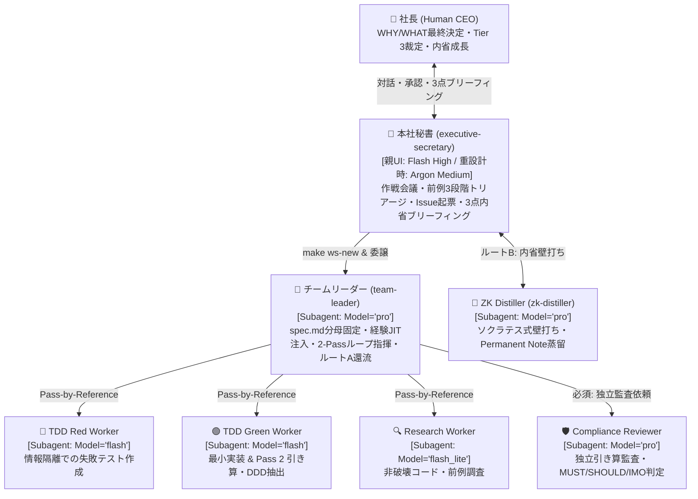
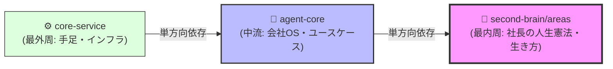
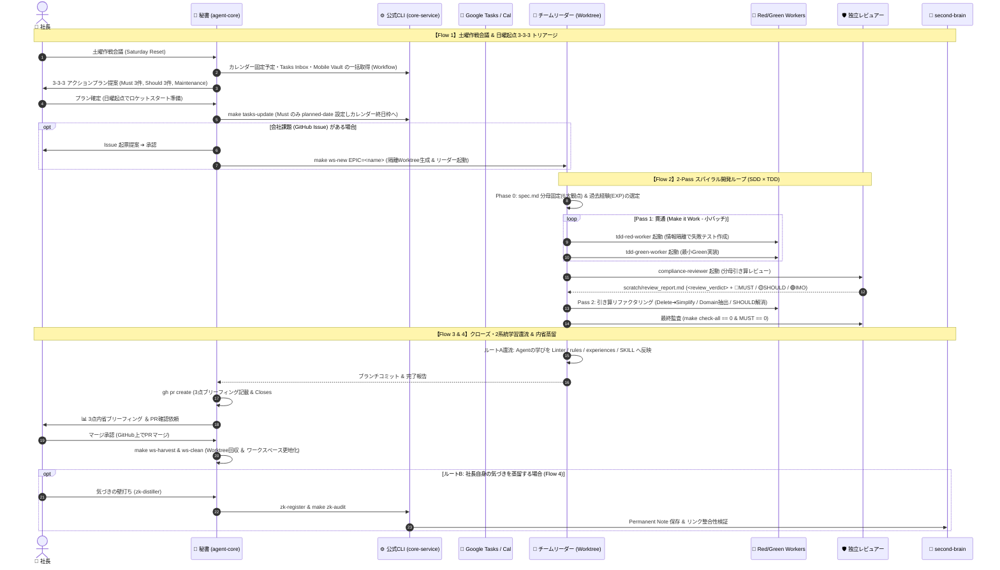

# 🏛️ You_Inc Architecture Blueprint (Timeless SSOT)

## 🎯 本ドキュメントの存在目的 (Document Purpose & When to Read)
- **WHY（なぜこのドキュメントが存在するか）**:
  1. **メンタルモデルの同期（ブラックボックス化の防止）**: 社長（人間）とAgent（秘書・リーダー）が、「現在 You_Inc がどのような設計思想（WHY）に基づき、どのような組織・境界（WHAT）と業務フロー（HOW）で稼働しているか」の全体像をいつでも俯瞰できるようにするため。
  2. **カイゼン（修正・改善）のベースライン**: 運用中に生じた課題を解決・改善する際、既存の構造が存在する理由（不変条件）を知らずに局所的な足し算パッチや過剰な削除を行ってシステムを歪めるのを防ぐため。仕組みを変更する際は、必ず本ドキュメントを起点として影響範囲を特定し、変更と同時に本ドキュメントを「現在の真実」へ書き換えること。

---

## 1. WHY：設計思想と4大基本原則 (Core Philosophy & Invariants)

You_Inc のすべての組織構造・ルール・ツールは、以下の4つの目的（WHY）を達成するために設計されている。将来いかなるカイゼンを行う際も、この4原則に反する変更は行ってはならない。

1. **社長の認知リソース保護と「内省による自己成長」の両立**:
   - **WHY**: 社長の時間を「WHY/WHATの最終意思決定」と「初めての未決事項の判断」に集中させつつ、Agent任せにすることで社内の仕組みがブラックボックス化（裸の王様化）したり、社長自身の学び・成長が止まるのを防ぐため。
   - **原則**: 前例のある判断はAgentが自律遂行して人間を止めない一方、タスク完了（クローズ）時には必ず **「3点内省ブリーフィング（①何をなぜ変えたか、②Agentの学びと仕組み化、③社長自身の気づきへの問い）」** を行い、社長自身の頭を通して咀嚼・内省化するタッチポイントを設ける。
2. **コンテキスト純度の維持 (Context Purity & Pass-by-Reference)**:
   - **WHY**: 単一のAgentがすべての情報（仕様・実装・大量の差分ログ・レビュー）を抱え込むことによる推論劣化、確証バイアス、ハルシネーションを防ぐため。
   - **原則**: **秘書 ⇄ チームリーダー ⇄ メンバー（実装ワーカー・独立レビュアー）** に責務とコンテキストを分離する。階層間の通信ではチャットに直接長文やコード全文を流さず、すべてファイルに出力して **「ファイルパス＋1〜3行の合否サマリー」のみを渡す（Pass-by-Reference）**。
3. **知識の3層分離と WHY の高凝集保持（「SKILLは薄く、思考原則は鋭く、経験は厚く」）**:
   - **WHY**: 個別の失敗が起きるたびに手順書（SKILL）やルールに例外をパッチ追記してドキュメントが無限膨張するのを防ぎつつ、同時に「なぜその制約があるのか（WHY）」を失って不変条件（チェスタトンのフェンス）を壊すのを防ぐため。
   - **原則**:
     - **Layer A — 薄い SKILL ([`skills/`](../skills/README.md))**: 各ロールの直前に「1〜2行の鋭いWHY」を高凝集で保持した上で、入出力契約・基本手順・停止条件のみを薄く定義する（他ファイルとの重複コピペを禁ずる）。
     - **Layer B — 鋭い思考原則 ([`docs/rules/`](rules/thinking_os_and_loop_principles.md))**: `WHY ➔ WHAT ➔ HOW`、目的ドリブンとWHYへの純化、DDD/SOLID、2-Passループという抽象度の高い思考のOSを定義する。
     - **Layer C — 厚い経験・前例ストック ([`docs/experiences/`](experiences/README.md))**: 現場で起きた具体的な失敗パターンや過去の社長判断（前例）を蓄積し、チームリーダーがタスクに応じて必要なものだけをピンポイントでJIT注入する。
4. **「AIの推論（`agent-core`）」と「安定した機械（`core-service`）」の完全分離 (Workflow First)**:
   - **WHY**: 静的に検証できるチェックや定型データ収集をAIの推論（確率的動作・複数ターンのツール呼び出し）に委ねることによるコスト増、レイテンシ、不安定さを排除するため。
   - **原則**: ドメインロジック・DB/外部API連携・公式CLI（[`src/entrypoints/cli/`](../../core-service/src/entrypoints/cli/main.py)）はすべてステートレスな `core-service` に集約し、本社 `agent-core` は環境変数（`config/conf.env`）を外から注入して公式CLIをキックするだけの極薄の司令塔とする。

---

## 2. WHAT：組織トポロジー・判断トリアージ・CCA-F 設計境界 (System Topology & Architectural Boundaries)

### 2.1 4層組織トポロジーとモデル配分
Antigravity のモデル枠（週次固定枠の `Gemini 4 Argon` と、5時間ごとに高速回復する `Gemini Models`）の特性に合わせ、思考の重さに応じてロールとモデルを最適配分する。

### 2.2 前例（Precedent）ベースの3段階判断トリアージ
人間が介入する頻度を減らし、使うほど自律性が複利で向上するよう、未決事項を「前例（[`agent_antipatterns_and_precedents.md`](experiences/agent_antipatterns_and_precedents.md)）があるか」で3段階に仕分ける：
- 🟢 **Tier 1（前例あり・ルール明確）➔ 【自律決定 ＆ 事後承認】**: 人間を止めずに自律決定して進め、完了時に「過去の `[PREC-XX]` に基づきAを採用」と事後報告する。
- 🟡 **Tier 2（前例の応用・軽微な選択）➔ 【根拠付き推奨案で1タップ承認】**: 白紙で質問せず、「過去の原則から【案A（推奨）】が整合的です。案Aで進めてよいですか？」と提案する。
- 🔴 **Tier 3（初めての判断・前例なし）➔ 【事前エスカレーション ＆ 前例化】**: 前例のない WHY/WHAT の分岐のみ作業を止めて社長へ上げる。**一度社長が下した判断は必ず `docs/experiences/` へ追記し、次回からは自動的に 🟢 Tier 1 へ降格させる**。

### 2.3 リポジトリ責務境界と3大レイヤーの単方向依存ルール (The Dependency Rule)

You_Inc は、クリーンアーキテクチャの同心円構造に基づき、**「最上流（個人の人生憲法） ➔ 中流（会社経営OS） ➔ 最下流（機能・手足）」** の3大レイヤーで厳格に分離されている。

> [!IMPORTANT]
> **単方向依存ルール（The Dependency Rule）**:
> 依存の矢印は **外側から内側へのみ** 許される。
> - `agent-core` は社長の `areas` を読み解き、それを実現するための戦略・プロトコルを組む。
> - 一方、`areas`（社長個人の生き方）は外側の `agent-core` やツール（Google Tasks, CLI, Workspace）を **一切知らない（依存度ゼロ）**。
> - 内側が外側の HOW を語った瞬間、依存汚染（Dependency Pollution）が発生し、システム変更のたびに生活OSが破壊される。

| 領域 / リポジトリ | 階層 | 役割（WHAT） | 正本データ（Single Source of Truth） |
| :--- | :--- | :--- | :--- |
| **🌟 社長の生き方 (`second-brain/areas`)** | 最内周（ドメイン） | **社長個人の人生の基準（Policy / Standard）** ※ツールの話・手順・HOWは一切書かない | [`01_Identity/`](../../second-brain/areas/01_Identity/), [`04_Life_Systems/`](../../second-brain/areas/04_Life_Systems/) |
| **🏢 本社・司令塔 (`agent-core`)** | 中流（ユースケース） | **社長の基準を達成する会社経営OS・戦略** ・秘書プロトコル（作戦会議・トリアージ） ・憲法・思考原則・経験ストック・Worktree | [`GEMINI.md`](../GEMINI.md), [`AGENTS.md`](../AGENTS.md), `docs/`, `skills/`, `config/` |
| **⚙️ 機能工場 (`core-service`)** | 最外周（インフラ） | **ステートレスな機能基盤・機械的実行（手足）** ・Google Tasks & Calendar 双方向連携 ・公式CLIツール、DIコンテナ | `src/domain/`, `src/application/` (`spec.md`), `src/entrypoints/cli/` |
| **🧠 知識資産庫 (`second-brain`)** | 思考基盤 | **社長自身の頭で咀嚼された普遍的知見（Docs for AI & Zettelkasten）** | `inbox/`, `sense_making/`, `permanent_notes/` |
| **📱 スマホ窓口 (`Gemini` & Widget)** | 出張所 | 外出先でのスケジュール確認と着想・ToDoの雑な放り込み | Google Calendar, Google Tasks, Mobile Vault |

### 2.4 CCA-F 準拠の5大アーキテクチャ設計規約 (Do / Don't Matrix)
Anthropic 公式の CCA-F（Claude Certified Architect Foundations）知見に基づき、Agent の注意力に頼らずシステムの信頼性・セキュリティ・コンテキスト純度を物理的に担保するための設計パターンを以下に定義する（詳細監査レポートは [`docs/ccaf_architecture_audit.md`](ccaf_architecture_audit.md) を参照）：

| 設計領域 | ✅ Do（守るべき設計パターン） | ❌ Don't（踏んではならないアンチパターン） |
| :--- | :--- | :--- |
| **1. Workflow vs. Agent 境界** *(Pack 1 & 3)* | ・**Workflow First**: 複数データソースの定型収集（土曜作戦会議の Calendar/Tasks/Vault 取得等）やクローズ前検証は、単一の決定論的 CLI / ハーネス（Context Bundler）に統合し1ターンで完了させる。 ・オープンエンドな推論・設計・テスト実装のみを Agent に委ねる。 | ・毎回決まりきった順序で3〜4個の CLI コマンドを Agent に手動で1つずつ呼び出させる（過剰エージェント化・ターンとトークンの浪費）。 |
| **2. 構造化 State & 機械的ゲート** *(Pack 1 & 4)* | ・ハーネス（`workspace_manager.py`）が検証する合否判定やループ状態は、構造化フォーマット（`<review_verdict status="PASS" must_count="0" />` または JSON）で出力させ、機械的にパースして Exit 0/1 を判定する。 ・Git `pre-commit` フックとハーネス検問所で違反を0秒でブロックする。 | ・プロンプトの「2回失敗したら止まれ」という注意書きだけに依存する。 ・自由記述の Markdown から `"PASS"` という部分文字列だけを grep して合否判定する（偽陽性の温床）。 |
| **3. Context 分割粒度 & Prefix Cache** *(Pack 1, 4 & 5)* | ・**アクセスパターンに応じたファイル分離**: 毎ターン読む短期メモリ（`tasks/context.md` <=50行）、着手/完了時に見る Goal & DoD（`AGENTS.md`）、クローズ時のみ読む教訓（`tasks/lessons_learned.md`）、一時的な議論・調査置き場（`scratch/`）を分離する。 ・Subagent 起動時は `Static Role/Rules ➔ Semi-Static Spec ➔ Dynamic Task` の順序（Prefix Caching 最適化）と XML タグ境界を守る。 | ・「引き算」を誤解してアクセスパターンの異なる全情報を単一ファイルに詰め込み、毎ターンのコンテキストを汚染する（`[EXP-15]`）。 ・仮設の `workspaces/<epic>/` 直下に永続成果物用の `docs/` を作り、Worktree へのコミット漏れを起こす（`[EXP-08]`）。 |
| **4. Self-Healing Tool & Injection 防御** *(Pack 2 & 4)* | ・**自己修復エラー JSON**: CLI が失敗した際は生 Traceback ではなく `{"status": "error", "error_code": "...", "recovery_hint": "..."}` を返し、Agent が次ターンで自律修正できるようにする。 ・外部入力（Mobile Vault メモ、Tasks 詳細、Web 記事）を返すツールは、出力自体を `<untrusted_content>` タグで包み、システム指示との混同（Prompt Injection）を無力化する。 | ・CLI エラー時に未キャッチ例外（Traceback）でクラッシュさせ、Agent に当てずっぽうの再試行を繰り返させる。 ・外部由来の生テキストをタグ隔離なしでプロンプトやコンテキストに直接流し込む。 |
| **5. 最小権限と OS サンドボックス** *(Pack 2 & 3)* | ・Workspace 内の全ロールに OS レベルのサンドボックス（macOS `sandbox-exec` + [`sandbox_runner.py`](../tools/sandbox_runner.py)）を適用し、機密領域（`config/secret.env`, `*.pem`, `token.json`）の Read/Write 遮断と外部 IP 通信遮断を物理強制する。 ・**ロール別 Write 境界 (`--role`)**: `leader` は `workspaces/<epic>/` 内のみ、`worker` は `worktrees/<repo>/` + `scratch/` のみ、`reviewer` は `scratch/` のみ（コード変更不可）に制限し、外部通信（本番 CLI・`gh pr create`）は本社秘書のみが行う（`[PREC-08]`）。 | ・「`secret.env` を読んではならない」「Worktree 外を編集するな」というプロンプト上の禁止事項（性善説）や管理職特権（野放しのリーダー）に頼る。 ・開発用と称して `dev-secret.env` のような二重管理ファイルを作る（テスト時は `monkeypatch.setenv` またはインメモリ環境変数注入を使う）。 |

---

## 3. HOW：4大業務フローと自律ループの運用定義 (End-to-End Operational Flows)

You_Inc の日常業務は、以下の **Flow 1 〜 Flow 4** のサイクルとして稼働する。

### 3.1 Flow 2 の核心：2-Pass スパイラルループと5大制御項目
「1周で完璧を目指して迷走する問題」と「レビュアーが無限に指摘を出して過品質になる問題」を防ぐため、[`thinking_os_and_loop_principles.md`](rules/thinking_os_and_loop_principles.md) に基づき以下の2段階ループを回す：
1. **Phase 0（上流ゲート）**: `spec.md` の6大観点シナリオID（検査の分母）を固定する。**上流の `spec.md` における曖昧な表現は後続で100倍の手戻りを生む（ブルウィップ効果）ため、無条件で 🔴 `MUST` として即排除する**。
2. **Pass 1（1周目：貫通 — Make it Work）**: 小バッチで全シナリオを一通り Green にする。🔴 `MUST` のみ即修正し、1周動かして見えた構造改善（🟡 `SHOULD`）は記録して Pass 2 へ送る。
3. **Pass 2（2周目：全体俯瞰と純化 — Make it Right）**: テスト防波堤が100%揃った状態で全体を俯瞰し、**「目的への純化（Purpose ➔ Delete ➔ Simplify ➔ Add）」** で不要パッチ削除・UseCase から Domain 層へのロジック抽出・🟡 `SHOULD` の一括解消を行う（🟢 `IMO` は切り捨てる）。
4. **定量的完了条件（Exit Criteria）**: `make check-all` 終了コード `== 0`（Cov $\ge 90\%$、SDD差分 `0`） **かつ** 独立レビュアーの構造化判定が `status="PASS"`（🔴 `MUST == 0件`）。
5. **定量的異常停止条件（Circuit Breaker）**: **同一エラー連続失敗 `== 2回`**、**1バッチ往復上限 `== 3周`**、または **🔴 Tier 3（前例なしの仕様矛盾）発生** で即座に強制停止し、`tasks/context.md` に原因仮説とA/B案を書いてエスカレーションする。

### 3.2 ワークスペースの完全ライフサイクルとファイル責務境界（PR駆動と更地化の原則）
「過去の作業ログを捨てるのが怖くてローカルに古いワークスペースが溜まり続ける問題（足し算バイアス）」と「一時的な議論メモと永続ドキュメントが混ざる問題（`[EXP-08]`）」を防ぐため、以下のライフサイクルと配置境界を厳格に適用する：
1. **仮設足場（`workspaces/<epic>/`）と納品物（`worktrees/<repo>/`）の物理分離**:
   - **永続化する正本ドキュメント（設計書・仕様書・前例）**: 最初から `workspaces/<epic>/worktrees/<repo>/docs/`（Git管理下）に配置してコミットする。
   - **作業中の一時的な議論メモ・比較表・調査レポート・レビュー結果**: すべて `workspaces/<epic>/scratch/` に配置する（仮設 Workspace 直下に `docs/` フォルダを作って永続成果物を置くことを禁ずる）。
   - **状態・進捗管理**: 着手・完了時に参照する Goal & DoD（`AGENTS.md`）、毎ターン更新する短期作業メモリ（`tasks/context.md` <=50行）、クローズ時に還流させる教訓メモ（`tasks/lessons_learned.md`）に責務を分離する（`[PREC-07]`）。
2. **GitHub PR が唯一の恒久アーカイブ（SoR）**: 独立レビュアー `PASS` 後、秘書が `gh pr create` で PR を作成し、PR本文に「3点内省ブリーフィング」と重要な設計判断の経緯を記録して関連 Issue（`Closes #XX`）と紐付ける。PRのタイムラインとコミットログこそが議論と検証の完全な記録である。
3. **マージ後の完全更地化（足場の解体）**: 社長が PR をマージした後、`make ws-harvest` および `make ws-clean` により、ローカルの `workspaces/<name>/` ディレクトリを完全削除する。ローカルには「現在進行中のActive Epicのみ」を残し、過去のアーカイブフォルダを作ってはならない（[`[PREC-05]`](experiences/agent_antipatterns_and_precedents.md)）。

---

## 4. Context & Evolution：3階層コンテキストとカイゼン規約 (How to Evolve)

### 4.1 3階層コンテキストの自動ロード構造
- **Layer 1 ([`/you_inc/GEMINI.md`](../../GEMINI.md) & [`agent-core/GEMINI.md`](../GEMINI.md))**: 全社共通の憲法（WHYと絶対境界）。二重管理ドリフトを防ぐため Linter で完全同一性を常時検証する。
- **Layer 2 ([`agent-core/AGENTS.md`](../AGENTS.md) & [`core-service/AGENTS.md`](../../core-service/AGENTS.md))**: 各リポジトリを開いた際のロール定義と知識ルーティング。
- **Layer 3 (`workspaces/<epic>/AGENTS.md`)**: 個別Epicの Goal・DoDチェックリスト・ルーティングを保持する現場監督（`team-leader`）のメモリ。

### 4.2 このアーキテクチャ自体のカイゼン規約（Change Protocol）
運用を通じて新たな課題や改善点が見つかった際は、**「WHY ➔ WHAT ➔ HOW」** と **「目的ドリブンとWHYへの純化（`[EXP-15]` 準拠）」** に従い、以下の優先順位で還流させる：
1. **機械化できるか？（CI / Linter / CLI / Hook）**: 人間やAgentの注意力に頼らず、`core-service/tools/` や `agent-core/tools/`、Git Hook の静的検証スクリプトで自動検知・即時ブロック（Exit 1）できないか？
2. **既存の思考原則に統合できるか？（[`docs/rules/`](rules/thinking_os_and_loop_principles.md)）**: ルール行数を増やすのではなく、既存の原則の表現を鋭くすることでカバーできないか？（※ルールを更新する際は、必ず直前の「1行のWHY」をセットで保持し、他ファイルへのコピペ重複を行わないこと）。
3. **具体的な失敗事例・前例か？（[`docs/experiences/`](experiences/README.md)）**: 現場固有のアンチパターンや社長の判断基準（Precedent）であれば、`[EXP-XX]` / `[PREC-XX]` として厚くストックする。
4. **全体構造や業務フローの変更か？（本 [`docs/architecture.md`](architecture.md) & [`skills/`](../skills/README.md)）**: 組織やフロー自体を変える場合は、古い記述をパッチ追記するのではなく、本ドキュメントの該当セクションを「最新の完成形（Timeless SSOT）」へ直接書き換える。
