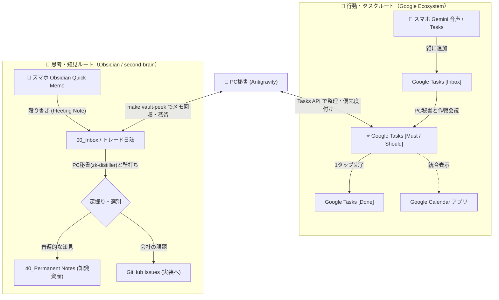

# 🏛️ Google Tasks & Calendar 連携アーキテクチャ構想 (Timeless SSOT)

## 1. 🎯 WHY: なぜこの再設計が必要なのか？

### (1) レガシー運用の敗因分析（4大摩擦）
1. **予定（Fixed Time）とタスク（Fluid Action）の混同**:
   - カレンダーにタスクを分刻み配置したため、1つの遅延で全体が崩壊し、カレンダーを見るのがストレスになった。
2. **完了チェック・メモ入力の摩擦**:
   - スマホで Obsidian を開き、日次ブリーフィングのファイルを探して `- [x]` をトグルし、時間を記録する運用は重すぎた。
3. **バッチ同期のタイムラグと「SoRの多頭化」**:
   - 夜23時までDBが更新されず、抱えている未完了タスクの一覧性がなく、ブラックボックス化していた。
4. **過剰な機械最適化（Over-Engineering）**:
   - AIが分刻みのパズルで人間を縛り、柔軟性や人間の体調・気分の変化を無視していた。

### (2) Ben Meer「System Sunday」から学ぶシステム設計思想
- **「意志力や根性に頼るな、仕組み（System）を作れ」**
- **土曜日作戦会議と「日曜日起点」の週設計（Saturday Reset）**:
  - **WHY**: 日曜日は週の中で最も社長自身の自由時間が取れる日。月曜（本業・拘束時間）起点ではなく、**「日曜日を週の最初のアクションDay（ロケットスタート）」** と位置づける。
  - **リズム**: 土曜日に作戦会議（時間は固定せず柔軟に）を実施し、日曜日に今週最大のディープワークを一気に前進させる。
- **3-3-3 Method による明確なコンテナ（採用決定）**:
  - ① **3 Hours**: 1つの最重要ディープワーク（主要プロジェクト）に3時間。
  - ② **3 Tasks**: 今日やるべき重要な短時間タスク（Must 3件）。
  - ③ **3 Maintenance**: メール・家事・事務などの維持タスク（Maintenance 3件）。
- **レジリエンス・バッファ（明確な仕組み化はせず自然確保）**:
  - 予定（拘束時間）以外の時間はすべて自然なバッファとする。日曜日にできなかったタスクも平日の余白で吸収し、罪悪感を持たせない。

---

## 2. 📊 メトリクス設計: 何を見たいから、何を測るのか？

「ストップウォッチで作業時間を測る」のではなく、**「社長が今、本当に前進しているか」** を最小の負荷で可視化する。

| 社長が見たいもの（WHY） | 測定する対象（WHAT） | 計測方法（HOW） |
| :--- | :--- | :--- |
| **① 最重要目標の前進感** | **3-3-3 の最重要タスク達成率** | Tasks 上の `⭐️ [Must]`（1〜3件）の完了率（週次で集計） |
| **② 時間の使い方と余裕度** | **可処分時間に対する集中度** | カレンダー上の空き時間（バッファ） vs 消化したタスク負荷 |
| **③ タスクの詰まり・負債感** | **Inbox の滞留日数** | Tasks の `[Inbox]` に入ったまま3日以上放置されたタスク数 |
| **④ 思考・知見のストック** | **知見の蒸留数** | Obsidian で `00_Inbox` から `Permanent Notes` / `Issues` に昇華された件数 |

---

## 3. 🗺️ WHAT: 2大ルートの完全分離（SoRの純化）

| 比較軸 | 🚀 行動ルート（Google Tasks & Calendar） | 🧠 思考ルート（Obsidian / second-brain） |
| :--- | :--- | :--- |
| **扱う対象** | **ToDo、スケジュール、約束、期限** | **アイデア、トレード日誌、読書メモ、内省、知識** |
| **データの性質** | **短期・揮発的**（終わったら消えていい） | **長期・永続的**（一生モノの知識資産） |
| **スマホでの操作** | **Google Tasks ウィジェット / Gemini 音声** （1タップで完了、声で追加） | **Obsidian アプリ** （感情の吐き出し、トレード反省の殴り書き） |
| **PC秘書の役割** | タスクの優先度付け（Must/Should）、期限整理 | メモの深掘り、Permanent Note への蒸留、Issue化 |
| **ゴール** | **迷わずアクションに集中し、今日を完勝する** | **思考を整理し、自己成長とマネタイズへ昇華する** |

---

## 4. 📱 Gemini アプリ（スマホ出張所）と PC 秘書（Antigravity）の役割

### (1) スマホ Gemini アプリ（出先・音声・直感・モバイル作戦会議）
- **役割**: 社長のリアルタイムな目と耳・声のインターフェース。
- **機能**:
  - Google Workspace 拡張機能（@Google Tasks, @Google Calendar）による音声ToDo追加・予定変更。
  - **📱 スマホ完結の作戦会議（Sunday Reset）**:
    - 移動中や散歩中、カフェなどの隙間時間に、音声で「今週の作戦会議をしよう。残タスクと来週の予定から、3-3-3 の候補を整理して」と対話。
    - Gemini が Tasks / Calendar を直接参照・並び替えるため、PC を開かずとも週次計画が完了する。
  - 毎朝の音声パーソナル新聞（AIニュース・トレード市況）の読み上げ。

### (2) PC 秘書（Antigravity: 戦略・開発連動・深層整頓）
- **役割**: 週次作戦会議・日次振り返りでの深い壁打ち参謀 ＆ 会社課題（GitHub）への接続。
- **機能**:
  - スマホ Gemini で整頓された Google Tasks / Calendar を引き継ぎ、会社の重要課題（GitHub Issues）や開発 Worktree と連動。
  - Google Tasks API を直接叩き、より詳細なタスクの棚卸しや一括管理。
  - 週次メトリクス（Must達成率、Inbox滞留数）を集計・可視化。

---

## 5. 🛡️ 考慮漏れ・潜在的な穴の検証（Failure Mode & Countermeasures）

設計の破綻を未然に防ぐため、運用・技術の両面から潜在的な穴と対策を定義する。

### ①【技術・認証】Google Tasks API はサービスアカウントで動かない
- **穴**: `agent-core/config/credentials.json` は `service_account` だが、Google Tasks API はサービスアカウントによるタスク所有・操作をサポートしていない（`403 Forbidden` になる）。
- **対策**: `core-service` の Tasks クライアントには **OAuth 2.0（User Credentials）** を採用する。Google Cloud Console でデスクトップアプリ用クライアントを発行し、初回認可で `token.json` を保存してリフレッシュトークンで自動更新する。

### ②【UI・視認性と納期】カレンダーの視認性 ＆ 「絶対期限 vs 計画日」の二重管理
- **穴**:
  - すべてのタスクに期日を設定するとカレンダーが埋め尽くされる。
  - さらに、特定の日に締め切りが集中した場合、前もって分散着手しないと当日パンクする。
- **対策**:
  - **二重構造の採用**:
    - **Hard Deadline（絶対締切）**: タスクの詳細欄またはメタデータに保持。
    - **Planned Date（計画着手日）**: カレンダー終日枠（`⭐️ [Must]` 最大3件）に表示される日付。
  - **逆算平準化（Back-casting）**: 土曜作戦会議で、秘書が「木曜締切が集中しているため、負荷の高いタスクAは日曜日、タスクBは火曜日に前倒し計画しましょう」と提案し、締切集中による破綻を未然に防ぐ。

### ③【入力・トリアージ】Gemini 音声登録の宛先 ＆ 「なりたい姿」への照合フィルター
- **穴**:
  - 音声で雑に入ったタスクをすべて真面目にやろうとすると、「やらなくていい雑務」で1日が終わる。
- **対策**:
  - デフォルトリストを **`📦 [Inbox]`** に指定して一時集約。
  - 土曜作戦会議で、秘書が単なる整理係ではなく **「時間の門番（ゲートキーパー）」** として以下の3大フィルターで問いかける：
    1. **目的フィルター**: 「これは社長の“なりたい姿”（Areas/目標）に直結していますか？」
    2. **ROIフィルター**: 「社長自身が貴重な時間を使う価値がありますか？」
    3. **引き算フィルター**: 「今やらなかった場合、どんな実害がありますか？（実害ゼロなら即削除）」
  - フィルターを通過した真の重要タスクのみを `[Must]` / `[Should]` に昇格させる。

### ④【習慣・メンタル】日曜日にロケットスタートできなかった時の失速
- **穴**: 「日曜日起点」にした場合、日曜日に急用や体調不良で作業できなかった時に「今週はもうダメだ」と挫折するリスクがある。
- **対策**: 日曜はあくまで「最大のディープワーク枠」であり、平日にも自然なバッファが存在する。日曜に完了できなかった場合は、月〜金の空き時間にスムーズにスライドし、ペナルティや罪悪感を持たせないルールとする。

### ⑤【思考 ➔ 行動】Obsidian のメモ死蔵 ＆ 【重要】運用開始前の更地化（Clean Slate ＆ 試運転）
- **穴**:
  - スマホで Obsidian に殴り書きしたトレード日誌やアイデアが死蔵される。
  - さらに、既存の Mobile Vault や second-brain が散らかったままでは、新運用を始めても最初から濁って破綻する。
- **対策**:
  - **運用開始前の大棚卸し ＆ E2E試運転（Phase 4: Clean Slate & Trial）**:
    - **タイミング**: タスク管理の仕組み（Google Tasks 連携）が完成した後、本格ローンチの直前に実施する。受け皿がある状態で棚卸しを行うことで、仕分けの実動確認（E2E試運転）を兼ねる。
    - Mobile Vault の古い残骸（過去の日次ブリーフィング等）を一掃。
    - `second-brain/00_Inbox`（現在23件）を秘書と一緒に一斉トリアージし、タスク化すべきものを新システムに実際に投入して Inbox Zero（更地）にする。
  - **日常ブリッジ**: 土曜の作戦会議（PC時）で `make vault-peek` を自動実行し、週のメモからタスク化を能動的に促す。
