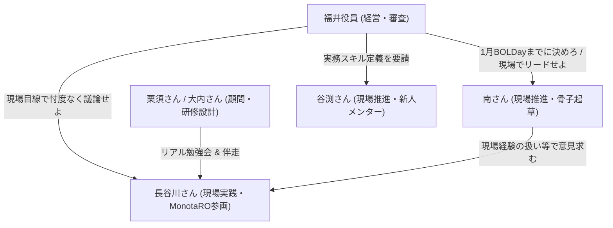

# 社内AI研修・人材育成制度 議論構造化レポート

- **対象期間**: 2025年10月6日 〜 直近（2026年11月）
- **参照元ログ**: `cleaned_chat_log.md` (全584メッセージ)
- **最終更新**: 2026-11-01

---

## 1. エグゼクティブサマリー（現在地と直近の状況）

### 🎯 最終ゴールと直近の締め切り
- **ゴール**: 全社員のAIスキル底上げ（感動大学・勉強会）と、高単価案件を獲得できる高度AI人材（**「リサーチエンジニア」手当月5万 / FDE型人材**）の育成・認定制度の確立。
- **締め切り**: **2027年1月の「BOLDay」**にて、全社向けに明確な制度・カリキュラムとして発表すること（福井役員より栗須さんへ指揮要請）。

### ⚡ 直近の超重要局面（長谷川さん参画の背景）
1. **福井役員からの問いかけ（10/27〜10/30）**:
   「リサーチエンジニアとして月額5万の手当をもらうエンジニアとは、何の資格を持ち、どんな現場経験を持ち、どんな研修を終えている者なのか。仮説でもいいので骨子を固定してほしい」
2. **南さんによるたたき台の提示（10/30）**:
   単金見合いを主軸とした要件案（G4以上、大内さん中級プログラム修了、AWS/Azure AI資格、実務成果物面談、社内還元活動など）と、未決の悩み（現場経験の扱い、資格の位置づけ等）を提示。
3. **長谷川さんの召喚と福井役員の裁定（10/29〜10/31）**:
   大阪技術部でMonotaRO参画・現場AI活用を牽引する**長谷川祥平さん**がルームへ招待される。
   福井役員より「議論は**南さん・谷渕さん・長谷川さん**（＆栗須さん・大内さん）の現場実践者を中心に進め、役員含め他はオブザーバーとする。迎合せず活発に議論せよ」と特命が下る。

---

## 2. 議論のタイムライン・変遷（4つのフェーズ）

| フェーズ | 時期 | 主な動きと論点 |
| :--- | :--- | :--- |
| **Phase 1: 立ち上げ・方針転換** | 2025/10〜12 | ルーム開設。当初の「研究所所属10名エリート選抜」仮説を修正し、「全社向け（底上げ）」と「選抜エリート（スキル・帰属意識重視）」の2階建て構造に整理。外部パートナー（栗須さん等）連携開始。 |
| **Phase 2: 勉強会試行と組織調整** | 2026/1〜5 | BOLDay発表目標の共有。社内各部門トップ（三国、雲林院、山口、内田）との調整。AI勉強会・体験講座の実施と日程調整。 |
| **Phase 3: 営業連動と手当回収モデル** | 2026/6〜8 | 福井役員より「SIerのAI駆動開発に対応できる中級研修を作り、営業が案件を取れるようにする」方針提示。生成AIパスポート（基礎資格）の是非議論。福井役員より**手当回収の3大ルート（①単金UP、②後輩育成、③発信・採用）**が提示される。 |
| **Phase 4: 具体化と現場主導化** | 2026/9〜11 (現在) | 大内さんより「初級・中級①・中級②」の3段階実践型プログラム案の提示。福井役員より「リサーチエンジニア（月5万）」の要件定義要請。南さんのたたき台投稿。現場実践者（南・谷渕・長谷川）への議論権限の移譲。 |

---

## 3. 決定事項・合意事項（Consensus）

1. **二層構造の研修・育成体系**:
   - **全社底上げ層**: 感動大学、社内勉強会、基礎資格（生成AIパスポート等）を通じた全社員のリテラシー向上。
   - **選抜・高度人材層**: 「リサーチエンジニア」（月額5万円の手当対象）として、高付加価値案件への参画および社内還元を担う層。
2. **手当（月5万円）の費用対効果（回収モデル）の合意**:
   - 単に「スキルがある」だけでは手当は出せない。会社として以下のいずれか（または複合）で回収できる設計とする：
     - ① **案件単金アップ**: お客様からAIエンジニアとして高い単金・プレミアムをいただく。
     - ② **勉強会・メンターでの後輩育成**: 次世代のAIエンジニアを育成する工数を担う。
     - ③ **社外発信・採用貢献**: ENGINEER.CLUBや登壇等を通じて会社のブランド・採用力を向上させる。
3. **推進体制の意思決定（10/31）**:
   - 議論のオーナーシップを経営陣から「AI駆動開発の現場実践者（南・谷渕・長谷川）」へ移譲。役員・管理職はオブザーバー。

---

## 4. 提案されている主要アイデア・枠組み（Proposals）

### A. 大内さんの研修プログラム案（10/14提示）
- **前提認識**: FDE（Forward Deployed Engineer）型人材に求めるスキル基準は技術進化が速すぎて最初から上級を体系化するのは困難。
- **3段階並行アプローチ**:
  - **初級**: 既存研修・基礎活用。
  - **中級①・中級②**: 座学ではなく**「RAG構築」「AIエージェント開発」「ローカルLLM活用」**をテーマに、実際に手を動かして動くシステムを開発し、成果物を残す実践型。
  - **上級**: 中級の成果や実案件ニーズを踏まえ、後から段階的に整備。

### B. 南さんのリサーチエンジニア認定骨子案（10/30提示）
- **前提**: G4以上。
- **研修要件**: 大内さんの中級プログラム修了＋成果物の提出。
- **資格要件**: AWSおよびAzureのAI系資格（受講条件か認定要件かは要検討）。
- **現場経験**: AI駆動開発／AIエージェント開発の実務経験（クラウド上構築推奨）。
- **技術力**: 公式仕様ドキュメントを踏まえ、RAGやエージェントを自力で組み、業務に落とし込み、仕組みを説明できること。
- **社内還元**: 認定期間中に勉強会登壇、または技術発信（ENGINEER.CLUB等）。
- **認定方法**: 提出成果物を前に**「何を作り、何が壊れ、どう直したか」**を説明する口頭試問・面談。

---

## 5. 未決事項・主要な論点（Pending & Trade-offs）

現在、現場メンバー（長谷川さん含む）の意見が求められている**核心的な4大論点**です。

### 論点①: 「実務現場経験」を必須にするか？（鶏と卵問題）
- **南さんの悩み**: 俯瞰力やトラブルシューティング能力は現場でしか身につかないため必須にしたい。しかし必須にすると「まだAI案件に入れていないエンジニアは永遠に認定されない」というジレンマに陥る。
- **南さんの代替案**: 営業等の社内実業務を題材にした「社内AIエージェント開発」の成果物でも代替カウントできないか？

### 論点②: 資格（生成AIパスポート、AWS/Azure AI資格）の位置づけ
- 単なるペーパーテスト合格が実務力に直結しないことは全員一致。
- 資格を「リサーチエンジニア認定の必須条件」にするのか、それとも「中級研修を受けるための足切り（前提条件）」にとどめるのか。

### 論点③: 認定基準と評価者（誰がどう合否を判定するのか）
- 成果物面談において、何をもって合格とするのか（定量的評価の難しさ）。
- 評価者を誰が担うのか（社内幹部か、現場エンジニアか、外部顧問の大内さん・栗須さんか）。

### 論点④: 認定の有効期間と再認定（技術変化への追従）
- 生成AIの技術スタックは1年で激変するため、永続資格ではなく「1年ごとの更新制」にし、更新時に直近の実績や社内還元度合いを再審査すべきか。

---

## 6. ステークホルダー関係図と長谷川さんへの期待値

- **長谷川祥平さんに期待されている役割**:
  - 大手案件（MonotaRO）の現場で実際にAIを活用・推進している「リアルな肌感覚」の提供。
  - 机上の空論（資格至上主義や座学中心）に陥らず、**「現場で本当に価値が出るスキルとは何か」「何を作れれば単金アップに繋がるか」**をズバッと指摘すること。
