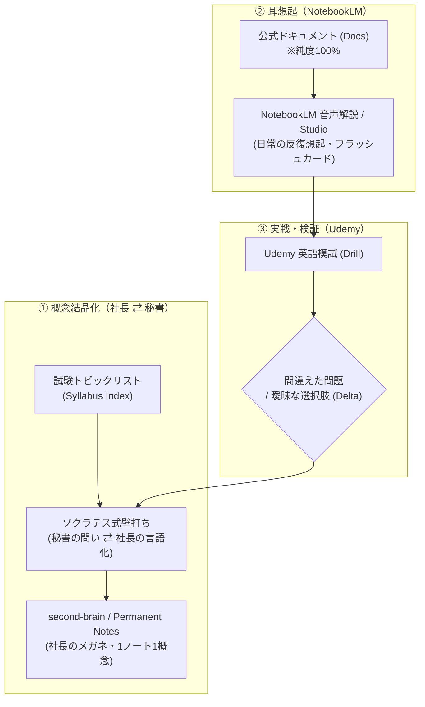

# 📘 Specification: CCA-F 取得 & Socratic Zettelkasten 学習フレームワーク

## 1. 🎯 WHY（背景と本質的価値）

### 1.1 プロジェクトの原点
- **社長の自己成長最大化**: 2026年12月中旬までに、Anthropic公式の難関技術認定資格「Claude Certified Architect – Foundations (CCA-F)」を取得する。
- **知識の資産化 (Compound IP)**: 単なる資格取得で終わらせず、自らがテスターとなって「ソクラテス式壁打ち × second-brain (Zettelkasten) × NotebookLM (耳学習) × Udemy (英語実戦演習)」の【AI駆動型・資格ハック学習フレームワーク】を確立し、社内外の勉強会や他資格への横展開パッケージとして資産化する。

### 1.2 コアバリュー：「社長のメガネ」哲学
- **一般的な正解・辞書的知識の排除**: ネット検索や公式ドキュメントで得られる一般的な解説スライドには価値がない。
- **社長独自の認知モデル**: 一次情報（公式仕様）に対し、社長自身の世界観・アナロジー・葛藤・トレードオフの思考（`second-brain` の Permanent Notes）を吹き込むことで、唯一無二の生きた知的財産（コンテンツ）へと昇華させる。

---

## 2. 📋 SMART 目標 ＆ 達成基準 (Definition of Done)

- **S (Specific)**: CCA-F を英語で受験し、1000点中720点以上で合格する。
- **M (Measurable)**: 
  - 本番合格スコア 720点以上（1000点満点）
  - Udemy英語模擬試験で連続2回 90%以上 ＆ 1問平均90秒以内
  - `second-brain/40_Permanent_Notes/` に社長独自の解釈が宿った Permanent Notes が最低10〜15本以上蓄積
- **A (Achievable)**: 日常の耳学習（45分）＋ 週3回のソクラテス壁打ち ＋ 週末のUdemy演習の反復
- **R (Relevant)**: You_IncのAI組織設計力強化、および「実践アーキテクチャ勉強会」のコンテンツ化
- **T (Time-bound)**: 2026年12月中旬（目標: 12/15前後）本番受験（年内リテイク可能枠を確保）

---

## 3. 🔄 Socratic Zettelkasten 学習ループ（4つの役割分担）

### 役割分担の鉄則：
1. **NotebookLM（インプット・耳学習）**:
   - **試験勉強中は「公式ドキュメントのみ（純度100%）」に限定**。
   - 自分の解釈ノートを混ぜると、公式の英語定義や出題意図からブレるリスクを排除する。
   - 音声解説（耳学習）、マインドマップ（全体俯瞰）、フラッシュカード（用語・限界値の暗記）に特化。問題演習機能には依存しない。
2. **second-brain（思考・概念結晶化）**:
   - 壁打ちを通じて得たアハ体験を、その場でアトミックな Permanent Note（社長のメガネ）として記録。
   - 勉強期間中もリアルタイムに蓄積する（思考の熱量を逃さないため）。
3. **Udemy Business（アウトプット・実戦演習）**:
   - プロが精査した英語模擬試験（Practice Exams）に一本化。
   - 120分で60問（長文シナリオ）を解き切るスピード感覚を養う。
   - 間違えた問題（Delta）のみを壁打ちにフィードバックする。
4. **合格後の資産合流（勉強会パッケージ化）**:
   - 合格した瞬間に、蓄積された Permanent Notes を NotebookLM に投入。
   - NotebookLM Studio（スライド資料・レポート機能）を用いて、社長オリジナルの「勉強会スライド・レジュメ」を自動生成する。

---

## 4. 🧭 トピックの2-Pass スパイラル構造（重要度トリアージ）

数を固定（20〜25等）せず、重要度と深さのグラデーションで管理する。

- 🔴 **MUST（必須・骨格 / Pass 1）**:
  - 全5ドメインの「根本的な設計思想」「トレードオフの境界線」「絶対的な仕様（制約・限界値）」。
  - まずは全体を薄く広く貫通させ、社長の頭の中で繋ぐ。
- 🟡 **SHOULD（詳細・補強 / Pass 2）**:
  - 具体的なAPIパラメータ、詳細なエラーハンドリング、CI/CD連携パターンなど。
  - **Udemy模試で間違えた論点を起点に深掘り**。
- 🟢 **IMO（枝葉 / スコープ外）**:
  - 試験で問われないSDKの内部実装詳細など。今回は深入りしない。

---

## 5. 🗺️ 実行計画とSub-Issues

- **#7: [Setup] CCA-F 現場ワークスペース立ち上げ & 🔴 MUSTトピックのインデックス網羅**
- **#8: [Phase 1: Pass 1] 🔴 MUST概念のソクラテス壁打ち ＆ second-brain 結晶化**
- **#9: [Phase 1: Ear] NotebookLM環境構築（音声解説・マインドマップ・フラッシュカード）による耳学習反復**
- **#10: [Milestone] Pearson VUE 12月中旬本番受験の予約・確定**
- **#11: [Phase 2: Pass 2] Udemy英語模試反復 ＆ 🟡 SHOULD（Delta）の壁打ち深掘り**
- **#12: [Phase 3] CCA-F 本番受験 ＆ 合格達成**
- **#13: [Asset] NotebookLM Studio連携による「勉強会パッケージ」のドキュメント化**
