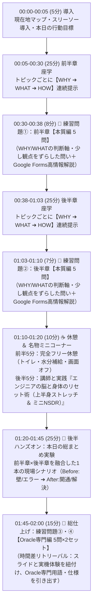

# 00_Design_Decisions: Oracle基礎勉強会 リニューアル設計思想・意思決定正本 (SSOT)

本ドキュメントは、25上期Oracle基礎勉強会の途中引き継ぎ（第3回〜第6回）および来期（25下期）に向けたカリキュラム刷新において、前任者資産の監査（`docs/predecessor_audit_report.md`）と受講者ヒアリング（`sessions/session_03/attendee_feedback.md`）を経て確立された**「講座設計の思想・アーキテクチャ・運営ルール」の正本（SSOT）**である。

---

## 1. 構造的課題の認識と「北極星（WHY）」の再定義

### 1.1 従来の社内勉強会（および前任者設計）が抱えていた構造的矛盾
- **時間軸の破綻**: 「月1回×2時間×6ヶ月（1ヶ月おき）」というフォーマットで「資格試験（1Z0-085 / 黒本）の暗記対策」を行うのは構造的に無理がある。実際に資格を取得する人は1〜2ヶ月の短期集中で黒本を周回するため、月1回の勉強会で黒本の重箱問題をそのまま出しても定着せず、負荷ばかりが高まる。
- **設計順序の逆転（パッチワーク化）**: 前任者の資料は「①講義設計（何をおさえて欲しいか）➔ ②問題設計（どう測るか）➔ ③資料設計（どう教えるか）」の順で作られておらず、「黒本の解説を間引いてスライドにし、黒本の章末問題をコピペした」ため、**全38問の半数以上が「授業スライドに一切書かれていない知識」から出題される**という断絶を起こしていた。
- **19c資格本と26ai実機のキメラ化**: 座学と問題は「19c・GUI（OUI/DBCA/EM Express）・非CDB」前提である一方、実機ハンズオンは「AWS EC2 + Oracle 26ai Free（RPM導入・完全CDB/PDB・GUI廃止・CUI）」に差し替えられており、座学・ハンズオン・問題の3者が噛み合っていなかった。

### 1.2 目指すべき北極星（真のゴール）
- **「Oracleを題材に、RDBMSの普遍的な基礎体力（メンタルモデル）をインストールする場」**とする。
  1. **インフラエンジニア視点の基礎体力**: データの整合性・耐久性・可用性・リカバリをDBはどう担保しているのか？（REDO/UNDO、ARCHIVELOG、RMANバックアップ・リカバリ、権限・セキュリティ分離）
  2. **開発エンジニア視点の基礎体力**: テーブル設計・制約（主キー等）、INDEX（なぜ速くなるのか／更新劣化とのトレードオフ）、実行計画（Full Scan vs Index Scan）、ロック・パフォーマンスをどう意識すべきか？
- この「普遍的な幹（WHY/WHAT）」と「Oracleの基本用語（HOW）」が結びついていれば、**いざ受講者が短期集中で黒本（資格勉強）を開いたときに理解速度が劇的に上がり、かつ他DB（MySQL/PostgreSQL等）や現場実務にもそのまま応用できる**。

---

## 2. 2段階リニューアル・ロードマップ（今期 vs 来期）

期初（第1回・第2回）に前任者の枠組みで受講を開始した現受講者への配慮と、講師交代という好機を活かし、以下の2段階で進める。

1. **【フェーズ1：25上期（残り第4回〜第6回）＝ プロトタイプ実験場】**
   - 期初に約束された「スケジュール上の章タイトル（箱）」「ハンズオンの題材」「第6回まとめテスト（全20問・8割合格）」の大枠は維持して安心感を担保する。
   - その上で、中身の説明順序（WHY➔WHAT➔HOW）、練習問題のSOLID分離設計、ハンズオンの地雷（エラー箇所）撤去をプロトタイプとして実践・検証する。
2. **【フェーズ2：25下期（全6回）＝ 完全刷新版】**
   - 今期の第3〜6回で得た実験結果・受講者反応をフィードバックし、第1回・第2回も含めた全6回を一貫したアーキテクチャで完全刷新する。

---

## 3. 全5回（10章）の「箱」の再定義（何をおさえて欲しいか）

既存の章立て（箱）の並び順自体はRDBMSの体系として理にかなっているため、箱は維持しつつ、各回で「エンジニアとして何をおさえて欲しいか（コア目標）」を以下の5階層として定義する。

| 回 | 既存の箱（章タイトル） | エンジニアにおさえて欲しいコア（基礎体力としての再定義） |
| :--- | :--- | :--- |
| **第1回** | 第1章：DB管理の概要 第2章：インストール・DB作成 | **【土台】** なぜExcelではなくRDBMSなのか？SQLの4分類（DDL/DML/DCL/TCL）と、OS上でDBが動く構造（環境変数・CDB/PDB） |
| **第2回** | 第3章：管理ツール 第4章：Oracle Network環境 | **【接続】** アプリや端末は、どうやってネットワーク越しに目的のDBを見つけて繋がるのか？（リスナーの役割と名前解決） |
| **第3回** | 第5章：インスタンス管理 第6章：記憶域構造の管理 | **【心臓部】** なぜDBは速くて消えないのか？メモリ（SGA/PGA）とディスク（データファイル・REDO・UNDO）の役割分担 |
| **第4回** | 第7章：ユーザー・セキュリティ 第8章：スキーマオブジェクト | **【設計と開発】** 現場でどう部屋と権限を分離し（スキーマ・システム権限・オブジェクト権限・ロール）、表・制約・VIEW・INDEX（トレードオフ含む）・データ移行をどう使い分けるか？ |
| **第5回** | 第9章：監視・アドバイザ 第10章：バックアップ・リカバリ | **【性能と可用性】** 遅いSQLをどう見抜いてINDEXで高速化するか（実行計画）？障害時にどうやってデータを1件も失わずに戻すか（インスタンスリカバリ vs メディアリカバリ、ARCHIVE・RMAN・フラッシュバック）？ |

---

## 4. SOLID原則と教育工学に基づく「講義・練習問題・ハンズオン・最終テスト」設計アーキテクチャ

ソフトウェア設計のSOLID原則（関心事の分離・依存性逆転）と教育工学（パイクの90/20/8の法則、ブルーム・タキソノミー、リトリーバル・プラクティス、高情報フィードバック）を掛け合わせ、**1回120分の授業シークエンスと問題構造**を以下のように定義する。

### 4.1 授業スライド（WHY ➔ WHAT ➔ HOW の3段ロケット ＋ スリー・ソーの法則）
- 導入では**スリー・ソーの法則**（「そうだよね：既有知への共感」➔「そういえば：現場エピソードとの接続」➔「そうなんだ！：Oracleの仕組みの発見」）を用いて知的好奇心を喚起する。
- トピックごとに必ず **「① WHY（どんな課題を解決するか）➔ ② WHAT（グラウンディング：比喩とMermaid図解による普遍的な仕組み）➔ ③ HOW（クラリティ：Oracle公式用語・資格本での問われ方・実機挙動との1対1対比）」** を連続で提示し、最初の脳内結線を作る。
- **中盤10分間の状態切り替え（State Change：休憩＋名物ミニコーナー）**:
  - 前半70分で満杯になったワーキングメモリを解放し後半の集中力を最大化するため、`01:10-01:20` に10分間を確保する。前半5分は完全離席フリー休憩とし、後半5分は講師のファン化・場づくりを兼ねた名物ミニコーナー**「エンジニアの脳と身体のリセット術（デスクワーカー向け上半身・肩甲骨ストレッチ ＆ NSDR：Non-Sleep Deep Rest／視覚遮断と深い呼吸の実践）」**を実施する。

### 4.2 各回の練習問題（5問×4セット＝計20問：SOLID分離 × 分散リトリーバル × 高情報フィードバック）
- 問題の目的を「査定」ではなく**「授業で聞いたことを思い出して脳に定着させる装置（形成的評価）」**と定義する。
- 45分連続の座学による集中力低下を防ぎ、かつ「本質（WHY/WHAT）」と「専門実装（HOW）」に適切な時間差（Spacing Effect）を作るため、**5問×4セット（計20問：計30分＝8分＋7分＋15分）**に分割する：
  1. **練習問題①（前半章・本質編：5問）** ＆ **練習問題②（後半章・本質編：5問）**:
     - 各章の座学直後に実施。特定のDB製品に依存しない「なぜその機能が必要か？開発・インフラとしてどう判断すべきか？（WHY/WHAT）」を、スライドの丸写しではなく「少し観点をずらした問い（裏返しの問い等）」で出題する（Oracle固有のコマンドや仕様をここに混ぜて専門編と重複させてはならない）。
  2. **練習問題③（前半章・Oracle専門編：5問）** ＆ **練習問題④（後半章・Oracle専門編：5問）**:
     - ハンズオン終了後の総仕上げとして実施。座学から約40〜60分の時間差を置いた状態で、スライドや実機体験と紐付けながら「Oracleにおける専門用語・コマンド・仕様（HOW）」を引き出させる。
- **ダミー選択肢（誤答）の品質基準（メタテストスキルの排除）**:
  - ジョーク選択肢（一般常識だけで切れる誤答）を禁止し、すべて「初学者が実際に陥りやすいもっともらしい設計アンチパターンや概念の取り違え」で作成する。
  - **極端な限定・言い切り表現（「〜のみ」「〜だけでよい」「一切〜ない」「必ず〜」等）によって、内容を理解していなくても誤答だと見抜けてしまう選択肢パターンを厳禁とする。**
- **高情報フィードバック（全問必須）**:
  - すべての選択問題において、回答後に**「なぜその選択肢が正解なのか」だけでなく「なぜ他の選択肢（a, b, c, d）がNGなのか（どの概念と混同しているか）」**を明記した解説を必ずセットで提供する。

### 4.3 ハンズオンの再定義（「手順の消化」から「本日の総まとめ実験（理科の実験）」へ）
- **ハンズオンの真の意義（WHY）**:
  - コマンドの打ち方を暗記することではない（コピペ用テキストを配布するため入力作業自体は25分に凝縮する）。
  - 普段はブラックボックスで見えないDBの**「壁（境界線・エラーによる拒絶）」と「威力（Before / After の劇的な変化）」を自分の手で引き起こして目撃し、座学の抽象概念（意味記憶）を『手触りのある確信（エピソード記憶）』に変えること**である。
- **設計原則（POE法 × 前後半融合シナリオ）**:
  - 講義の最後にまとめて実施するため、前半章と後半章の知識がバラバラにならないよう**「1本の現場ストーリーに融合した総まとめ実験（全3ステップ程度・25分）」**として設計する。
  - 各実験ステップには必ず **「①いつ使うか（現場のシチュエーション）」「②Before（あえて権限不足や制約違反、親表削除などの壁・エラーを目撃する予測と観察）」「③After（座学の機能を投入して解決・変化を目撃する）」「④この実験で何を掴んでほしいか（結論）」** を明記する。

### 4.4 第6回 最終まとめテスト（WHY ⇄ HOW 双方向ミックス：全20問・8割合格）
- 総括的評価として、単純なCtrl+F検索では解けない応用問題とする。
- 各回の練習問題をそのままコピペするのではなく、1問の中で **「現場の課題・目的（WHY/WHAT）からOracleの手段（HOW）を選ばせる問題」** と **「Oracleの仕様・操作（HOW）からその目的・理由（WHY/WHAT）を選ばせる問題」** の双方向変換問題（全20問：各回4問×5回）として出題する。
- 第6回前半の総復習スライドは、この20問の根拠（WHY ⇄ HOW）を100%網羅するチートシートとして再構成する。

---

## 5. 第3回 受講者フィードバックに基づく運営・資料作成の絶対ルール

1. **コピペ専用コマンド集（`.txt` / `.sql`）の別添同梱（最重要）**:
   - スライドやPDFからのコピペによる不要な空白・改行エラーを防ぐため、ハンズオン実行コマンドは各回ごとにプレーンテキストで別添作成する。
2. **目次・現在地（大項目／小項目）の明示**:
   - 冒頭にアジェンダを提示し、セクションの切り替わりごとに現在地を示して受講者が迷子にならないようにする。
3. **前半座学（25分×2章＋本質クイズ）＋ 中盤10分休憩＆リセットコーナー ＋ 後半ハンズオン（25分）＋ 総仕上げ専門クイズ（15分）の明確なブロック分離**:
   - 座学と実機操作の同時並行（サンドイッチ）は受講者がメモと画面往復でパンクするため廃止する。
4. **コマンド実行後のターミナル出力・意味の解説**:
   - コマンドを叩かせるだけでなく、「実行前に何が起きるか（予測）」「実行後に画面に何が表示されれば成功（または意図したエラー）か」「裏で何が起きたか」の解説を必ず添える（期待出力は `NLS_LANG=Japanese_Japan.AL32UTF8` に準拠した26ai日本語表記を主とし、英語表記を併記する）。

---

## 6. 各回の標準制作プロセス（Maker/Checker 4ステップ）と NotebookLM スライド生成戦略

第4回以降のすべての回（第5回・第6回および第1〜2回リファクタリング）は、以下の標準ワークフローとNotebookLM生成規格に従って一貫して制作する。

### 6.1 標準制作ワークフロー（4ステップ）
1. **Step 1：設計ブループリント作成（Maker Subagent）**
   - `sessions/session_XX/design_blueprint.md` を作成。120分タイムライン、全10トピックの「スリー・ソー導入＋WHY➔WHAT➔HOW＋`> 📝 補足`」、POE法に基づく前後半融合ハンズオン（3実験＋おまけ）、5問×4セット（計20問）の問題・選択肢・高情報フィードバック解説を設計する。
2. **Step 2：Gate 1 クリティカルレビュー（Opus Checker Subagent）**
   - 独立した監査サブエージェントが `sessions/session_XX/opus_review_report.md` を出力。①教育工学・認知負荷（5分/トピックの適正量）、②スライド×全20問の100%整合性とダミー選択肢品質（ジョーク選択肢や「〜のみ」「〜だけでよい」等の言い切り表現の排除、本質編と専門編の重複排除）、③Oracle 26ai Free (`freepdb1`) 実機での技術的整合性を厳格に監査する。
3. **Step 3：講師（人間）との壁打ち・意思決定（`/grill-me`）**
   - 監査レポートの Must Fix / Should Fix 論点を講師に提示し、方針を確定する。
4. **Step 4：最終成果物一式の本生成（Maker Subagent）**
   - 以下の標準成果物セットを一気通貫で生成する：
     - `final_ssot.md`（全体統合版の正本原稿）
     - `slide_part0_frame.md` ／ `slide_part1_chX.md` ／ `slide_part2_chY.md`（NotebookLM サンドイッチ方式3分割投入用ソース：枠組み＋ハンズオン／前半章単体／後半章単体）
     - `notebook_prompt.txt`（NotebookLM スライド生成用プロンプト）
     - `quiz_set_25h1.md`（Google Forms 投入用・全20問×高情報解説）
     - `generate_sessionXX_forms.gs`（各回専用のGoogle Forms 3フォーム生成GASスクリプト ※共通エンジン `scripts/00_setup_and_core.gs` を呼び出すOCP分離構造）
     - `handson_commands.txt`（受講者配布用・コピペ専用プレーンテキストコマンド集）

### 6.2 NotebookLM スライド生成のベストプラクティス（適正枚数約21〜22枚・章扉確保・ガチャ防止）
NotebookLMのスライド生成機能（「詳細なスライド」モード）は1枚の情報密度が高いため、120分講義（実質スライド説明時間60分）で40枚以上生成すると展開が速すぎて消化不良を起こす。また、複数の章やハンズオンを1ファイルに同居させると後半の章タイトル表紙（章扉）が省略される特性がある。これを制御するため以下の4原則を適用する：
1. **全体で「約21〜22枚（1トピック5分 ＝ 詳細なスライド1枚基本）」の枚数適正化**:
   - 各Topicを複数枚に分散させず、**1枚のスライド内に「上段/左：💡WHY＆🏢WHAT（比喩・構造図）」と「下段/右：🛠️HOW（Oracle正式用語・SQL・表）」を同居させる（空間的近接性の原則）**ことで、1章（5トピック）あたり「章表紙1枚＋Topic 5枚（〜最大7枚）＝計6〜8枚」に凝縮する（NotebookLM生成時は「長さ：短め」またはプロンプトでの枚数上限指定を併用）。
2. **サンドイッチ方式3分割・単一ソース生成（合計約21〜22枚。章扉を各章単体ソースの先頭で確実に出す）**:
   - **Part 0 (`slide_part0_frame.md`：約8〜10枚)**：進行の枠組みとハンズオン。【枠1】全体表紙＋ロードマップ＋前回接続 ／【枠2】疑問リスト＋全体目次 ／【枠3】スリー・ソー導入＋行動目標 ／【枠4】練習問題①ブリッジ ／【枠5】練習問題②ブリッジ＋10分リフレッシュ案内 ／【枠6】ハンズオン表紙＋全体図＋`handson_commands.txt`誘導 ／【枠7〜9】実験1〜3（各1枚）／【枠10】総仕上げ練習問題③ブリッジ。
   - **Part 1 (`slide_part1_chX.md`：6枚)**：**前半章単体**。1枚目が章扉、続いてTopic 1〜5を各1枚。導入・目次・ブリッジは含めない。
   - **Part 2 (`slide_part2_chY.md`：6枚)**：**後半章単体**。1枚目が章扉、続いてTopic 6〜10を各1枚。ブリッジ・休憩案内は含めない。
   - **Googleスライド上での結合（2か所に挿入）**：①Part 0 の【枠3】の後ろに Part 1 を挿入 ➔ ②Part 0 の【枠4】（練習問題①ブリッジ）の後ろに Part 2 を挿入 ➔ ③残りの Part 0（【枠5】以降）がそのまま続く。Part 0 の見出しに付けた【枠N】番号が結合位置の目印となる。
   - **採用理由**：入力の粒度が責務ごと（進行の枠組み／前半章／後半章）に分かれ、SOLIDに近づくため。
   - ※別解（時系列ストレート3分割）：「①前半（オープニング＋前半章＋練習問題①）／②中盤（後半章＋練習問題②＋休憩）／③後半（ハンズオン＋総仕上げ）」とすれば、各パート先頭に章扉・ハンズオン表紙が来て、①➔②➔③を末尾連結するだけで済む。
3. **スライド上のハンズオンは「SQL全文抜き」の実験サマリー（各実験1枚）に絞る**:
   - 実行コマンド自体は別添の `handson_commands.txt` で配布するため、`slide_part0_frame.md` のハンズオン部には長いSQLコードブロックを載せず、**「①ミッション ➔ ②🔮予測（Predict） ➔ ③⚡目撃すべきORAエラー出力（Observe） ➔ ④🎯結論（Explain）」**の図解サマリーのみを記載する。
4. **全回共通ベースプロンプト（デザイン固定＋パンくず常設＋1トピック1枚凝縮指示）の適用**:
   - `notebook_prompt.txt` には、全回共通の**【デザイン固定指示（白背景×ネイビー＆ブルー基調のクリーンなIT企業研修インフォグラフィック）】**、**【全スライド最上部への `📍 現在地` パンくずバー常設】**、**【1 Topic＝1スライド（WHY/WHATとHOWの1画面対比）による各パートの枚数上限の厳守】**、**【Part 1/2は1枚目が必ず章扉、Part 0はスライド順（【枠N】）の厳守】**を標準テンプレートとして組み込む。

### 6.3 Google Forms 自動生成（GAS 2ファイル分離）と「社員番号KEY」一元管理 Dashboard 規格
1. **OCP（開放閉鎖原則）に基づくGASファイルの2階層分離**:
   - **① 共通セットアップ＆コアエンジン (`scripts/00_setup_and_core.gs`)**:
     - マスタ用スプレッドシートのApps Scriptに**初回に1度だけ登録**する共通ファイル。
     - 初回セットアップ関数 `setupMasterSpreadsheet()`、共通フォーム生成エンジン `createSessionFormsFromConfig(sessionConfig)`、および全回横断Dashboard再構築関数 `rebuildDashboard(ss)` を保持する。
   - **② 各回専用のフォーム生成スクリプト (`sessions/session_XX/generate_sessionXX_forms.gs`)**:
     - 回ごとにApps Scriptへファイル追加して実行するデータ専用ファイル。その回の問題・解説データ（JSON）と実行トリガー関数 `generateSessionXForms()`（内部で `createSessionFormsFromConfig` を呼ぶだけ）のみを持ち、既存コードを変更せずに第5回・第6回を追加できる構造とする。
2. **1回あたり「3フォーム」構成（授業中の3回の実施タイミングと1対1対応）**:
   - **練習問題①**：前半章【本質編】（全5問 / 5点満点：前半座学直後に実施）
   - **練習問題②**：後半章【本質編】（全5問 / 5点満点：後半座学直後に実施）
   - **練習問題③**：前半章・後半章【Oracle専門編】（全10問 / 10点満点：後半ハンズオン直後にまとめて実施。フォーム内を前半章5問・後半章5問のセクション見出しで区切る）
3. **回答者情報の統一（メールアドレス収集なし＋「社員番号 ➔ 名前」の順）**:
   - `setCollectEmail(false)` とし、全フォームの冒頭2問に必ず **「Q1: 社員番号を入力してください。」（記述式・必須・0点 ➔ 回答シートC列）** と **「Q2: 名前を入力してください。」（記述式・必須・0点 ➔ 回答シートD列）** の順番で自動配置する。
4. **高情報フィードバック解説の自動埋め込みと「社員番号KEY」Dashboard**:
   - `FormApp.createFeedback().setText(...)` により、各設問の回答後フィードバックとして `quiz_set_25h1.md` の【高情報フィードバック解説】を全自動登録する。
   - `Dashboard` シートは **「社員番号（KEY：全回答シートのC列からUNIQUE抽出）」** と **「名前（最新回答のD列から自動VLOOKUP）」** を左端2列に据え、各回の「練習問題①(5点)」「練習問題②(5点)」「練習問題③(10点)」「回別合計(20点)」を自動集計する。

