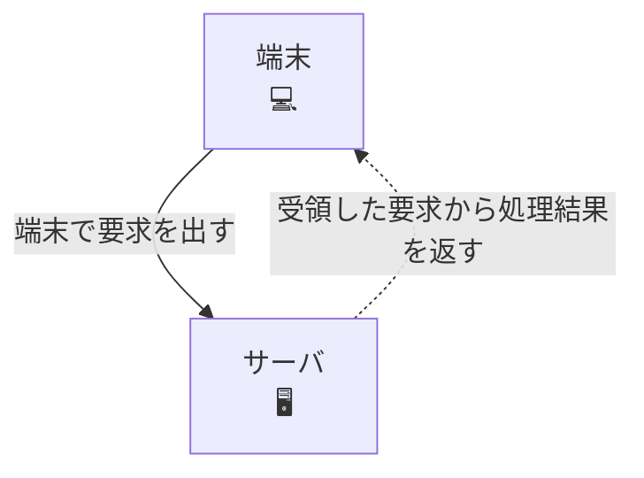
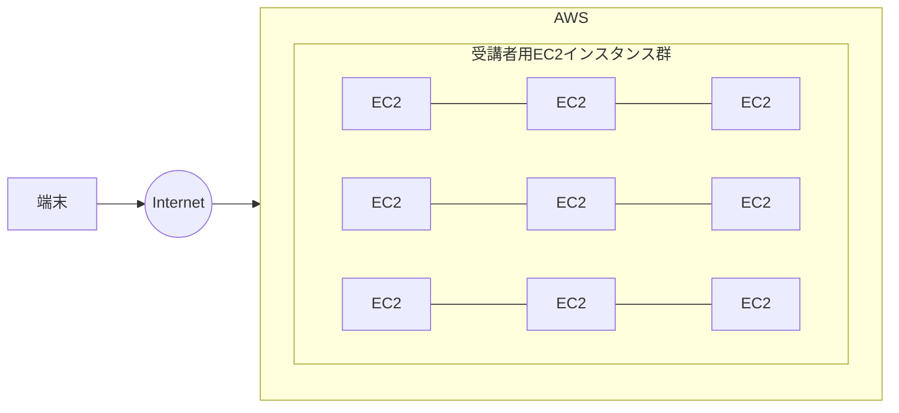

# 25上期 Oracle基礎勉強会 第1回テキスト

---

## 表紙

**25上期 Oracle基礎勉強会**  
**第1回テキスト**

---

## スケジュール

| 回数 | 日付 | 内容 |
| :--- | :--- | :--- |
| **第1回**（※赤枠強調） | **2026/7/21** | **第1章：Oracleデータベース管理の概要**<br>**第2章：Oracleデータベースのインストールおよびデータベースの作成** |
| 第2回 | 2026/8/18 | 第3章：Oracle Enterprise Manager Database Express および SQL 管理ツールの使用<br>第4章：Oracle Network 環境の構成 |
| 第3回 | 2026/9/15 | 第5章：Oracleインスタンスの管理<br>第6章：データベース記憶域構造の管理 |
| 第4回 | 2026/10/20 | 第7章：ユーザーおよびセキュリティの管理<br>第8章：スキーマオブジェクトの管理 |
| 第5回 | 2026/11/17 | 第9章：データベースの監視およびアドバイザの使用<br>第10章：バックアップ・リカバリの概要と可用性を高める構成 |
| 第6回 | 2026/12/15 | 全工程振り返り<br>最終テスト |

---

## オリエンテーション

### ・勉強会のルール
実施日は決まっています。業務調整を事前に行ってください。  
障害対応や緊急な顧客対応が発生する場合は勉強会開始前に  
ボールドチャットで事前連絡してください。  
勉強会終了時のレポートを確実に提出してください。

### ・環境
Windows端末でもMacでも受講可能です。  
資料を写しながらハンズオンとなるので画面が２つ以上あるとやりやすいです。  
リアルの場合、端末の貸し出しも可能です。

### ・講義の進め方
前半は座学メインで進めます。後半がハンズオンとなります。  
不明点や疑問は自ら質問するようにしましょう。


---

## 資格試験概要

資格試験：Bronze DBA Oracle Database Fundamentals (1Z0-085-JPN)  
受験料：\34,300(税抜)  
出題形式：選択問題  
試験時間：120分  
出題数：70問  
合格ライン：65% https://education.oracle.com/ja/product/pexam_1Z0-085  

新資格の紹介  
  Oracle Master Oracle AI Database 26ai  
  https://www.oracle.com/jp/education/master-portal/oracle-master-26ai/  

---

## 講師紹介

### 講師紹介
講師　　：渡辺(東京)  
サブ講師：黒須(東京)、尾原(大阪)、長谷川(大阪)  

### OracleMaster参考書
（※書籍画像：Bronze DBA Oracle Database Fundamentals 1Z0-085 参考書）  
ボールド本社に数冊あるので貸出可能です。  
使いたい方は講師までご相談ください。  

---

## Oracleデータベース管理の概要

### ■リレーショナルデータベース（RDBMS）とは
Oracle DatabaseやMySQLなど主要なデータベースはRDBMSです。

#### データの関連図（表とリレーション）

| 社員番号 | 名前 | 部署ID (※赤枠) | 連絡先 |
| :--- | :--- | :--- | :--- |
| 111 | 山田 | 100 | XXX-XXXX-XXXX |
| 122 | 田中 | 100 | XXX-XXXX-XXXX |
| 133 | 鈴木 | 100 | XXX-XXXX-XXXX |
| 144 | 斉藤 | 101 | XXX-XXXX-XXXX |
| 155 | 佐藤 | 101 | XXX-XXXX-XXXX |

↕（リレーション / 赤い両方向矢印）

| 部署ID (※赤枠) | 部署名 |
| :--- | :--- |
| 100 | 営業部 |
| 101 | 技術部 |

#### 説明文
データを表形式で整理・管理するもの。  
複数の表に関連(リレーション)を持たせることで  
データの生合成を保ちつつデータの分析が可能。


---

### ■SQLの概要

・SQL（Structured Query Language：構造化問合せ言語）は、ANSI、ISO、JISなどで標準規格化されている、リレーショナルデータベースを操作するための言語である。  
・SQLを使用すると、論理レベルでデータを処理することができるため、ユーザーがデータの物理的な格納場所やアクセス経路を意識する必要はない。  
・SQLは以下の通りに分類される。  

| 分類 | 説明 | SQL文 |
| :--- | :--- | :--- |
| データ操作言語 (DML) | データベースからデータの取り出し、新しい行の挿入、既存の行の変更、行からの行を削除を実行する。 | INSERT/UPDATE/DELETE/MERGE |
| データ定義言語 (DDL) | オブジェクトを設定、変更、削除する。 | CREATE/ALTER/DROP/RENAME/TRUNCATE/COMMENT |
| データ制御言語 (DCL) | データベースとその構造体の両方に対するアクセス権の付与・取り消しを行う。 | GRANT/REVOKE |
| トランザクション制御 | DMLによる変更をトランザクション単位で管理する。 | COMMIT/ROLLBACK/SAVEPOINT |

要するにデータベースを操作するためのコマンドと思ってください。

---

### ■クライアントサーバシステム（クラサバ）

Oracle Databaseはクラサバシステムです。



- **端末**: 端末で要求を出す
- **サーバ**: 受領した要求から処理結果を返す

---

## Oracleデータベースの管理に使用するツールの定義

### ■Oracleデータベースの管理に使用するツール
・インストールとアップグレード関連

| 項目 | ツール名 | 用途 |
| :--- | :--- | :--- |
| インストール関連 | OUI | Oracleソフトウェアをインストールする。 |
| (インストール関連) | DBCA | データベースを作成する。 |
| (インストール関連) | DBUA | 既存のデータベースをアップグレードする。 |
| ネットワーク関連 | netmgr | Oracleネットワークの構成を行う。 |
| (ネットワーク関連) | netca | Oracleネットワークの構成を行う。 |
| 管理系 | EM Express | WebブラウザからOracleデータベースを管理する。 |
| (管理系) | EM CC | 複数のOracleデータベースを一元的に管理可能 |
| (管理系) | SQL*Plus | SQLを手入力できるコマンドラインインターフェース |
| (管理系) | SQL Developer | データベースを管理するGUIツール |
| (管理系) | RMAN | データベースのバックアップ、リストア、リカバリ処理を実行する |
| (管理系) | Data Pump | データベース間で高速にデータを転送する。 |
| (管理系) | SQL*Loader | 外部ファイルのデータを表にロードする。 |


---

## Oracleデータベース・ソフトウェアのインストール

### ■OUIの概要とインストール要件
・Oracleソフトウェアは、OUI（Oracle Universal Installer）を使用してインストールする。  
・OUIが自動的に設定する主な環境変数は以下の通り。  

| 環境変数 | 説明 |
| :--- | :--- |
| ORACLE_BASE | Oracleディレクトリ構造のトップのディレクトリを指定する |
| ORACLE_HOME | Oracleソフトウェアを格納するディレクトリを指定する |
| ORACLE_SID | システム識別子を指定する。ORACLE_SIDによって同じコンピュータ上の他のインスタンスと区別できる |

### ■Oracle Database構築の流れ
1. OUIにてインストーラ起動し、Oracleソフトウェアのインストール  
2. DBCAにてデータベースの作成  
3. 動作確認(SQL Plus)  
※第１回はここまで実施します。  

---

## ハンズオン：Oracle Database構築

AWSにみなさんのEC2を構築しております。  
事前にIPアドレスをお伝えしているのでvscodeのssh-remoteで接続してください。  
接続ユーザはec2-userです。鍵による認証となります。鍵は任意の場所に保管してください。  
Oracleインストールは別紙にまとめておりますのでそちらを参照してください。  
本講義ではLinux上でのインストールとなります。  



---

## Linux（AWS環境）構成情報

Linuxは以下の構成となっております。  

- **VPC**: `172.31.0.0/16`  
- **サブネット**: `172.31.0.0/20`  
- **セキュリティグループ**: インバウンド ポート２２を許可  
- **EC2**:  
  - **AMI**: `Amazon Linux 2023 kernel-6.1 AMI 64bit x86`  
  - **インスタンスタイプ**: `t3.small`  
  - **キーペア**: `251st_oracle.pem`  
- **EBS**:  
  - `50GB`  
  - `IOPS 3000`  
  - `スループット 125`  


---

## 事前設定（お渡ししているEC2はすでに設定済みです）

### メモリ不足なのでswap作成
```bash
$ sudo su -
# dd if=/dev/zero of=/swapfile bs=128M count=32
# chmod 600 /swapfile
# mkswap /swapfile
# swapon /swapfile
# sh -c 'echo "/swapfile swap swap defaults 0 0" >> /etc/fstab'
```

### Linuxの基本設定
```bash
# wget https://yum.oracle.com/repo/OracleLinux/OL9/appstream/x86_64/getPackage/oracle-database-preinstall-23ai-1.0-3.el9.x86_64.rpm
# dnf install -y libxcrypt-compat libnsl
# rpm -ivh --nodeps oracle-database-preinstall-23ai-1.0-3.el9.x86_64.rpm
# ln -s /etc/system-release /etc/redhat-release
# wget https://download.oracle.com/otn-pub/otn_software/db-free/oracle-ai-database-free-26ai-23.26.0-1.el8.x86_64.rpm
```

---

## Oracle26ai Free インストール（作業はここから👇）

### 管理者のrootに変更
```bash
$ sudo su -
```

### Oracleインストール
```bash
# rpm -ivh --nodeps oracle-ai-database-free-26ai-23.26.0-1.el8.x86_64.rpm
```

#### ターミナル実行ログ
```text
[root@ip-172-31-14-15 ~]# rpm -ivh --nodeps oracle-ai-database-free-26ai-23.26.0-1.el8.x86_64.rpm
warning: oracle-ai-database-free-26ai-23.26.0-1.el8.x86_64.rpm: Header V3 RSA/SHA256 Signature, key ID ad986da3: NOKEY
Verifying...                          ################################# [100%]
Preparing...                          ################################# [100%]
Updating / installing...
   1:oracle-ai-database-free-23.2################################# [100%]
[INFO] Executing post installation scripts...
[INFO] Oracle home installed successfully and ready to be configured.
To configure Oracle AI Database Free, optionally modify the parameters in '/etc/sysconfig/oracle-free-26ai.conf' and then run '/etc/init.d/oracle-free-26ai configure' as root.
```

### インストールできたか確認
```bash
# ls -ld /opt/oracle/product/26ai/dbhomeFree
```

#### ターミナル実行ログ
```text
[root@ip-172-31-14-15 ~]# ls -ld /opt/oracle/product/26ai/dbhomeFree
drwxrwxr-x. 63 oracle oinstall 16384 Jun 22 09:58 /opt/oracle/product/26ai/dbhomeFree
```

---

## Oracle Databaseの作成と構成（ここからDBを作ります。）

以下の構成で作成。  
・プラガブルデータベース(FREEPDB1) 1つを持つコンテナデータベース(FREE)を作成  
・デフォルトのポート1521でリスナーを構成  

```bash
# /etc/init.d/oracle-free-26ai configure
```

#### ターミナル実行ログおよび対話プロンプト操作手順
```text
[root@ip-172-31-14-15 ~]# /etc/init.d/oracle-free-26ai configure
Specify a password to be used for database accounts. Oracle recommends that the password entered should be at least 8 characters in length, contain at least 1 uppercase character, 1 lower case character and 1 digit [0-9]. Note that the same password will be used for SYS, SYSTEM and PDBADMIN accounts:
①Enterを押下
Password cannot be null. Enter password: ②oracleを入力してEnterを押下
Confirm the password: ③oracleを入力してEnterを押下
Configuring Oracle Listener.
Listener configuration succeeded.
Configuring Oracle AI Database FREE.
Enter SYS user password:
******
Enter SYSTEM user password:
******
Enter PDBADMIN User Password:
******
Prepare for db operation
7% complete
Copying database files
100% complete
Database creation complete. For details check the logfiles at:
/opt/oracle/cfgtoollogs/dbca/FREE.
Database Information:
Global Database Name:FREE
System Identifier(SID):FREE
Look at the log file "/opt/oracle/cfgtoollogs/dbca/FREE/FREE.log" for further details.

Connect to Oracle AI Database using one of the connect strings:
    Pluggable database: ip-172-31-14-15.ap-northeast-1.compute.internal/FREEPDB1
    Multitenant container database: ip-172-31-14-15.ap-northeast-1.compute.internal
```

※赤字注釈手順：  
1. `①Enterを押下`  
2. `②oracleを入力してEnterを押下`（Enter password: の箇所）  
3. `③oracleを入力してEnterを押下`（Confirm the password: の箇所）  


---

## oracleユーザーの環境変数設定

### Oracleユーザーに変更
```bash
# su - oracle
$ export ORACLE_SID=FREE
$ export ORAENV_ASK=NO
$ export NLS_LANG=Japanese_Japan.AL32UTF8
$ . /opt/oracle/product/26ai/dbhomeFree/bin/oraenv
```

### Oracle Database 26ai FREEに接続
```bash
$ sqlplus sys/oracle@localhost:1521/freepdb1 as sysdba
```

#### ターミナル実行ログ
```text
[oracle@ip-172-31-14-15 ~]$ sqlplus sys/oracle@localhost:1521/freepdb1 as sysdba

SQL*Plus: Release 23.26.0.0.0 - Production on 月 6月 22 10:19:07 2026
Version 23.26.0.0.0

Copyright (c) 1982, 2025, Oracle. All rights reserved.

Oracle AI Database 26ai Free Release 23.26.0.0.0 - Develop, Learn, and Run for Free
Version 23.26.0.0.0
に接続されました。
SQL> 
```

---

## DBデータの作成

### 表領域の作成
```sql
SQL> Create bigfile tablespace tbs2
     Datafile 'bigtbs_f2.dbf' SIZE 1G AUTOEXTEND
     ON next 32m maxsize unlimited
     extent management local segment space management auto;
```

### UNDO表領域の作成
```sql
SQL> CREATE UNDO TABLESPACE undots2
     DATAFILE 'undotbs_2a.dbf' SIZE 1G
     AUTOEXTEND ON RETENTION GUARANTEE;
```

### 一時表領域の作成
```sql
SQL> CREATE TEMPORARY TABLESPACE temp02
     TEMPFILE 'temp02.dbf' SIZE 100M AUTOEXTEND ON;
```

---

## スキーマ作成

### ユーザーの作成
```sql
SQL> CREATE USER bold
     IDENTIFIED BY bold
     DEFAULT TABLESPACE tbs2 QUOTA UNLIMITED ON tbs2;
```

### boldユーザーにDBA権限を付与
```sql
SQL> GRANT DBA TO bold;
```

### SQL Plusを終了する
```sql
SQL> exit
```


---

## 環境変数の永続化

```bash
$ cat << 'EOF' >> ~/.bash_profile

# Oracle Database 26ai Environment Settings
export ORACLE_BASE=/opt/oracle
export ORACLE_HOME=$ORACLE_BASE/product/26ai/dbhomeFree
export ORACLE_SID=FREE
export PATH=$ORACLE_HOME/bin:$PATH
export LD_LIBRARY_PATH=$ORACLE_HOME/lib:/lib:/usr/lib
export NLS_LANG=JAPANESE_JAPAN.AL32UTF8
EOF

$ exit
```

---

## Oracleデータベースの自動起動設定(systemdファイル作成)

```bash
# cat << 'EOF' > /etc/systemd/system/oracle-26ai.service
[Unit]
Description=Oracle Database Free 26ai Service
After=network-online.target

[Service]
Type=forking
User=oracle
Group=oinstall
Environment="ORACLE_BASE=/opt/oracle"
Environment="ORACLE_HOME=/opt/oracle/product/26ai/dbhomeFree"
Environment="ORACLE_SID=FREE"
ExecStart=/opt/oracle/product/26ai/dbhomeFree/bin/dbstart /opt/oracle/product/26ai/dbhomeFree
ExecStop=/opt/oracle/product/26ai/dbhomeFree/bin/dbshut /opt/oracle/product/26ai/dbhomeFree
Restart=always

[Install]
WantedBy=multi-user.target
EOF
```

---

## Oracleデータベースの自動起動設定(サービスの有効化、oratab設定)

```bash
# systemctl daemon-reload
# systemctl enable oracle-26ai.service
# sed -i 's|^FREE:/opt/oracle/product/26ai/dbhomeFree:N|FREE:/opt/oracle/product/26ai/dbhomeFree:Y|' /etc/oratab
```

---

## Oracle操作

### SQL PlusでログインしてPDBへ接続
```bash
# su - oracle
$ sqlplus / as sysdba
```

### PDBを確認
```sql
SQL> show pdbs
```

### PDBに接続
```sql
SQL> alter session set container=freepdb1;
SQL> show con_name
```


---

## 第一章練習問題

### ■練習問題 1
以下URLに接続して問題をやってみましょう。  
https://forms.gle/nFPiVWyHZfqWw1ZGA  

画面が表示されたらメールアドレス（Boldメアド）、名前、社員番号を入力してください。  

---

## 第二章練習問題

### ■練習問題 2
以下URLに接続して問題をやってみましょう。  
https://forms.gle/DYZFRUT2n3StP8wu5  

画面が表示されたらメールアドレス（Boldメアド）、名前、社員番号を入力してください。  
