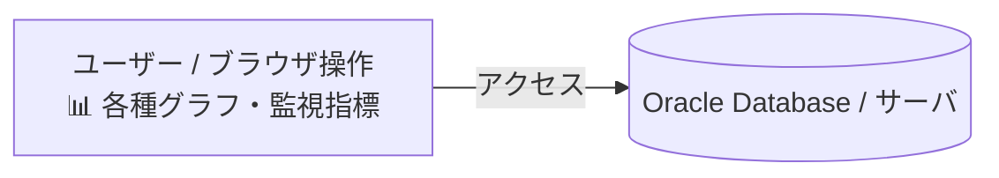
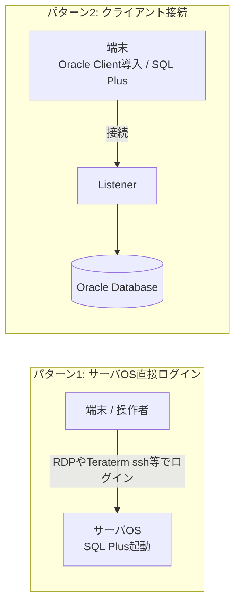
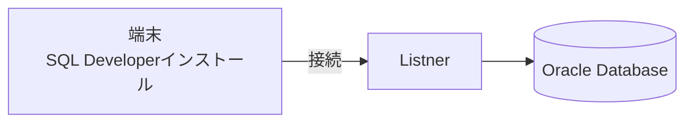
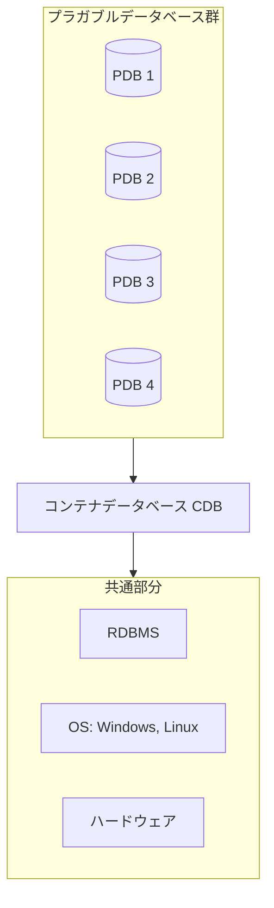
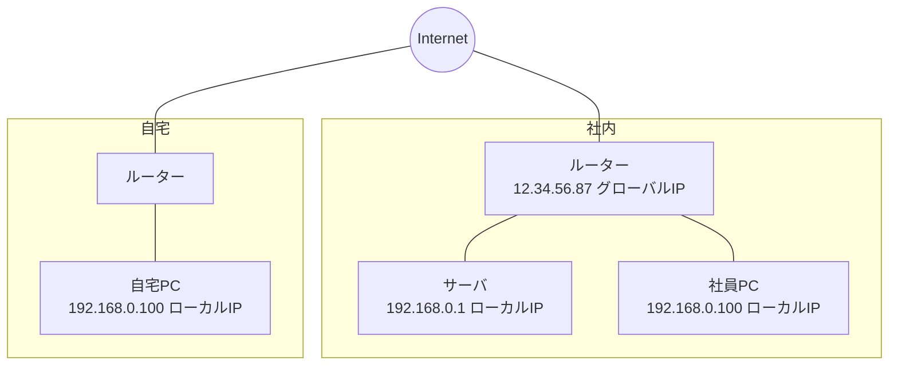
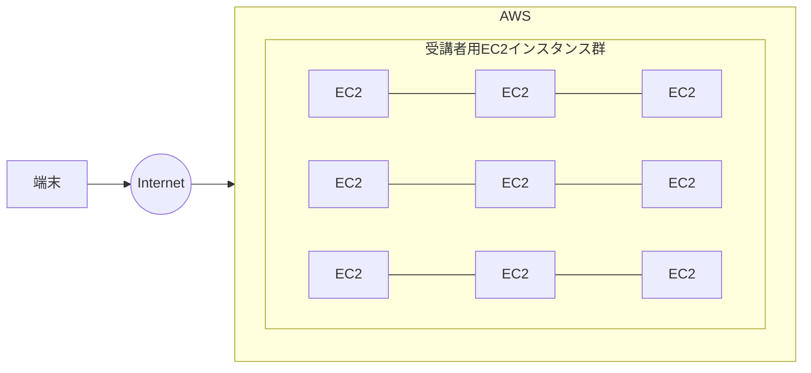

# 25上期 Oracle基礎勉強会 第2回テキスト

---

## 表紙

**25上期 Oracle基礎勉強会**  
**第2回テキスト**

---

## スケジュール

| 回数 | 日付 | 内容 |
| :--- | :--- | :--- |
| 第1回 | 2026/07/21 | 第1章：Oracleデータベース管理の概要<br>第2章：Oracleデータベースのインストールおよびデータベースの作成 |
| **第2回**（※赤枠強調） | **2026/08/18** | **第3章：Oracle Enterprise Manager Database Express および SQL 管理ツールの使用**<br>**第4章：Oracle Network 環境の構成** |
| 第3回 | 2026/09/15 | 第5章：Oracleインスタンスの管理<br>第6章：データベース記憶域構造の管理 |
| 第4回 | 2026/10/20 | 第7章：ユーザーおよびセキュリティの管理<br>第8章：スキーマオブジェクトの管理 |
| 第5回 | 2026/11/17 | 第9章：データベースの監視およびアドバイザの使用<br>第10章：バックアップ・リカバリの概要と可用性を高める構成 |
| 第6回 | 2026/12/15 | 全工程振り返り<br>最終テスト |

---

## Oracle Databaseを操作する管理ツール

### ■管理ツール
Oracle Databaseを操作するにあたり、一般的に使われるツールは以下となります。

| 管理ツール名 | 用途 |
| :--- | :--- |
| EM Express | データベース単体のパフォーマンスや状態をGUIで見ることができる<br>Oracle Database側でインストールが必要 |
| SQL Plus | データベースを操作することができるCLIのツール<br>Oracle Databaseをインストールすると標準で導入される<br>別の端末で接続する場合はOracle Clientをインストールする必要がある |
| SQL Developer | 一般的ではなく、Oracleが提供しているツール<br>SQL PlusでできることをGUIとして操作できるもの |
| lsnrctl | リスナーを管理するツール<br>クライアントから接続はリスナーが起動していないと接続できない |

---

## Enterprise Manager Database Express

### ■EM Expressとは
Oracle DatabaseやMySQLなど主要なデータベースはRDBMSです。  
・1つのデータベースを簡易的に管理したり、パフォーマンスを監視するための、Webベースのデータベース管理ツールである。  
・EM Expressは、Oracleソフトウェアのインストール時に、OUIによって自動的にインストールされる。  
・EM Expressはデータベースの起動・停止を伴わない、限定された管理作業を行うツールである。  

#### イメージ図


> **ブラウザでOracleのパフォーマンスの状態を見ることができる。**

---

## SQL Plus

### ■SQL Plusとは
Oracle Databaseを使う際、通常利用されるツール。  
CLIなので操作コマンドを理解する必要がある。  
Oracle Databaseには標準で導入されるが、外部の端末から接続する場合はOracle Clientを別途インストール必要がある。  

#### 利用パターンの比較図


- **パターン1（左側）**:  
  RDPやTeraterm(ssh)などでサーバOSにログインしてSQL Plusを起動して利用
- **パターン2（右側）**:  
  端末にOracle Clientをインストール  
  インストールしたOracle ClientにSQL PlusがあるのでSQL Plusを起動して利用。  
  Oracle Databaseでリスナーが起動していないと接続できない。


---

## SQL Developer

### ■SQL Developerとは
Oracleが提供している高機能なSQLツール  
SQL PlusでできることをGUIで使えるがSQL自体はコマンド入力となる  
SQL Plusをインストールしなくてもこのツールだけで利用できる  



> **端末にSQL Developerをインストール**  
> **SQL Developerに接続情報を登録してOracle Databaseを利用。**  
> **Oracle Databaseでリスナーが起動していないと接続できない。**  

---

## lsnrctl

### ■lsnrctlとは
lsnrctlはOracle Databaseのリスナーを管理するrためのツール  
OSにログインしてコマンドを実行することで利用  

### 制御コマンド一覧

| コマンド | 説明 |
| :--- | :--- |
| lsnrctl start [リスナー名] | リスナーの起動 |
| lsnrctl stop [リスナー名] | リスナーの停止 |
| lsnrctl status [リスナー名] | リスナーの状態を確認 |
| lsnrctl services [リスナー名] | リスナーのサポート対象サービス名の確認 |

OS起動することで自動でリスナーは起動されるが、障害によって起動しないことも稀にある  
クライアントから接続できない場合はリスナーを疑うのが良い。  

---

## クライアントの構成（ネーミングメソッド）

### ■クライアントの構成
Oracle Databaseに接続するにはクライアントの「設定」が必要です。  
その設定にあたるものがネーミングメソッドとなります。  
接続情報にあたるものが接続記述子と呼ばれる。  

### 以下、ネーミングメソッドの種類

| 種類 | 説明 |
| :--- | :--- |
| ローカルネーミング | tnsnames.oraというファイルを使う<br>tnsnames.oraに接続情報を記載する |
| 簡易接続ネーミング | 接続する際、接続情報をすべて記載して接続する |
| ディレクトリネーミング | LDAP等に接続情報を格納してこの情報を使って接続 |
| 外部ネーミング | サードパーティのネーミングサービスを使って接続<br>※NIS、DCE、CDSなどの名前解決 |


---

## コンテナデータベースとプラガブルデータベース(おまけ)

現在のOracle Databaseはコンテナデータベースが標準となっています。



- **上段（PDB群）**: 論理的に独立。ユーザデータを保持
- **中段（CDB）**: PDBの器。メタデータを保持
- **下段（共通部分: RDBMS / OS / ハードウェア）**: 共通部分。DB層で仮想化するため単一のインフラで集約が可能

---

## グローバルIPとローカルIP(おまけ)

IPアドレスに大きくわけて２種類あります。  
グローバルIP（パブリックIP）とローカルIP（プライベートIP）の２種類です。  



> **グローバルIPはInternetから接続するユニークなIPです。ローカルIPは社内や自宅内のみで使えるIPとなります。**  
> **お伝えしているAWSのEC2インスタンスのIPはグローバルIP、ローカルIPのどちらかわかりますか？**

---

## ハンズオン：ツールの利用

AWSにみなさんのEC2を構築しております。  
事前にIPアドレスをお伝えしているのでvscodeのssh-remoteで接続してください。  
接続ユーザはec2-userです。鍵による認証となります。鍵は任意の場所に保管してください。  

※第１回と同様です。ただし、接続するIPアドレスは違います。  




---

### ■EM Express

Oracle26aiからEM Expressは利用できなくなりました。  
構築した環境では利用できませんが、手順は以下となります。  
以下のURLに接続  
`https://<OracleDatabaseが動作しているOSのIP>://5500/em`  

（※画面キャプチャ：Oracle Enterprise Manager Database Express データベース・ホーム画面）

---

### ■SQLPlus

vscodeでSSH接続する。  
```bash
$ sudo su - oracle
```

sysユーザでログイン（ローカルのみ接続可能）  
```sql
$ sqlplus / as sysdba
SQL> show user
SQL> show con_name
SQL> exit
```

sqlplus を起動してsystemユーザで接続  
```sql
$ sqlplus /nolog
SQL> connect system/oracle@free
SQL> quit
```

> **sysユーザはクライアントにインストールしたSQL Plusからは接続できません。**  
> **Oracle Databaseがインストールされている環境でのみ接続可能です。（デフォルト設定の場合）**  
> **sysやsystemユーザは管理者アカウントなので通常は利用しません。Oracle Databaseの設定を変更するなどDBAが利用するアカウントとなります。**  
> **SQL Plusを終了する場合、exit/quit のどちらでも利用可能です。**  

---

### ■SQL Developer

vscodeに追加した拡張機能のsqldeveloperを利用します。  
左ペインのアイコンをクリックする。  
Create Connetion をクリック  
以下のように入力  

| 項目 | 設定値 |
| :--- | :--- |
| 接続名 | 任意 |
| ロール | sysdba |
| ユーザー名 | sys |
| パスワード | oracle |
| ホスト名 | 連携されたIP |
| サービス名 | free |

入力したらテストをクリック  
テストに合格したら保存をクリック  
作成した接続名をクリックし、パスワード oracleを入力する。  


---

## ローカルネーミングメソッド（設定と編集）

### ■ローカルネーミングメソッド
ローカルネーミングメソッドの初期設定はCDBのみとなっています。  
PDBの設定を入れてみましょう。  
設定ファイルは「tnsnames.ora」となります。  
パスは「/opt/oracle/product/26ai/dbhomeFree/network/admin」です。  
編集するため、tnsnames.oraをec2-userのホームディレクトリにコピーしましょう。  

```bash
$ exit
$ sudo su -
# cp /opt/oracle/product/26ai/dbhomeFree/network/admin/tnsnames.ora /home/ec2-user/
# chmod 777 /home/ec2-user/tnsnames.ora
```

vscodeのエクスプローラを使って編集します。接続パスを/etc/ec2-userとします。  

#### tnsnames.ora 編集例
```text
FREE =
  (DESCRIPTION =
    (ADDRESS = (PROTOCOL = TCP)(HOST = ip-172-31-14-15.ap-northeast-1.compute.internal)(PORT = 1521))
    (CONNECT_DATA =
      (SERVER = DEDICATED)
      (SERVICE_NAME = FREE)
    )
  )

FREEPDB1 =
  (DESCRIPTION =
    (ADDRESS = (PROTOCOL = TCP)(HOST = ip-172-31-14-15.ap-northeast-1.compute.internal)(PORT = 1521))
    (CONNECT_DATA =
      (SERVER = DEDICATED)
      (SERVICE_NAME = FREEPDB1)
    )
  )

LISTENER_FREE =
  (ADDRESS = (PROTOCOL = TCP)(HOST = ip-172-31-14-15.ap-northeast-1.compute.internal)(PORT = 1521))
```

- ←のようにFREEをコピーしてFREEPDB 1を作成します。  
- 作成できたらctrl+sで保存、Macはcommand+sで保存  

---

## ローカルネーミングメソッド（配置と接続確認）

### ■ローカルネーミングメソッド
ファイルを所定の位置に配置します。  

念の為、バックアップを取ります。  
```bash
# cd /opt/oracle/product/26ai/dbhomeFree/network/admin/
# cp -p ./tnsnames.ora ./tnsnames.ora.yyyymmdd
```

所有者、パーミッションを変更します。  
```bash
# chown oracle:oinstall /home/ec2-user/tnsnames.ora
# chmod 640 /home/ec2-user/tnsnames.ora
```

tnsnames.oraを上書きします。  
```bash
# cp -p /home/ec2-user/tnsnames.ora ./
```

oracleユーザーに変更します。  
```bash
# su - oracle
```

ローカルネーミングメソッドで接続します。  
```sql
$ sqlplus system/oracle@freepdb1
SQL> show con_name
CON_NAME
------------------------------
FREEPDB1
SQL> exit
```

---

## 簡易接続

### ■簡易接続
> **localhostはIPアドレス、ホスト名でも接続可能です。**

簡易接続は設定は不要です。  
以下のように接続してみましょう。  
```sql
$ sqlplus system/oracle@localhost:1521/freepdb1
SQL> show con_name
```

### ＜演習＞
講師のPDBに接続してみましょう。  
IPアドレス：  
ポート：1521  
SERVICE_NAME：freepdb1  

簡易接続、ローカルネーミングメソッドの両方で接続してみてください。  
ローカルネーミングメソッドのtnsnames.oraの設定は３つ目の接続識別子を作成してください。  

---

## おまけ：ベクトル検索

Oracle23aiから導入された新機能です。  
キーワードの一致だけでなく、AIが内容の文脈を読み取って、  
関連する情報を『意味の近さ』で探し出す検索技術です。  

実際に演習します。※時間が足りなくなる場合は来月続きをやります。  
クラウド環境での運用が本来の理想ですが、今回は通信費とネットワークの  
負荷を考慮し、ローカル環境で手軽かつ安価に検証できる『Ollama』を  
活用した構成を採用します。  

vscodeで自分のEC2（Amazon Linux2023）にec2-userでSSHログイン  

### Ollamaのインストール
```bash
$ sudo curl -fsSL https://ollama.com/install.sh | sh
```

### 外部アクセス許可設定
```bash
$ sudo sed -i '/^\[Service\]$/a Environment="OLLAMA_HOST=0.0.0.0:11434"' /etc/systemd/system/ollama.service
$ sudo systemctl daemon-reload
$ sudo systemctl restart ollama
$ ss -tlnp | grep 11434
```


---

## ベクトル検索環境の構築（OllamaモデルとOracle連携設定）

### Llama3モデルのダウンロードと起動
```bash
$ ollama run qwen2.5:1.5b
$
>>> こんにちは

>>> /exit
```

### SYSDBAでログインし、対象のPDBに切り替え
```bash
$ sudo su - oracle
$ sqlplus sys/oracle@localhost/FREEPDB1 as sysdba
```

### 初期パッケージのロード
```sql
SQL> @$ORACLE_HOME/rdbms/admin/dbms_cloud_install.sql
SQL> ALTER SESSION SET CONTAINER = FREEPDB1;
SQL> CREATE USER SCOTT IDENTIFIED BY Oracle26ai ACCOUNT UNLOCK;
SQL> GRANT CONNECT, RESOURCE, UNLIMITED TABLESPACE TO SCOTT;
SQL> @$ORACLE_HOME/rdbms/admin/utlsampl.sql
```

```bash
$ sqlplus sys/oracle@localhost/FREEPDB1 as sysdba
```

```sql
SQL> ALTER SESSION SET CONTAINER = FREEPDB1;
SQL> GRANT EXECUTE ON UTL_HTTP TO SCOTT;
```

---

## ネットワークACL設定とSCOTTユーザー再設定

### ネットワークACL設定
```sql
SQL> BEGIN
       DBMS_NETWORK_ACL_ADMIN.APPEND_HOST_ACE(
         host => '*',
         lower_port => NULL,
         upper_port => NULL,
         ace => xs$ace_type(privilege_list => xs$name_list('connect', 'resolve'),
                            principal_name => 'SCOTT', -- ★必ず大文字
                            principal_type => XS_ACL.PTYPE_DB)
       );
     END;
     /
SQL> COMMIT;
```

### SCOTTユーザーの再設定（消えることがあるので。。。）
```sql
SQL> quit
```

```bash
$ sqlplus / as sysdba
```

```sql
SQL> ALTER SESSION SET CONTAINER = FREEPDB1;
SQL> ALTER USER scott IDENTIFIED BY "Oracle26ai";
SQL> ALTER USER scott ACCOUNT UNLOCK;
SQL> GRANT CREATE SESSION, CONNECT, RESOURCE TO scott;
SQL> COMMIT;
SQL> exit
```

---

## SCOTTユーザーでログインし、疎通確認

```bash
$ sqlplus 'scott/Oracle26ai@localhost:1521/FREEPDB1'
$ SELECT UTL_HTTP.request('http://' || SYS_CONTEXT('USERENV', 'SERVER_HOST') || ':11434') FROM dual;
```


---

## AI翻訳用の設定（ASK_OLLAMA関数の定義 1/2）

```sql
SQL> CREATE OR REPLACE FUNCTION ASK_OLLAMA (p_prompt IN VARCHAR2) RETURN VARCHAR2 IS
  req          UTL_HTTP.REQ;
  res          UTL_HTTP.RESP;
  buffer       VARCHAR2(32767);
  v_prompt     VARCHAR2(32767);
  request_body VARCHAR2(32767);
  res_body     VARCHAR2(32767);
  v_sql        VARCHAR2(32767);
  v_final_sql  VARCHAR2(32767);
  result_val   VARCHAR2(32767);

  -- IPアドレスのハードコードを撤廃し、動的解決用の変数を定義
  v_server_host VARCHAR2(255);
  v_full_url    VARCHAR2(500);
BEGIN
  -- タイムアウトを60秒に延長
  UTL_HTTP.SET_TRANSFER_TIMEOUT(60);

  -- 1. Oracleが稼働しているOS（EC2ホスト）のホスト名をSQL内で自動的に100%可変取得
  v_server_host := SYS_CONTEXT('USERENV', 'SERVER_HOST');

  -- 2. 取得したホスト名を使って、OllamaのAPI接続先URLを完全に動的組み立て
  v_full_url := 'http://' || v_server_host || ':11434/api/generate';

  -- 文字列のクレンジング
  v_prompt := REGEXP_REPLACE(p_prompt, '[\r\n]', ' ');
  v_prompt := TRIM(v_prompt);

  -- AIへの指示（プロンプト）の組み立て。Qwen2.5向けに最適化
  request_body := '{"model": "qwen2.5:1.5b", "prompt": "' ||
                  'You are an Oracle Database expert. ' ||
                  'Available tables: ' ||
                  'DEPT (DEPTNO, DNAME, LOC), ' ||
                  'EMP (EMPNO, ENAME, JOB, MGR, HIREDATE, SAL, COMM, DEPTNO). ' ||
                  'Rules: ' ||
                  '1. Select ONLY ONE column in the SELECT clause (e.g., SELECT SAL or SELECT ENAME). ' ||
                  '2. Never include any semicolons (;) inside or at the end of the query. ' ||
                  '3. Use ONLY available tables (DEPT or EMP). ' ||
                  '4. Return ONLY the raw SQL string without explanation or markdown code block. ' ||
                  'Request: ' || v_prompt || '", "stream": false}';

  -- 自動解決されたURLでリクエストを開始
  req := UTL_HTTP.BEGIN_REQUEST(v_full_url, 'POST', 'HTTP/1.1');
  UTL_HTTP.SET_HEADER(req, 'Content-Type', 'application/json; charset=utf-8');
  UTL_HTTP.SET_HEADER(req, 'Content-Length', LENGTHB(CONVERT(request_body, 'AL32UTF8')));
  UTL_HTTP.WRITE_RAW(req, UTL_RAW.CAST_TO_RAW(CONVERT(request_body, 'AL32UTF8')));

  res := UTL_HTTP.GET_RESPONSE(req);
  BEGIN
    LOOP
      UTL_HTTP.READ_TEXT(res, buffer, 32767);
      res_body := res_body || buffer;
    END LOOP;
  EXCEPTION
    WHEN UTL_HTTP.END_OF_BODY THEN NULL;
  END;
  UTL_HTTP.END_RESPONSE(res);

  -- レスポンスJSONからSQLのみ抽出
  v_sql := REGEXP_SUBSTR(res_body, '"response"\s*:\s*"([^"]+)"', 1, 1, 'i', 1);
  v_sql := REPLACE(v_sql, '\n', ' ');
  v_sql := REPLACE(v_sql, '\"', '"');
  v_sql := REGEXP_REPLACE(v_sql, '```sql|```', '');
  v_sql := TRIM(v_sql);

  -- 動的SQLの安全な実行
  IF v_sql IS NOT NULL AND UPPER(v_sql) LIKE 'SELECT%' THEN
    IF SUBSTR(v_sql, -1) = ';' THEN
      v_sql := SUBSTR(v_sql, 1, LENGTH(v_sql) - 1);
    END IF;

    -- AIが複数行を返すSQLを作っても、外側から1行に強制ラップしてデータ型エラーやORA-01422を完全防止
    v_final_sql := 'SELECT * FROM (' || v_sql || ') WHERE ROWNUM = 1';
    EXECUTE IMMEDIATE v_final_sql INTO result_val;
    RETURN result_val;
  ELSE
    RETURN 'SQLを抽出できませんでした。AIの応答: ' || res_body;
  END IF;
EXCEPTION
  WHEN OTHERS THEN
    BEGIN UTL_HTTP.END_RESPONSE(res); EXCEPTION WHEN OTHERS THEN NULL; END;
    RETURN 'エラーが発生しました: ' || SQLERRM || ' (ターゲットURL: ' || v_full_url || ') (実行されたSQL: ' || v_final_sql || ')';
END;
/
```

---

## DEPT / EMP テーブルの確認および作成

```sql
SQL> desc dept
```

※表がない場合は以下を実行

```sql
SQL> CREATE TABLE DEPT (
       DEPTNO NUMBER(2) CONSTRAINT PK_DEPT PRIMARY KEY,
       DNAME VARCHAR2(14),
       LOC VARCHAR2(13)
     );
SQL> INSERT INTO DEPT VALUES (10,'ACCOUNTING','NEW YORK');
SQL> INSERT INTO DEPT VALUES (20,'RESEARCH','DALLAS');
SQL> INSERT INTO DEPT VALUES (30,'SALES','CHICAGO');
SQL> INSERT INTO DEPT VALUES (40,'OPERATIONS','BOSTON');
SQL> CREATE TABLE EMP (
       EMPNO NUMBER(4) CONSTRAINT PK_EMP PRIMARY KEY,
       ENAME VARCHAR2(10),
       JOB VARCHAR2(9),
       MGR NUMBER(4),
       HIREDATE DATE,
       SAL NUMBER(7,2),
       COMM NUMBER(7,2),
       DEPTNO NUMBER(2) CONSTRAINT FK_DEPTNO REFERENCES DEPT
     );
```

```sql
SQL> INSERT INTO EMP VALUES (7369,'SMITH','CLERK',7902,TO_DATE('17-12-1980','DD-MM-YYYY'),800,NULL,20);
SQL> INSERT INTO EMP VALUES (7499,'ALLEN','SALESMAN',7698,TO_DATE('20-02-1981','DD-MM-YYYY'),1600,300,30);
SQL> INSERT INTO EMP VALUES (7839,'KING','PRESIDENT',NULL,TO_DATE('17-11-1981','DD-MM-YYYY'),5000,NULL,10);
SQL> INSERT INTO EMP VALUES (7902,'FORD','ANALYST',7566,TO_DATE('03-12-1981','DD-MM-YYYY'),3000,NULL,20);
SQL> COMMIT;
```

### データ検索を実行
```sql
SQL> COLUMN ASK_OLLAMA FORMAT A40
SQL> SELECT ASK_OLLAMA('DEPTテーブルを使って、DEPTNOが10のDNAMEを表示して') FROM dual;
SQL> SELECT ASK_OLLAMA('DEPTテーブルとEMPテーブルを結合して、DNAMEがRESEARCHの部門に所属している従業員のENAMEを教えて') FROM dual;
```

---

## 第一章練習問題

### ■練習問題 1
以下URLに接続して問題をやってみましょう。  
https://forms.gle/D1XVdFBRQJQ9xnbZ7  

画面が表示されたらメールアドレス（Boldメアド）、名前、社員番号を入力してください。  

---

## 第二章練習問題

### ■練習問題 2
以下URLに接続して問題をやってみましょう。  
https://forms.gle/5rqCwsbsv2DhtqzTA  

画面が表示されたらメールアドレス（Boldメアド）、名前、社員番号を入力してください。  
