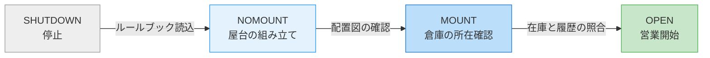
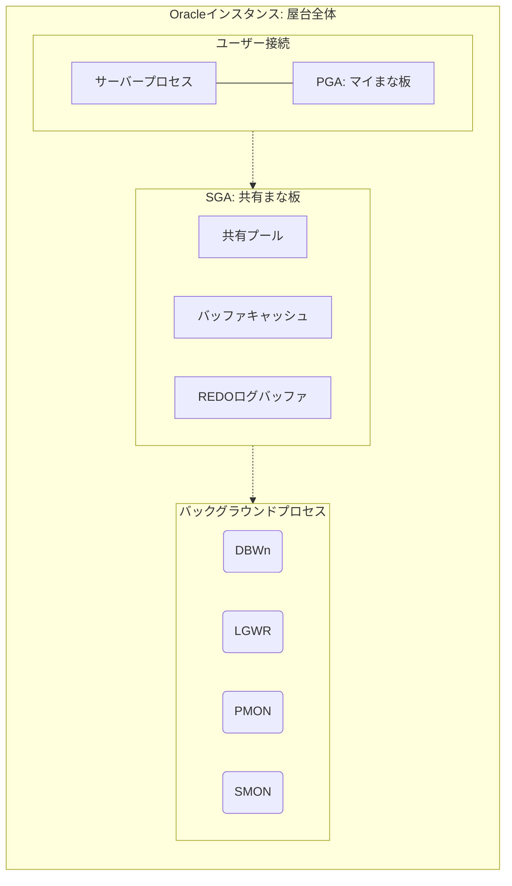
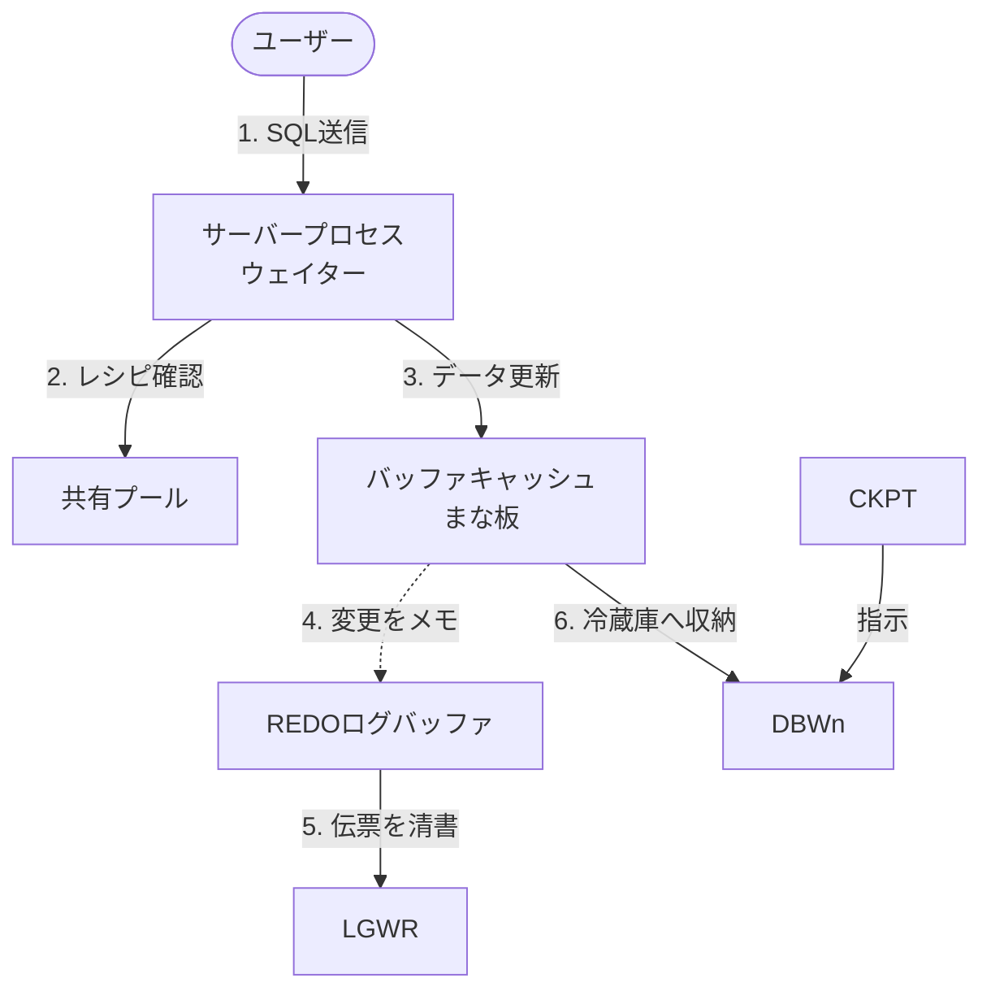
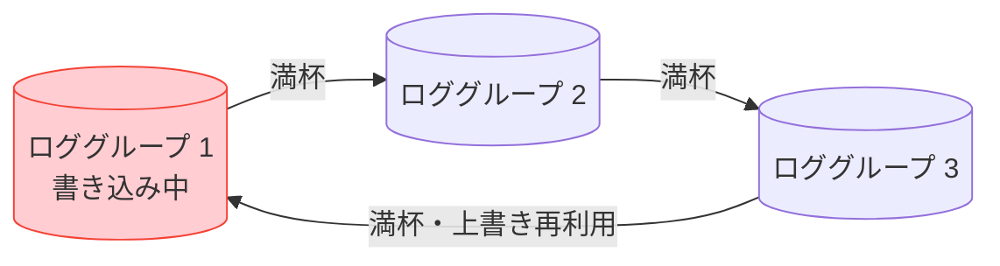
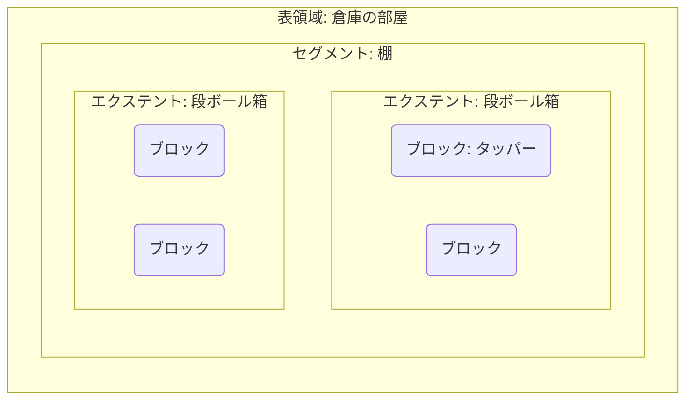

# Oracle基礎勉強会 第3回：Oracleインスタンスの管理 / 記憶域構造

## イントロダクション

### 本日の学習テーマと「学び方」
今日学ぶ「Oracleの裏側の仕組み」は、一見すると専門用語（SGA、PGA、REDOなど）ばかりで難しそうに見えます。
しかし、本日はすべて**「臨時店舗（屋台）の営業」**に例えて説明します！
専門用語を覚えるときは、必ずこの「例え（イメージ）」とセットで脳に刷り込んでいきましょう。

### 💡 Oracleデータベースの全体イメージ
Oracleデータベースとは、一言でいうとどのような構造なのでしょうか？

**「巨大な共有の倉庫（データファイル）の前に、今日働くための『屋台（インスタンス）』をその場でパッと組み立てて営業しているような感じ」**です。

- **倉庫（データベースファイル）**: 物理的なHDDにあり、電源を切っても食材（データ）は残ります。
- **屋台（インスタンス）**: 電源を入れるたびに、メモリ上にパッと確保される一時的な作業スペースとスタッフです。電源を切ると消えて無くなります。

---

## 0. 事前準備（ハンズオン環境への接続）

本日は各章の合間に実際のコマンドを叩いて確認（ハンズオン）を行います。
まずは、AWS上に用意されたご自身のEC2インスタンス（屋台の現場）へ接続しておきましょう。

### EC2へのSSH接続
VS Codeの `ssh-remote` を使用して接続してください。
- **接続ユーザ**: `ec2-user`
- **認証方式**: 鍵による認証（第1回と同様ですが、IPアドレスが異なります）

---

## 1. Oracleの全体像と「起動」のストーリー

### データベースの起動ステップ（屋台の組み立てと開店）
お店の開店プロセスと同じ順番で、段階的に起動します。



**【各ステップの具体的な裏側】**
- **NOMOUNT (屋台の組み立て)**:
  一番最初に「初期化パラメータファイル（ルールブック）」を読み込みます。ここに書かれている「メモリサイズ」などを基に、広さを決めてインスタンス（作業スペース）をパッと組み立てます。
- **MOUNT (倉庫の所在確認)**:
  「制御ファイル」を読み込みます。制御ファイルには「データファイル（倉庫）がどこにあるか」という配置図が書かれています。ここではまだデータの中身は開けず、「どこに何があるか」だけを確認します。
- **OPEN (営業開始)**:
  実際のデータファイルやREDOログを読み込みます。前回の営業終了時の状態（進捗や履歴）をチェックし、矛盾があれば整合性を整えてから、晴れてユーザーに開放（OPEN）します。

### 【ハンズオン】データベースの起動と停止
実際に「開店」と「閉店」のコマンドを実行してみましょう。
まずはターミナルから `sys` ユーザ（管理者）としてCDB（大元のデータベース）にログインします。

```bash
# OSのターミナルからsqlplusを起動してログイン
$ sqlplus / as sysdba
```

```sql
-- 現在の状態を確認
SQL> select status from v$instance;

-- 閉店 (強制終了)
SQL> shutdown immediate;

-- 段階的な起動（開店準備）
SQL> startup nomount;
SQL> alter database mount;
SQL> alter database open;

-- 停止状態から一気に開店 (通常はこちらを使います)
SQL> shutdown immediate;
SQL> startup;
```

---

## 2. 働く人たちと作業スペース（メモリとプロセス）

### インスタンスの内部構造（屋台の構成）
インスタンス（屋台）の中は、大きく分けて「共有スペース(SGA)」「個人スペース(PGA)」「働くスタッフ(プロセス)」の3つで構成されています。



### SGA（システムグローバル領域）
SGA ＝ **みんなで共有する巨大な「まな板（作業スペース）」**

SGAは、お店のスタッフ全員が共有して使う大きな作業台です。用途に合わせていくつかの「専用エリア」に区切られています。

**【SGAの具体的な中身】**
- **データベースバッファキャッシュ**: 倉庫から出した食材（データ）を一時的に置く場所。よく使うデータはここに残り処理が速くなります。
- **REDOログバッファ**: 注文の変更履歴（伝票）を一時的にメモする場所。
- **共有プール**: レシピ本（SQLの解析結果・実行計画）を置く場所。一度考えた手順はここに記憶されます。

> 📝 **その他のSGA領域（参考）**
> - **Javaプール**: Javaで記述されたプログラム実行に利用。
> - **ラージプール**: バックアップや並列処理など、大きな処理で利用される広場。

### PGA（プログラムグローバル領域）
PGA ＝ **ウェイター個人の「マイまな板」**

ユーザー（接続）ごとに割り当てられる「自分専用の作業スペース」です。他のプロセスと共有されることはありません。

**【PGAの具体的な中身】**
- **ソート領域**: `ORDER BY` などでデータを並び替える際、この個人スペースを使って並べ替えを行います。
- **セッション情報**: 「今誰がログインしているか」などのログイン状態。
- **カーソル状態**: 実行中のSQL文の現在の進捗状況。

### バックグラウンドプロセス
バックグラウンドプロセス ＝ **裏方スタッフたち**

データベースがスムーズに動くよう、裏側では様々な専門スタッフが働いています。

**【主要なスタッフ】**
- **DBWn (データベースライター)**: まな板（バッファキャッシュ）から冷蔵庫（データファイル）へデータを片付ける実動部隊。
- **LGWR (ログライター)**: 伝票（REDOログバッファ）をノート（REDOログファイル）に清書する係。
- **PMON (プロセスモニター)**: 作業員（ユーザープロセス）の面倒を見る「厨房長・リーダー」。ウェイターが倒れたら片付け（リソース解放）をします。
- **SMON (システムモニター)**: 建物全体を管理する「支配人・現場監督」。クラッシュ時に、次回起動時の復旧作業を取り仕切ります。
- **CKPT (チェックポイント)**: DBWnに対して「まな板にあるこの情報を、ファイルへ書き込め！」と指示を出す司令塔。

> 📝 **その他の裏方スタッフ（参考）**
> - **MMON (管理モニター)**: 性能分析の統計情報を定期収集する「分析官」。
> - **ARCn (アーカイバ)**: REDOログをアーカイブログとしてコピー（バックアップ）する係。

### SQL実行時の「流れ作業」フロー



### 【ハンズオン】SGAとPGAの確認
引き続き `sys` ユーザでログインした状態で確認します。

```sql
-- SGAの確認
SQL> show sga
SQL> select * from v$sgainfo;

-- PGAの確認 (ユーザーごとの使用量)
SQL> SELECT pro.PROGRAM, ses.SCHEMANAME, pro.PGA_USED_MEM/1024/1024 as "MEMORY[MB]"
     FROM V$SESSION ses, V$PROCESS pro
     WHERE ses.TYPE = 'USER' AND ses.PADDR = pro.ADDR;
```

### メモリーコンポーネントの管理方式
屋台のまな板の広さをどうやって決めるかには、以下の3つの方式があります。

1. **自動メモリー管理（AMM）**: SGAとPGAの全体サイズ（MEMORY_TARGET）だけを決めれば、Oracleが自動調整する。一番ラクな「オートマ車」。
2. **自動共有メモリー管理（ASMM）**: SGA（SGA_TARGET）とPGA（PGA_AGGREGATE_TARGET）のバランスを人間が決めたい「マニュアル車」。
3. **手動共有メモリー管理**: 各プール（共有プールやバッファキャッシュなど）のサイズをすべて手動で決める。

---

## 3. お店のルールブック（初期化パラメータ）

初期化パラメータ ＝ **屋台の設計書・ルールブック**

**NOMOUNT（組み立て）の段階で読み込まれる**超重要な設定値です。大きく分けて2つの種類（動的・静的）があります。

### 主な初期化パラメータ一覧

**【動的パラメータ】**（営業時間中にすぐ変更できる設定）
| パラメータ名 | 説明 |
| :--- | :--- |
| **DISPATCHERS** | ディスパッチャプロセスの構成 |
| **MEMORY_TARGET** | SGA+PGAのサイズ (AMM用) |
| **PGA_AGGREGATE_TARGET** | 全プロセスのPGA合計サイズ (ASMM用) |
| **SHARED_POOL_SIZE** | 共有プールのサイズ |
| **SGA_TARGET** | SGAの合計サイズ (ASMM用) |
| **UNDO_RETENTION** | UNDO保存の下限値(秒) |

**【静的パラメータ】**（一度屋台をたたんで組み立て直さないと変更できない設定）
| パラメータ名 | 説明 |
| :--- | :--- |
| **CONTROL_FILES** | 制御ファイル名 |
| **MEMORY_MAX_TARGET** | MEMORY_TARGETの上限 |
| **SGA_MAX_SIZE** | SGA合計サイズの上限 |

### パラメータの変更方法とSCOPE（適用範囲）
パラメータを変更する際、それを「いつから適用するか」を `SCOPE` で指定します。

`ALTER SYSTEM SET 【パラメータ名】 = 【値】 SCOPE = 【BOTH|SPFILE|MEMORY】`

- **`BOTH` (デフォルト)**: **「今すぐ変えたいし、次回以降も採用」**（メモリとファイルの両方を変更）。
- **`SPFILE`**: **「次回以降から」**（ファイルのみ変更）。静的パラメータを変更する場合は必須です。
- **`MEMORY`**: **「今だけ変えたい」**（メモリのみ変更。再起動すると元に戻ります）。

### 【ハンズオン】初期化パラメータの変更
引き続き `sys` ユーザで実行します。

```sql
-- 現在の値の確認
SQL> show parameter UNDO_RETENTION

-- 値の変更
SQL> ALTER SYSTEM SET UNDO_RETENTION = 800 SCOPE=BOTH;

-- 変更結果の確認
SQL> show parameter UNDO_RETENTION
```

---

## 4. 倉庫の構造（記憶域と表領域）

データベースを構成する物理ファイル群（3大ファイル）です。

- **データファイル**: 実際のデータ（表や索引）が保存されるファイル。
- **制御ファイル**: MOUNT時に読み込まれる、ファイルの配置図（目次）。
  > 💡 **なぜ多重化が必須なのか？**
  > もし制御ファイルが壊れると、Oracleは「データファイルがどこにあるか」という記憶をすべて失い、データベースが一切起動できなくなる（店が迷子になる）致命傷に繋がるためです。
- **REDOログファイル**: 更新履歴（ドラレコ）。

### REDOログの「循環方式」とは？
REDOログは容量を食いつぶさないよう、2つ以上のファイル（グループ）を使って以下のように**「循環（使い回し）」**して書き込みます。


※古い履歴は上書きされる前に、ARCn（アーカイバ）スタッフによって別の場所へバックアップコピーされます（アーカイブログモード時）。

### 記憶域の階層構造（ブロックとエクステント）
実際のデータファイルの中身は、細かく箱分けされて管理されています。



- **ブロック**: 最小単位。食材を入れる**「タッパー（小箱）」**。
- **エクステント**: ブロックの集まり。タッパーをいくつかまとめた**「段ボール箱・コンテナ」**。
- **セグメント（表など）**: エクステントの集まり。コンテナを並べた**「棚」**。
- **表領域**: セグメントを入れる論理的な**「倉庫の部屋」**。
- **データファイル**: OS上に実在する物理的な**「倉庫の建物（HDD）」**。1つの表領域は1つ以上のデータファイルから構成されます。

### 特殊な表領域
> 💡 **注意**: ここから下の表領域は、メモリ（まな板）の話ではなく、すべて**データファイル（ディスク・倉庫）**内の構造の話です！

- `SYSTEM`表領域: お店の最重要台帳（データディクショナリ等）。
- `SYSAUX`表領域: 営業日報や分析データ（AWR等）を入れるキャビネット。
- `UNDO`表領域: UNDOデータ（過去への巻き戻しデータ）保存用。
- `一時`表領域: ソート処理等でメモリ（PGA）が足りなくなった際、一時的に書き出すための退避スペース。

> 📝 **コラム：REDO と UNDO の違い**
> 初心者が最も混乱する2つの違いを整理しておきましょう。
> - **REDO（やり直す）**: 停電などで消えたデータを復元し、障害発生直前まで進めるための**「未来への日記（ロールフォワード）」**。専用のREDOログファイルに記録されます。
> - **UNDO（元に戻す）**: 「間違えた！注文取り消し！」のための**「過去への巻き戻し（ロールバック）」**。専用のログファイルはなく、UNDO表領域内のセグメントとして格納されます。

### 【ハンズオン】表領域の作成・拡張・削除

ここではCDB（大元）ではなく、PDB（個別の店舗）に一般ユーザーでログインし直してから実行します。
一度 `SQL>` プロンプトを `exit` で抜けてから、以下のコマンドを実行してください。

```bash
# OSのターミナルからPDBへログイン
$ sqlplus bold/bold@freepdb1
```

```sql
-- 表領域の作成
SQL> CREATE TABLESPACE test_tbs DATAFILE 'test_tbs.dbf' SIZE 10M AUTOEXTEND OFF;

-- 容量が足りなくなった場合の拡張（リサイズ）
SQL> ALTER DATABASE DATAFILE 'test_tbs.dbf' RESIZE 20M;

-- 表領域の削除
SQL> DROP TABLESPACE test_tbs INCLUDING CONTENTS AND DATAFILES;
```

---

## 5. まとめと練習問題

| 専門用語 | イメージ（屋台の例え） |
| :--- | :--- |
| **インスタンス** | 組み立て式の屋台テントと働く人（メモリとプロセス） |
| **SGA / PGA** | 共有まな板 / マイまな板 |
| **初期化パラメータ** | 屋台の設計書・ルールブック |
| **REDO / UNDO** | ドラレコ録画 / 注文の取り消し |

### 練習問題リンク
- [第5章 練習問題](https://forms.gle/jBMtQkPVj3D65cgHA)
- [第6章 練習問題](https://forms.gle/C7pTbXdmem2Ns2DP6)
