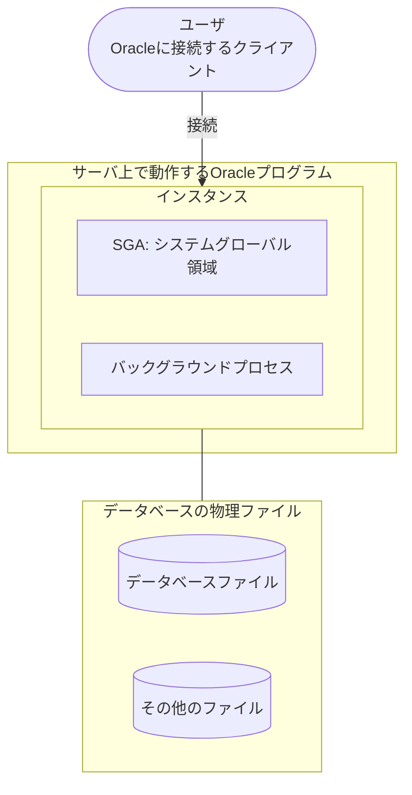
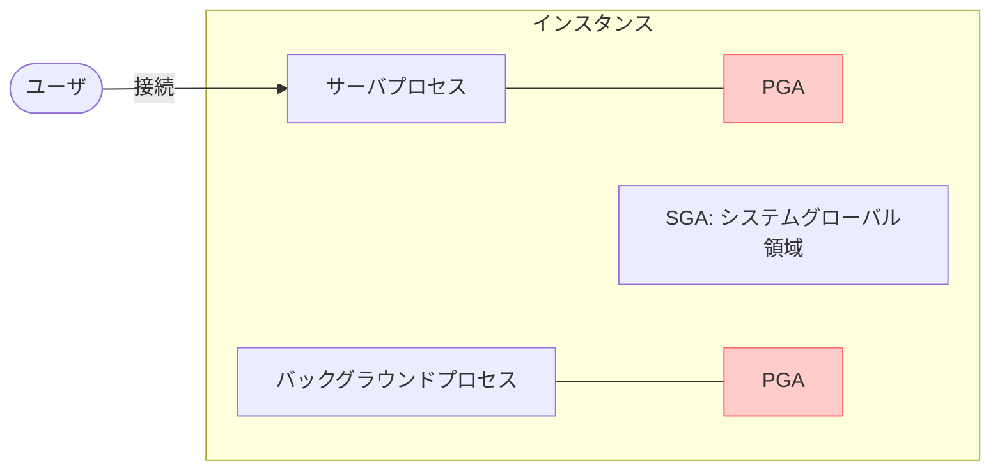
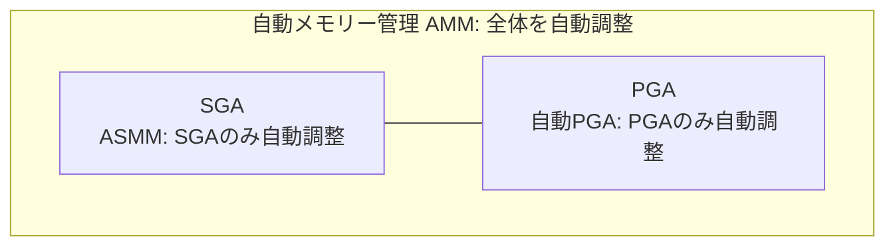
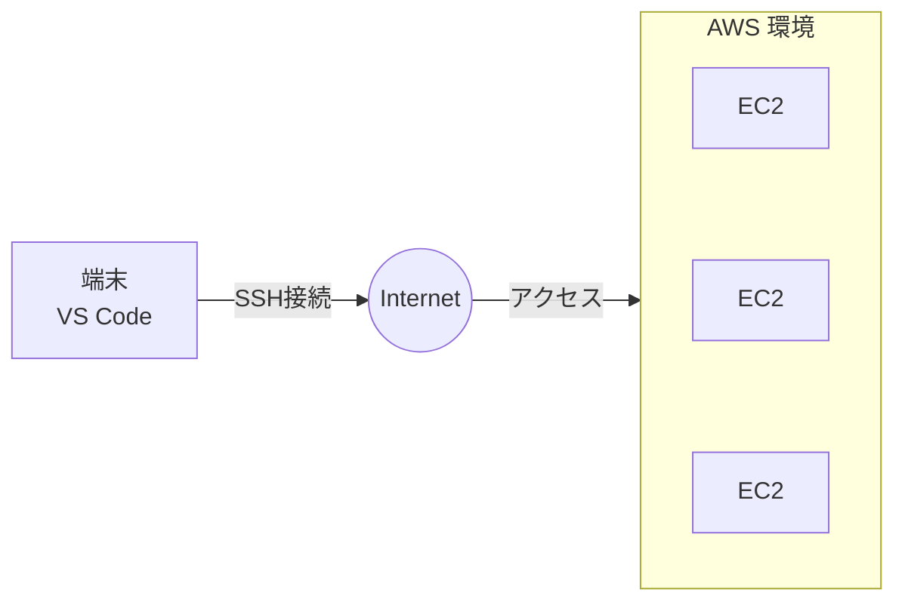

# 24下期 Oracle勉強会 第3回テキスト

---

## スケジュール

| 回数 | 日付 | 内容 |
| :--- | :--- | :--- |
| 第1回 | 2026/07/21 | 第1章：Oracleデータベース管理の概要<br>第2章：Oracleデータベースのインストールおよびデータベースの作成 |
| 第2回 | 2026/08/18 | 第3章：Oracle Enterprise Manager Database Express および SQL 管理ツールの使用<br>第4章：Oracle Network 環境の構成 |
| **第3回** | **2026/09/15** | **第5章：Oracleインスタンスの管理**<br>**第6章：データベース記憶域構造の管理** |
| 第4回 | 2026/10/20 | 第7章：ユーザーおよびセキュリティの管理<br>第8章：スキーマオブジェクトの管理 |
| 第5回 | 2026/11/17 | 第9章：データベースの監視およびアドバイザの使用<br>第10章：バックアップ・リカバリの概要と可用性を高める構成 |
| 第6回 | 2026/12/15 | 全工程振り返り<br>最終テスト |

---

## 1. Oracleインスタンス

Oracleデータベースは以下のような構成となっています。



### [メモ] 用語解説
- **ユーザ**: Oracleに接続するクライアント
- **インスタンス**: サーバで動作するOracleのプログラム
- **データベースファイル**: データベースの物理ファイル

---

## SGA (システムグローバル領域)

Oracleデータベースが起動する際、OSの物理メモリからSGAとしてメモリを事前に確保し、確保したメモリ内でOracleの作業領域として利用される。

### SGAの構成要素
- **データベースバッファキャッシュ**
- **REDOログバッファ**
- **共有プール**
- **Javaプール**: Javaで記述されたストアードプログラム実行に利用。
- **ラージプール**: バックアップや並列処理で利用。

### 各コンポーネントの役割

#### データベースバッファキャッシュ
- **データ参照**: データベースファイルにあるデータをSGA（メモリ）に保持することでデータ参照が速くなります。
- **データ更新**: SGA（メモリ）のデータのみ更新することで性能向上させます。

#### REDOログバッファ
- **データ更新 (履歴)**: REDOログとは更新履歴です。直接REDOログを更新せずにSGA（メモリ）に保持しておきます。

#### 共有プール
- **SQLの発行**: SQLを発行すると効率のよいSQLは何かを解析します。その効率のよいSQLをSGA（メモリ）に保持しておき、同じSQLだったら再利用します。

---

## バックグラウンドプロセス

Oracleインスタンスの各種処理を裏側で支えるプロセス群です。

- **DBWn (データベースライター)**
  - データベース・バッファ・キャッシュ上で変更されたデータをデータファイルに書き込む。複数起動できる。（※nは数字）
- **LGWR (ログライター)**
  - REDOログバッファのREDOデータをREDOログに書き出す。
- **CKPT (チェックポイント)**
  - DBWnに対してデータファイルに書き込む指示を出す。
- **SMON (システムモニター)**
  - 障害などでインスタンスを再起動した際に、データベースファイルの復旧処理を行う。
- **PMON (プロセスモニター)**
  - ユーザープロセスの障害時に、使用していたリソースを解放してクリーンアップを行う。
- **MMON (管理モニター)**
  - 性能分析で使用される統計情報を定期収集する。
- **ARCn (アーカイバ)**
  - REDOログファイルをアーカイブログファイルとしてコピーする。（※nは数字）

---

## PGA (プログラムグローバル領域)

PGAはプロセスごとに獲得するメモリー領域です。



- PGAで展開されたデータは他のプロセスと共有されない。
- PGAはソート処理などのプロセス専用の作業用メモリとして使用される。

---

## 初期化パラメータファイル

### 主な初期化パラメータファイルの設定値

| パラメータ | 説明 | 起動中の変更 |
| :--- | :--- | :---: |
| **CONTROL_FILES** | 制御ファイル名 | X |
| **DISPATCHERS** | ディスパッチャプロセスの構成 | 〇 |
| **MEMORY_MAX_TARGET** | MEMORY_TARGETの上限 | X |
| **MEMORY_TARGET** | SGA+PGAのサイズ。自動メモリ管理使用で設定 | 〇 |
| **PGA_AGGREGATE_TARGET** | 全プロセスのPGAの合計サイズ。自動PGAメモリ管理使用で設定 | 〇 |
| **SHARED_POOL_SIZE** | 共有プールのサイズ | 〇 |
| **SGA_MAX_SIZE** | SGA合計サイズの上限 | X |
| **SGA_TARGET** | SGAの合計サイズ。自動共有メモリ管理使用で設定 | 〇 |
| **UNDO_RETENTION** | UNDO保存の下限値(秒) | 〇 |

### パラメータとファイルの種類
- 初期化パラメータには**「動的パラメータ」**と**「静的パラメータ」**の2種類がある。
- 動的パラメータはインスタンスが稼働中でも設定値の変更ができるが、静的パラメータの場合、設定を反映するにはインスタンスの再起動が必要。
- 初期化パラメータファイルには**「サーバーパラメータファイル（SPFILE）」**と**「テキスト初期化パラメータファイル（PFILE）」**の2種類がある。
- SPFILEはバイナリファイル、PFILEはテキストファイルで構成されている。

---

## 初期化パラメータの変更方法

DB起動時にSPFILEを読み込み、メモリ上に情報を展開します。変更をどこに反映するか、以下のいずれかを選択可能です。

1. メモリ上に展開された設定を変更する。
2. SPFILEの設定を変更し、次回読み込み時(DB起動時)から反映させる。
3. 上記1と2を同時に実行する。

※ただし、静的パラメータは「1. メモリ上のみの変更」を選択できない。

### 設定変更コマンド

```sql
ALTER SYSTEM SET 【初期化パラメータ名】 = 【設定する値】 scope = 【BOTH|SPFILE|MEMORY】
```

> [!NOTE]
> `scope` を何も指定しないと、デフォルトである **BOTH** (上記3の同時実行) が使用されます。

---

## 3. メモリーコンポーネントの管理

### メモリーコンポーネントの管理方法の設定
メモリーコンポーネントの管理方法には以下の3つの方法があります。

1. **自動メモリー管理（AMM：Automatic Memory Management）**
   - SGA、PGAのサイズ全体を自動的に調整します。
2. **自動共有メモリー管理（ASMM：Automatic Shared Memory Management）＋ 自動PGAメモリー管理**
   - ASMM: SGAのサイズだけ自動的に調整します。
   - 自動PGA: PGAのサイズだけ自動的に調整します。
3. **手動共有メモリー管理 ＋ 自動PGAメモリー管理**



---

## 4. データベース記憶域構造の管理

### データベースの記憶域構造の概要

Oracleデータベースを構成する主要なファイル群です。

| データファイルの種類 | 説明 |
| :--- | :--- |
| **データファイル** | 表や索引などのデータ |
| **REDOログファイル** | データベースの更新情報が記録されるファイル |
| **制御ファイル** | データベースの構成情報、管理情報が記載されたファイル |

#### REDOログ
- 2つ以上のファイルで構成され、複数グループで構成されています。
- 書き込みは**循環方式**で行われます。（ファイル1がいっぱいになったらファイル2へ、ファイル2がいっぱいになったらファイル3へ、そして再びファイル1へ）

#### 制御ファイル
- ファイルが破損するとデータベースが起動できなくなるため、**ファイルを多重化**することを推奨します。

---

## 表領域とデータファイル

Oracle内部の論理的な構造（表領域）と、OS上の物理的なファイル（データファイル）の関係です。

- **オブジェクト（Oracleで見える部分）**: 社員表などのテーブル
- **表領域（Oracleで見える部分）**: 複数のオブジェクト（セグメント）を格納する論理的な領域
- **データファイル（OSから見える部分）**: 表領域を構成する物理ファイル。内部は「エクステント」や最小単位の「ブロック」で構成される。

### 特殊な表領域

| 表領域 | 説明 |
| :--- | :--- |
| **SYSTEM表領域** | Oracleに必須な表領域。内部管理情報であるデータディクショナリを格納。 |
| **SYSAUX表領域** | Oracleに必須な表領域。SYSTEM表領域の補助的な役割。AWR（Automatic Workload Repository）で利用。 |
| **UNDO表領域** | UNDOデータ保存用。（更新前の過去データ） |
| **一時表領域** | ソート処理などで利用される領域 |

---

## ハンズオン：ツールの利用

AWSにみなさんのEC2を構築しております。
事前にIPアドレスをお伝えしているので、VS Codeの `ssh-remote` で接続してください。

- **接続ユーザ**: `ec2-user`
- **認証方式**: 鍵による認証となります。鍵は任意の場所に保管してください。

※第1回と同様ですが、接続するIPアドレスは違います。



---

## SGAとPGAの確認 (ハンズオン)

以下のSQLでSGA、PGAを確認してみましょう。

### 1. SGAの確認
sqlplusを使って `sys` ユーザでCDBにログインします。

```sql
SQL> show sga
SQL> select * from v$sgainfo;
```

### 2. PGAの確認

```sql
SQL> SELECT pro.PROGRAM, ses.SCHEMANAME
       , pro.PGA_USED_MEM/1024/1024 as "MEMORY[MB]"
     FROM
       V$SESSION ses, V$PROCESS pro
     WHERE
       ses.TYPE = 'USER'
       AND ses.PADDR = pro.ADDR;
```

---

## 初期化パラメータの変更 (ハンズオン)

現在の `UNDO_RETENTION` の値の確認と変更を行ってみましょう。

### 1. 初期化パラメータの確認
sqlplusを使って `sys` ユーザでCDBにログインします。

```sql
SQL> show parameter UNDO_RETENTION
```

### 2. 初期化パラメータの変更

```sql
SQL> ALTER SYSTEM SET UNDO_RETENTION = 800;
SQL> show parameter UNDO_RETENTION
```

### 3. UNDO_RETENTIONの設定戻し
変更した `UNDO_RETENTION` の値を元の値に戻してみてください。

---

## データベースの起動と停止 (ハンズオン)

データベースの停止、起動をやってみましょう。

### 1. データベースの停止
sqlplusを使って `sys` ユーザでCDBにログインします。

```sql
SQL> shutdown immediate;
SQL> select status from v$instance;
```

### 2. nomountで起動
nomountの状態で起動します。

```sql
SQL> startup nomount;
SQL> select status from v$instance;
```

### 3. nomountから段階的に起動

```sql
SQL> alter database mount;
SQL> alter database open;
```

### 4. 停止状態から起動

```sql
SQL> shutdown immediate;
SQL> startup;
```

---

## 表領域の作成、拡張、削除 (ハンズオン)

以下にてPDBにログインします。

```bash
$ sqlplus bold/bold@freepdb1
```

### 1. 表領域の作成

```sql
SQL> CREATE TABLESPACE test_tbs
     DATAFILE 'test_tbs.dbf'
     SIZE 10M AUTOEXTEND OFF;
```

### 2. 表領域の拡張（リサイズ）

```sql
SQL> ALTER DATABASE
     DATAFILE 'test_tbs.dbf'
     RESIZE 20M;
```

### 3. 表領域の削除

```sql
SQL> DROP TABLESPACE test_tbs
     INCLUDING CONTENTS AND DATAFILES;
```

---

## 練習問題

### 第一章（第5章） 練習問題 1

以下URLに接続して問題をやってみましょう。
[https://forms.gle/jBMtQkPVj3D65cgHA](https://forms.gle/jBMtQkPVj3D65cgHA)

> 画面が表示されたらメールアドレス（Boldメアド）、名前、社員番号を入力してください。

---

## 練習問題

### 第二章（第6章） 練習問題 2

以下URLに接続して問題をやってみましょう。
[https://forms.gle/C7pTbXdmem2Ns2DP6](https://forms.gle/C7pTbXdmem2Ns2DP6)

> 画面が表示されたらメールアドレス（Boldメアド）、名前、社員番号を入力してください。
