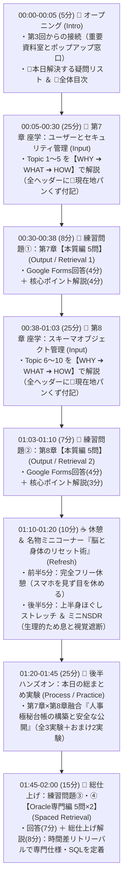

# 25上期 Oracle基礎勉強会 第4回 設計ブループリント (Design Blueprint - 統一メタファー・パンくず・疑問リスト完全反映版)

- **対象回**: 第4回（第7章：ユーザーおよびセキュリティの管理 ／ 第8章：スキーマオブジェクトの管理）
- **準拠SSOT**: `docs/00_Design_Decisions.md`, `docs/slide_design_guidelines.md`, `docs/predecessor_audit_report.md`, `sessions/session_04/opus_review_report.md`, `second-brain/30_Resources/Instructional_Design/02_ID.md`, `03_IS.md`
- **実機ターゲット**: AWS EC2 (Amazon Linux 2023) + Oracle AI Database 26ai Free (`freepdb1` / 管理者ユーザー `bold` / `NLS_LANG=Japanese_Japan.AL32UTF8`)

---

## 第1部：第4回 全体シークエンス（120分タイムライン）と行動目標（Learning Objectives）

### 1.1 本日の北極星（Purpose：存在意義）と「第3回からの統一メタファー接続」
- **第3回（インスタンス管理）からの接続**:
  - 第3回で、ディスク上の**「データベース（データファイル群）」は奥にある『企業の重要資料室・大金庫』**であり、メモリとプロセスの**「インスタンス（SGA＋バックグラウンドプロセス）」は利用者と素早くやり取りするために手前に開いた『仮設のポップアップ窓口（出張所）』**であることを学んだ。
- **第4回（第7章・第8章）の統一舞台（「企業の重要資料室（会員制図書館）とマイ本棚」）**:
  - 本日はいよいよ、その**「企業の重要資料室（会員制の社内図書館）」の内部**に入り、社員一人ひとりにどうやって**「会員証（`User`）」**と**「自分専用のマイ本棚（`Schema`）」**を割り当て、本棚に並べる**「資料・台帳（`Table`）」**の書き方ルール（`Constraint`）や別紙の索引カード（`Index`）、機密欄を隠す閲覧用フィルター（`View`）をどう設計・保護するかという**普遍的なメンタルモデル**をインストールする。
  - 特に「なぜ全員に強い権限を与えず最小権限にするのか？」について、**「強い権限を与えてルールで禁止すると『操作は可能だがルールで禁止』という恐怖と監視コストが生まれるが、最初から権限を絞れば『実行できる操作＝すべて安全な操作』になり、管理者も利用者も安心して自由に動ける（全員が幸せになるガードレール設計）」**という本質（WHY）を腹落ちさせる。

### 1.2 本日の行動目標（Learning Objectives：学習者を主語とした観察可能な到達目標）

インストラクショナル・デザイン（`02_ID.md` 2-3「1文1動詞・評価条件と基準の明示」）およびブルーム・タキソノミーに基づき、授業終了時に学習者が達成すべき行動目標を以下の通り定義する。

#### ① 認知領域（知識・理解・判断：練習問題 全20問で80%＝16問以上の正答を基準とする）
1. **【ユーザーとスキーマの分離】** シナリオ問題において、OSユーザー（ビル入館証）とDBユーザー（資料室会員証）を分離する理由およびOracleにおける「ユーザー＝スキーマ（1対1で割り当てられるマイ本棚）」の関係を正しく**選択できる**（理解）。
2. **【管理権限とアカウント制御】** 運用要件に応じて、`SYS`（創設オーナー・`SYSDBA`）と`SYSTEM`（日常の館長）の使い分け、および初期パスワード変更強制（`PASSWORD EXPIRE`）・アカウントロック（`ACCOUNT LOCK`）・共有書庫の棚幅上限（`QUOTA`）・利用規約（`PROFILE`）の適切な設定方法を**識別できる**（適用）。
3. **【最小権限の原則とロール・委譲】** システム権限（入館・本棚拡張権）とオブジェクト権限（他人の本棚の資料閲覧・記入権）の違い、およびロール（役職バッジ）を用いた権限管理の仕様と `WITH ADMIN OPTION`（公的資格の発令＝連鎖しない） / `WITH GRANT OPTION`（私物資料の又貸し＝連鎖消滅する）の剥奪（`REVOKE`）時における連鎖有無の違いを正確に**予測できる**（分析）。
4. **【表・データ型・5大制約】** テーブル設計要件に対し、基本データ型（記入欄テンプレート：`VARCHAR2`, `CHAR`, `NUMBER`, `DATE`）および資料の整合性を守る5つの書き方ルール（5大制約：特に `PRIMARY KEY` と `UNIQUE` のNULL許容性の違い、`FOREIGN KEY` の役割）を正しく**区別できる**（理解・分析）。
5. **【INDEXのトレードオフとVIEW・オブジェクト寿命】** 別紙の索引カード（INDEX）による検索高速化とDML更新時の自動書き換えコスト（トレードオフ）、閲覧用フィルター枠（VIEW）の2大目的（アクセス制限・SQL簡素化）、および本編資料 `DROP TABLE` 時に道連れ消滅するもの（INDEX・制約）と無効化（`INVALID`）されて残るもの（VIEW）を正確に**特定できる**（分析・評価）。
6. **【大量データ移動ツールの選定】** データ移行要件に応じ、外部CSV束から高速自動転記する `SQL*Loader` と、Oracle資料室間で専用コンテナ（`.dmp`）により論理バックアップ・高速引っ越しを行う `Oracle Data Pump (expdp/impdp)` の仕様を正しく**選択できる**（適用）。

#### ② 運動領域（技能：後半ハンズオン実験で全3ステップの出力確認完了を基準とする）
1. **【制約によるデータ保護の実験】** SQL*Plus上で主キー制約付きの表を作成し、重複データやNULLデータの投入がOracleによって拒絶される（`ORA-00001` / `ORA-01400`）挙動を実機で**再現できる**（制御）。
2. **【VIEW×ロールによる機密保護の実装】** 新規ユーザーの入館拒否（`ORA-01045`）と他人のマイ本棚参照拒否（`ORA-00942`）を確認した上で、機密列（年収）を目隠ししたVIEWとロールを組み合わせて安全なデータ公開を**実装できる**（制御）。
3. **【親表削除の連鎖挙動の検証】** 本編の台帳を `DROP TABLE` した際に、付属品の索引カードが自動消滅し、別棚のVIEWが `INVALID`（`ORA-04063`）になる現象を実機で**確認できる**（制御）。

#### ③ 情意領域（態度・メタ認知）
1. **【ガードレール設計とトレードオフへの当事者意識】** 「実行できる操作＝安全な操作」にするための最小権限設計の重要性と、根拠のないINDEX乱造が引き起こす更新性能劣化のトレードオフを認識し、設計根拠を持って判断しようとする姿勢を**示すことができる**（価値づけ）。

---

### 1.3 120分 全体シークエンス（パイクの90/20/8の法則 × 中盤ストレッチ＆NSDR組み込み）

---

## 第2部：座学スライド構成プロット（オープニング疑問リスト＆全体目次 ＋ 全10トピック × パンくず × 統一メタファー）

---

### 🧭 オープニング：現在地マップ ＆ 本日の講義で解決する疑問リスト ＆ 全体目次（00:00 - 00:05）
> 📍 **現在地**：オープニング ＞ **全体ロードマップと本日のゴール**

- **【第3回からの繋がりと本日の舞台】**:
  - 第3回では、ディスク上の**「データベース（データファイル群）」は奥にある『企業の重要資料室・大金庫』**であり、メモリとプロセスの**「インスタンス（SGA＋バックグラウンドプロセス）」は利用者と素早くやり取りするために手前に開いた『仮設のポップアップ窓口（出張所）』**であることを学んだ。
  - 第4回となる本日の舞台は、その**「企業の重要資料室（会員制の社内図書館）」の内部**。誰に入館証（`User`）を発行し、資料室の中にどうやって各自の**「マイ本棚（`Schema`）」**を作り、その本棚にどんな**「資料・台帳（`Table`）」**や**「索引カード（`Index`）」「閲覧用フィルター（`View`）」**を並べて守るのかを習得する。

#### 🤔 本日の講義で解決する「6つの疑問リスト」
> 📍 **現在地**：オープニング ＞ **本日の講義で解決する疑問リスト ＆ 全体目次**

1. **「Linuxサーバーに `oracle` でログインしたのに、なぜSQL*Plusでもう一度 `bold` でログインし直すの？『ユーザー』と『スキーマ』って何が違うの？」**（➔ Topic 1で解決！）
2. **「なぜ最強の管理者 `SYS` 1人だけでなく、日常管理用の `SYSTEM` がわざわざ別に用意されているの？みんなに強い権限を渡して『気をつけて使おう』ではダメなの？」**（➔ Topic 2・Topic 4で解決！）
3. **「上司から部下へ権限を分け与えたあと、上司の権限を取り消したら、部下の権限まで芋づる式に消える場合と消えない場合があるのはなぜ？」**（➔ Topic 5で解決！）
4. **「Webアプリの画面側で入力チェックをしているのに、なぜDBのテーブル側にも『制約（書き方ルール）』を設定しなきゃいけないの？」**（➔ Topic 6・Topic 7で解決！）
5. **「検索を速くしたいなら、テーブルの全カラムに『索引（INDEX）』を作っておけば最強じゃないの？なぜ作りすぎると逆効果になるの？」**（➔ Topic 8で解決！）
6. **「同じテーブル内の『氏名・部署』は全社員に見せたいけれど『年収』だけは絶対に隠したい！テーブルを2つにコピーして二重管理せずに解決する方法は？」**（➔ Topic 9・後半ハンズオン実験で解決！）

#### 📑 本日の全体目次（Master Table of Contents）
- **第1部：第7章 ユーザーおよびセキュリティの管理（00:05 - 00:30）**
  - **Topic 1**：OSユーザーとDBユーザー／スキーマの分離（ビルの入館証 vs 資料室の会員証と「マイ本棚」）
  - **Topic 2**：初期管理ユーザー（`SYS` vs `SYSTEM`）と管理権限 `SYSDBA`（創設オーナーと日常の館長を分ける理由）
  - **Topic 3**：アカウント状態管理（ロック・期限切れ）とクォータ（`QUOTA`）・プロファイル（`PROFILE`）
  - **Topic 4**：最小権限の原則：システム権限とオブジェクト権限（なぜ権限を絞ると「全員が幸せになる」のか？）
  - **Topic 5**：ロール（`Role`：役職バッジ）と権限委譲オプション（`WITH ADMIN OPTION` vs `WITH GRANT OPTION`）
- **📝 練習問題①：第7章【本質編 5問】（00:30 - 00:38）**
- **第2部：第8章 スキーマオブジェクトの管理（00:38 - 01:03）**
  - **Topic 6**：スキーマオブジェクトの全体像と「表（`Table`）・基本データ型」（資料と記入欄テンプレート）
  - **Topic 7**：データの整合性を守る「資料の5大書き方ルール（5大制約：`Constraints`）」
  - **Topic 8**：索引（`Index`）の仕組みと「光と影（別紙の索引カードと更新時書き換えコストのトレードオフ）」
  - **Topic 9**：ビュー（`View`：閲覧用フィルター）の正体と2大目的 ＆ 親テーブル `DROP` 時の連鎖
  - **Topic 10**：大量データの移動ツール（`SQL*Loader` 高速自動転記マシン vs `Oracle Data Pump` 専用引っ越しコンテナ便）
- **📝 練習問題②：第8章【本質編 5問】（01:03 - 01:10）**
- **☕ 中盤リフレッシュコーナー：脳と身体のリセット術（ストレッチ＆ミニNSDR）（01:10 - 01:20）**
- **🧪 第3部：後半ハンズオン「本日の総まとめ実験（全3実験＋おまけ2実験）」（01:20 - 01:45）**
- **🏁 総仕上げ：練習問題③・④【Oracle専門編 5問×2セット】（01:45 - 02:00）**

---

### 【前半：第7章 ユーザーおよびセキュリティの管理（全5トピック）】
> 📍 **現在地**：第1部：第7章 ユーザーおよびセキュリティの管理（全5トピック：会員証・マイ本棚・権限・ロール）

---

#### Topic 1：OSユーザーとDBユーザー／スキーマの分離（会員証とマイ本棚）
> 📍 **現在地**：第1部 第7章 ユーザーとセキュリティ管理 ＞ **Topic 1：OSユーザーとDBユーザー／スキーマの分離**（1/10）

- **【スリー・ソー導入】**:
  - **そうだよね**: Linuxサーバーにログインするとき、`ec2-user` や `oracle` といった「OSのアカウント」を使う。
  - **そういえば**: 第1回〜第3回のハンズオンで、Linuxに `oracle` でログインしたあと、さらに `sqlplus bold/bold@freepdb1` と打って別の名前（`bold`）でログインし直していた。「なんで2回もログインするの？OSのユーザーと何が違うの？」と疑問に思わなかったか？
  - **そうなんだ！**: OSが「オフィスビルの入り口」だとすると、Oracleはビルの中にある「会員制の重要資料室（社内図書館）」。そしてOracleでは、**「DBユーザー（会員証）を1人作ると、資料室の中にその人専用の『マイ本棚（スキーマ：Schema）』が自動的に1つ割り当てられる（1ユーザー＝1スキーマ）」**という超重要なルールがある！
- **【WHY】**:
  - サーバーOSのログインアカウントだけで重要資料室の中身まで無制限に触れてしまったら、サーバー保守担当者が極秘の人事資料や経理資料を書き換えられてしまう（職務分掌の崩壊）。また、資料室の中で全員が1つの巨大な棚にバラバラと資料（表）を置いたら、人事システムと営業システムで同じ『社員表（`emp`）』という名前の資料を作った瞬間に名前が衝突して上書き事故が起きる。だからこそ、OSとDBの認証を分離し、さらにDB内部でも「誰のマイ本棚にある資料か（名前空間）」を1人ずつ隔離する必要がある。
- **【WHAT（比喩と図解）】**:
  - **OSユーザー（`root`, `ec2-user`, `oracle`）** ＝ オフィスビルの施設入館証。
  - **DBユーザー（`SYS`, `bold`, `u1`）** ＝ ビル内にある「Oracle重要資料室」の会員証。
  - **スキーマ（`Schema`）** ＝ 会員登録と同時に1対1で自動割り当てされる**「自分専用のマイ本棚（名前空間）」**（**1人のDBユーザー ＝ 1つの同名のマイ本棚**）。`Aさん.emp` と `Bさん.emp` として安全に区別される。
- **【HOW】**:
  - 自分のマイ本棚の資料を見る時：`SELECT * FROM emp;`
  - 他人（`bold`）のマイ本棚の資料を見る時：`SELECT * FROM bold.emp;`（`スキーマ名.オブジェクト名`）
  - 補足：非スキーマ・オブジェクト（共有書庫フロアの設備である表領域 `TABLESPACE`、会員証 `USER`、役職バッジ `ROLE`、ディレクトリ `DIRECTORY` など）。

---

#### Topic 2：初期管理ユーザー（`SYS` vs `SYSTEM`）と管理権限 `SYSDBA`
> 📍 **現在地**：第1部 第7章 ユーザーとセキュリティ管理 ＞ **Topic 2：初期管理ユーザー（SYS vs SYSTEM）とSYSDBA**（2/10）

- **【スリー・ソー導入】**:
  - **そうだよね**: Windowsには `Administrator`、Linuxには `root` という最初から用意されている最強の管理者アカウントがある。
  - **そういえば**: Oracleにも `SYS` や `SYSTEM` という最初から存在する管理ユーザーがある。なぜ最強の管理者が1人ではなく、`SYS` と `SYSTEM` の2人も用意されているのか？
  - **そうなんだ！**: **`SYS` は「重要資料室の建物自体を閉鎖・解体できる創設オーナー（最高権力者）」**であり、**`SYSTEM` は「建物の閉鎖や解体はできないけれど、日々の会員管理や案内を行う日常運用の館長」**として、明確に役割（安全装置）が分かれている！
- **【WHY（なぜ最強のオーナー権限を日常使いせず、役割を分離するのか？）】**:
  - もし日常の定型作業（新しい会員の追加や資料の確認）を、何でもできる最強アカウント（`SYS`）のまま行っていたらどうなるか？「技術的にはDB全体を止めたり設計図原本（データディクショナリ）を消したりできるが、運用ルール上やってはいけない」という状態になり、作業者は常に「コマンドを1文字間違えたら会社が止まる…」とビクビク怯えながら作業し、周囲も常に監視しなければならなくなる。
  - 逆に、日常の運用管理では「そもそも建物を壊すコマンドや停止コマンドが実行できない館長アカウント（`SYSTEM` や個別の管理ユーザー）」を使うように分離しておけば、**「実行できる操作＝日常業務として安全な操作」というガードレール**が働き、うっかりミスによる大惨事をシステム的に100%防げるため、管理者自身も安心して日々の業務を行える。
- **【WHAT（比喩と図解）】**:
  - **`SYS` ユーザー（＋ `SYSDBA` 権限）** ＝ 重要資料室の「創設オーナー兼・建物管理責任者」。データディクショナリ（全蔵書台帳の原本）の所有者であり、資料室の開館・閉館（`STARTUP` / `SHUTDOWN`）が可能。
  - **`SYSTEM` ユーザー** ＝ 重要資料室の「日常運営の館長」。`DBA` ロールを持ち日常管理ができるが、**資料室自体の閉館・開館（インスタンスの起動・停止）や原本台帳の直接破壊はできない**安全設計。
- **【HOW】**:
  - `SYS` はデータディクショナリの所有者、`AS SYSDBA` 必須、起動・停止可能。
  - `SYSTEM` は日常管理用、通常接続（`AS SYSDBA` なし）、起動・停止は不可能。
  - 補足：`SYSOPER`, `SYSBACKUP`, `SYSDG`, `SYSKM`。

---

#### Topic 3：アカウント状態管理（ロック・期限切れ）とクォータ（`QUOTA`）・プロファイル（`PROFILE`）
> 📍 **現在地**：第1部 第7章 ユーザーとセキュリティ管理 ＞ **Topic 3：アカウント状態・クォータ・プロファイル**（3/10）

- **【スリー・ソー導入・WHY・WHAT・HOW】**:
  - **`ACCOUNT LOCK / UNLOCK`** ＝ 会員証の「一時利用停止・停止解除」。
  - **`PASSWORD EXPIRE`** ＝ 「初回入館時の暗証番号変更強制モード」。
  - **`QUOTA`（表領域の割り当て制限）** ＝ 資料室の共有書庫フロア（表領域 `USERS` 等）の中で「あなたのマイ本棚に並べていい資料の最大幅（容量上限）は100MBまで！」という個人別の容量キャップ（※一時作業机である `TEMP` 一時表領域には設定不要・設定不可）。
  - **`PROFILE`（プロファイル）** ＝ 全会員に適用される「重要資料室の利用規約書」（省略時は `DEFAULT` プロファイルが自動適用）。

---

#### Topic 4：最小権限の原則：システム権限とオブジェクト権限
> 📍 **現在地**：第1部 第7章 ユーザーとセキュリティ管理 ＞ **Topic 4：最小権限の原則（システム権限 vs オブジェクト権限）**（4/10）

- **【スリー・ソー導入】**:
  - 作ったばかりの `u1` でログインしようとすると `ORA-01045` で門前払いされる。Oracleは「最小権限の原則（最初はゼロ権限）」で作られており、権限には「システム権限」と「オブジェクト権限」の2種類がある。
- **【WHY（なぜ全員に強い権限を与えず「最小権限」にするのか？ ── 全員が幸せになるガードレール設計）】**:
  - 「いちいち権限を設定するのは面倒だから、全員に全権限（管理者権限）を渡して、『他人の資料を消さないように気をつけてね』とルールブック（手順書）で禁止すればいいのでは？」と考える現場がある。しかし、それをやると**「技術的には実行可能だが、ルールで禁止されている操作」**が大量に発生する。
  - その結果、**利用者（社員）は「禁止ルールを全部暗記し、1つのミスで会社のデータを吹き飛ばしてしまうかもしれない」という恐怖とストレスの中で萎縮して作業する**ことになり、**管理者も「誰かが誤操作や不正をしていないか」を24時間監視し続けなければならず、誰も幸せにならない**。
  - 逆に、最初から業務に必要な最小限の権限だけを付与しておけば、**「自分が実行できる操作＝すべて会社から許可された安全な操作」**という状態になる。うっかり危険なSQLを叩いてもOracleが自動でブロックしてくれるため、**利用者も管理者もストレスから解放され、安心して思い切り業務に集中できる**。これが「最小権限の原則」の本当の価値である。
- **【WHAT（比喩と図解）】**:
  - **システム権限（System Privileges）** ＝ **「資料室の入館ゲートを通る権利（`CREATE SESSION`）や、自分のマイ本棚に新しいバインダーを置く資格（`CREATE TABLE`）」**（`ON` 句なし）。
  - **オブジェクト権限（Object Privileges）** ＝ **「資料室に入ったあと、他人のマイ本棚にある『特定の資料（`ON A.社員表`）』を開いて閲覧（`SELECT`）したり記入（`INSERT/UPDATE`）したりする許可証」**（`ON スキーマ.オブジェクト名` あり）。
- **【HOW】**:
  - システム権限とオブジェクト権限の構文比較表、および「所有者Aが `ACCOUNT LOCK` されても、すでに `SELECT` オブジェクト権限を持つBは引き続き `A.社員表` を検索できる」という鉄則。

---

#### Topic 5：ロール（Role：役職バッジ）と権限委譲オプション（`WITH ADMIN OPTION` vs `WITH GRANT OPTION`）
> 📍 **現在地**：第1部 第7章 ユーザーとセキュリティ管理 ＞ **Topic 5：ロールと権限委譲オプション**（5/10）

- **【スリー・ソー導入・WHY・WHAT・HOW】**:
  - **ロール（`Role`）** ＝ 複数の入館資格（システム権限）や特定資料の閲覧権（オブジェクト権限）、さらには別のロールまで1つに束ねた**「役職バッジ（営業部バッジ・一般社員バッジ）」**（※プロファイル `PROFILE` にロールは付与不可）。
  - **なぜ `WITH ADMIN OPTION` は連鎖せず、`WITH GRANT OPTION` は芋づる式に連鎖するのか？（本質的な理由）**:
    1. **`WITH ADMIN OPTION`（システム権限・ロールの委譲 ＝ 公的資格の発令）**:
       - システム権限（入館資格や表作成資格）は、誰か個人の持ち物ではなく「資料室全体の公的な資格」。人事担当者（B）が「入館証の発行権限（`WITH ADMIN OPTION`）」を使って新入社員（C）に入館証を発行したあと、人事担当者（B）が他部署へ異動して発行権限を返上（`REVOKE`）したとする。このとき、もしBが過去に入館証を発行した社員（C）の入館証まで全部一斉に無効になったら、会社中の社員が資料室に入れなくなり業務が崩壊する！だから**システム権限の剥奪は連鎖しない（Cの権限は残る）**。
    2. **`WITH GRANT OPTION`（オブジェクト権限の委譲 ＝ 私物資料の又貸し許可）**:
       - オブジェクト権限は、特定の所有者（Aさん）のマイ本棚にある「私物資料（`A.極秘台帳`）」の閲覧許可。所有者Aが信頼するBさんに「この資料を見ていいよ。必要なら部下（C）にも見せていいよ（`WITH GRANT OPTION`）」と貸したあと、「やっぱりBさんへの貸出を取り消す！（`REVOKE`）」と回収したとする。このとき、もしBさんがCさんに又貸ししていた閲覧権が残ってしまったら、所有者Aは自分の機密資料を取り戻せない！だから**オブジェクト権限の剥奪は芋づる式に連鎖する（Cの権限も同時に消滅する）**。

---

### 【後半：第8章 スキーマオブジェクトの管理（全5トピック）】
> 📍 **現在地**：第2部：第8章 スキーマオブジェクトの管理（全5トピック：資料・書き方ルール・索引カード・閲覧用フィルター・大量データ移動）

---

#### Topic 6：スキーマオブジェクトの全体像と「表（Table）・基本データ型」
> 📍 **現在地**：第2部 第8章 スキーマオブジェクト管理 ＞ **Topic 6：表（Table）と基本データ型**（6/10）

- **【統一メタファーと核心】**:
  - **表（`TABLE`）** ＝ マイ本棚に置く**「情報をまとめた資料・台帳（バインダー）」**。
  - **基本データ型** ＝ 資料の各列に設定する**「記入欄のフォーマット（テンプレート）」**：
    - `VARCHAR2(n)`：文字数に合わせて幅が縮む可変記入欄（実データ分だけ消費・標準の文字列型）。
    - `CHAR(n)`：マス目の数が固定された記入欄（足りないマス目は空白スペースでパディングされる）。
    - `NUMBER(p, s)`：数字専用の記入欄。
    - `DATE`：カレンダーと時計（年月日時分秒）の日時記入欄。
  - 補足：順序（`SEQUENCE`：自動ナンバリングスタンプ）、シノニム（`SYNONYM`：長い資料名へのあだ名ラベル）。

---

#### Topic 7：データの整合性を守る「資料の5大書き方ルール（5大制約：Constraints）」
> 📍 **現在地**：第2部 第8章 スキーマオブジェクト管理 ＞ **Topic 7：5大制約（Constraints）**（7/10）

- **【統一メタファーと核心】**:
  - **5大制約（`Constraints`）** ＝ 資料テンプレートに印字された**「5つの書き方ルール・記入規約」**：
    1. **`NOT NULL`（非NULL制約）**：空欄（白紙）禁止ルール（違反時は `ORA-01400`）。
    2. **`UNIQUE`（一意制約）**：重複記入禁止ルール（空欄 `NULL` は複数行でも許容・自動で索引カード作成）。
    3. **`PRIMARY KEY`（主キー制約）**：台帳の行を特定する絶対的な管理番号ルール（重複NG `ORA-00001` ＋ 空欄NG `ORA-01400`・1表につき1つ・自動で索引カード作成）。
    4. **`FOREIGN KEY`（外部キー制約）**：親マスタ台帳との照合ルール。
    5. **`CHECK`（チェック制約）**：記入値の条件チェックルール（例：`salary >= 0`）。

---

#### Topic 8：索引（Index）の仕組みと「光と影（更新性能劣化とのトレードオフ）」
> 📍 **現在地**：第2部 第8章 スキーマオブジェクト管理 ＞ **Topic 8：索引（Index）の光と影**（8/10）

- **【統一メタファーと核心】**:
  - **索引（`Index`）** ＝ 分厚い資料を1ページ目から全部めくらずに目的の行（`ROWID`）へ直行するための**「別紙の索引カード」**。
  - **光と影（トレードオフ）**: 本編の資料（表）に1行追記・変更・削除（`INSERT`/`UPDATE`/`DELETE`）するたびに、Oracleが裏で自動的に**関連するすべての別紙の索引カードも書き換えて並べ替える（自動メンテナンス）**ため、むやみに多くの列に索引カードを作ると台帳への記入・更新性能が劣化する。
  - **試験頻出の5大仕様**: ①DML時の自動メンテナンス、②複数列への複合索引作成可、③重複値・NULLを含む列への作成可、④`PRIMARY KEY` / `UNIQUE` 定義時の自動作成、⑤本編の表を `DROP TABLE` した際は付属品である索引カードも道連れで消滅する。

---

#### Topic 9：ビュー（View）の正体と2大目的 ＆ 親テーブル `DROP` 時の連鎖
> 📍 **現在地**：第2部 第8章 スキーマオブジェクト管理 ＞ **Topic 9：ビュー（View）と親表DROP時の連鎖**（9/10）

- **【統一メタファーと核心】**:
  - **ビュー（`View`）** ＝ 本編の台帳の上に重ねて、年収などの機密欄を目隠しして公開列だけを透かして見せる**「閲覧用フィルター枠（覗き窓・実データを持たない保存されたSELECT文）」**。
  - **2大目的**: **①アクセス制限（セキュリティ保護）** と **②アクセスの簡素化（複雑SQLの隠蔽）**。（※実データを持たないため「× 検索速度の向上」は目的ではない）。
  - **権限ルール**: 利用者（`u1`）には閲覧用フィルター（`VIEW`）に対する `SELECT` 権限さえ付与すればよく、元の基底表（`emp_secret`）の権限は付与不要。
  - **本編の資料を `DROP TABLE` で廃棄したときの連鎖**:
    - バインダーに直接綴じ込まれた**「表構造・データ・索引カード（INDEX）・書き方ルール（制約）」は道連れで消滅**する。
    - 別の棚に独立して置かれた**「閲覧用フィルター枠（VIEW）」は削除されずに残るが、参照先を失って `INVALID`（無効状態）**になり、覗き込む（`SELECT` する）と `ORA-04063` エラーになる。

---

#### Topic 10：大量データの移動ツール（`SQL*Loader` vs `Oracle Data Pump`）
> 📍 **現在地**：第2部 第8章 スキーマオブジェクト管理 ＞ **Topic 10：大量データの移動ツール**（10/10）

- **【統一メタファーと核心】**:
  - **`SQL*Loader`（`sqlldr`）** ＝ 転記指示書（**制御ファイル `.ctl`**）に従って、外部から届いた紙伝票束（CSV等のテキストファイル）を資料室の台帳へ一気に書き写す**「高速自動転記マシン」**（外部 ➔ Oracle表へのロード専用）。
  - **`Oracle Data Pump`（`expdp` / `impdp`）** ＝ 本棚（スキーマ）や台帳を丸ごとOracle専用バイナリ箱（**ダンプファイル `.dmp`**）に梱包して別館へ運ぶ**「資料室専用の引っ越しコンテナ便（兼・論理バックアップ）」**（双方向）。（※データファイル `.dbf` 等を丸ごと保護する物理バックアップは第5回の `RMAN` の役割）。

---

## 第3部：後半ハンズオン「本日の総まとめ実験（第7章×第8章融合シナリオ・25分・全3実験＋おまけ）」
> 📍 **現在地**：第3部：後半ハンズオン ＞ **実験1〜3 ＆ おまけ実験A/B（SQL*Plus / Linux OS実機検証）**

（※実行コマンドと期待出力の詳細は `final_ssot.md` 第3部および `handson_commands.txt` と完全同期）
- **実験1（7分）**: 管理者 `bold` のマイ本棚に主キー規約（`PRIMARY KEY`）つきの人事極秘台帳 `emp_secret` と別紙の索引カード `idx_emp_dept` を作成し、重複記入が `ORA-00001`、空欄（`NULL`）記入が `ORA-01400` でブロックされる瞬間を目撃する。
- **実験2（10分）**: 一般社員 `u1` を作成し、入館ゲート拒否（`ORA-01045`）と他人の本棚の覗き見拒否（`ORA-00942: 表またはビュー"BOLD"."EMP_SECRET"が存在しません。`）を目撃したあと、年収欄を目隠しした閲覧用フィルター `v_emp_public`（VIEW）と役職バッジ `staff_role`（ROLE）で公開項目だけを安全に見せる。
- **実験3（6分）**: 本編の極秘台帳 `emp_secret` を `DROP TABLE` で廃棄し、付属品の索引カード（`user_indexes`）が道連れ消滅する一方、別棚の閲覧用フィルター枠（`V_EMP_PUBLIC`）が `INVALID` 状態で残り、`SELECT` 時に `ORA-04063` エラーになる瞬間を目撃する。
- **おまけ実験A/B**: `SQL*Loader`（`/tmp/members.csv` + `/tmp/members.ctl` ➔ `load_test`）と `Data Pump`（`dp_dir` `/tmp` への `expdp` 書き出し ➔ `DROP TABLE` ➔ `impdp` 復元）の完全自己完結スクリプト。

---

## 第4部：練習問題 全20問（4セット×5問：高情報フィードバック解説付き）
> 📍 **現在地**：第4部：練習問題SSOT（`quiz_set_25h1.md` と完全同期）

- **セット①（Q1〜Q5）**: 第7章【本質編（WHY/WHAT）】5問（00:30 - 00:38）
- **セット②（Q6〜Q10）**: 第8章【本質編（WHY/WHAT）】5問（01:03 - 01:10）
- **セット③（Q11〜Q15）**: 第7章【Oracle専門編（HOW）】5問（01:45 - 01:52）
- **セット④（Q16〜Q20）**: 第8章【Oracle専門編（HOW）】5問（01:52 - 02:00）
（※全20問の設問・選択肢・正解・高情報フィードバック解説の全文は `quiz_set_25h1.md` に収録）
