# 25上期 Oracle基礎勉強会 第4回：ユーザーおよびセキュリティの管理 ／ スキーマオブジェクトの管理

---

## 0. オープニング：現在地マップと本日のゴール（00:00 - 00:05）

> 📍 **現在地**：0. オープニング ＞ **全6回ロードマップと前回（第3回）からの接続**

### 🧭 全6回ロードマップにおける「本日の現在地」と前回からの繋がり
前回（第3回）では、奥にある物理的な**「重要資料室・書庫（データファイル）」**の手前に、利用者の近くで素早く情報をやり取りするためにパッと開く**「出張営業所・窓口カウンター（インスタンス：SGA共有机・PGA個人机・裏方スタッフ）」**の仕組みを学びました。

第4回となる本日は、いよいよその**「重要資料室（会員制の社内図書館）の内部に、どうやって利用者ごとの『マイ本棚（スキーマ）』を作り、誰に入館証と閲覧許可を渡し、本棚の中の『資料（Table）』をどう設計・保護するか」**という、開発・インフラ現場で毎日触れる最重要パートに入ります！

| 回数 | 講義テーマ（章構成） | エンジニアとして押さえるべきコア（基礎体力） |
| :--- | :--- | :--- |
| 第1回 | 第1章：DB管理の概要 ／ 第2章：インストール・DB作成 | **【土台】** なぜExcelではなくRDBMSなのか？SQLの4分類とOS上でDBが動く構造 |
| 第2回 | 第3章：管理ツール ／ 第4章：Oracle Network環境 | **【接続】** アプリや端末はどうやってネットワーク越しに目的のDBを見つけて繋がるのか？（リスナーと名前解決） |
| 第3回 | 第5章：インスタンス管理 ／ 第6章：記憶域構造の管理 | **【心臓部】** 奥の「重要書庫（データファイル）」と手前の「出張窓口（インスタンス：SGA/PGA・REDO/UNDO）」の連携 |
| 👉 **第4回（本日）** | **第7章：ユーザーおよびセキュリティの管理**<br>**第8章：スキーマオブジェクトの管理** | **【設計と開発】** 重要資料室の中でどう「マイ本棚（スキーマ）」と「権限」を分け、資料（表）・記入ルール（制約）・索引カード（INDEX）・閲覧フィルター（VIEW）をどう使い分けるか？ |
| 第5回 | 第9章：監視・アドバイザ ／ 第10章：バックアップ・リカバリ | **【性能と可用性】** 遅いSQLをどう見抜いて高速化するか？障害時にデータを1件も失わずにどう復旧するか？ |
| 第6回 | 全工程総復習 ／ 最終まとめテスト（全20問） | **【総括】** WHY（課題・目的）とHOW（Oracleの仕組み・用語）を双方向に結びつける |

---

> 📍 **現在地**：0. オープニング ＞ **🤔 本日の講義で解決する疑問リスト ＆ 📑 全体目次**

### 🤔 本日の講義で解決する「現場の6大疑問」
1. **「Linuxサーバーに `oracle` でログインしたのに、なぜDBに入るためにまた別のユーザー名でログインし直すの？」**（Topic 1）
2. **「もし社員全員に『何でもできる最強の管理者権限』を渡してしまったら、現場でどんな悲劇が起きるの？」**（Topic 2 & 4）
3. **「上司から部下へ権限を分け与えたあと、上司の権限を取り消したら、部下の権限は消える？それとも残る？」**（Topic 5）
4. **「Web画面のプログラムで入力チェックをしているのに、なぜDBの資料（表）側にも『記入ルール（制約）』を設定するの？」**（Topic 7）
5. **「検索を速くするために『すべての列に索引カード（INDEX）を作ってください！』と言われたら、なぜ全力で止めなければならないの？」**（Topic 8）
6. **「年収データが入った人事資料をコピーせずに、一般社員には『名前と部署だけ』を安全に見せるにはどうすればいい？」**（Topic 9 & 後半ハンズオン実験）

### 📑 本日の全体目次（大項目・小項目アウトライン）
- **📘 第1部：第7章 ユーザーおよびセキュリティの管理（00:05 - 00:30）**
  - **Topic 1/10**：OSユーザーとDBユーザー／スキーマの分離（ビル通用口と、資料室内の「マイ本棚」）
  - **Topic 2/10**：初期管理ユーザー（`SYS` vs `SYSTEM`）と `SYSDBA`（創設オーナーと窓口の司書長）
  - **Topic 3/10**：アカウント状態管理（ロック・期限切れ）とクォータ（`QUOTA`）・プロファイル（`PROFILE`）
  - **Topic 4/10**：最小権限の原則：システム権限（入館証）とオブジェクト権限（他人の本棚の閲覧許可）
  - **Topic 5/10**：ロール（Role：役職バッジ）と権限委譲オプション（`WITH ADMIN OPTION` vs `WITH GRANT OPTION`）
- **📝 練習問題①：第7章【本質編 5問】（00:30 - 00:38）**
- **📗 第2部：第8章 スキーマオブジェクトの管理（00:38 - 01:03）**
  - **Topic 6/10**：スキーマオブジェクトの全体像と「表（Table＝資料）・基本データ型（記入欄テンプレート）」
  - **Topic 7/10**：データの整合性を守る「5つの書き方ルール（5大制約：Constraints）」
  - **Topic 8/10**：索引（Index＝別紙の索引カード）の仕組みと「光と影（更新時の書き直しオーバーヘッド）」
  - **Topic 9/10**：ビュー（View＝閲覧用フィルター窓）の2大目的 ＆ 親テーブル `DROP` 時の連鎖
  - **Topic 10/10**：大量データの移動ツール（自動転記マシン `SQL*Loader` vs 専用引っ越しコンテナ便 `Data Pump`）
- **📝 練習問題②：第8章【本質編 5問】（01:03 - 01:10）**
- **☕ 中盤リフレッシュコーナー：エンジニアの脳と身体のリセット術（ストレッチ＆ミニNSDR）（01:10 - 01:20）**
- **🧪 第3部：後半ハンズオン「本日の総まとめ実験（全3実験＋おまけ）」（01:20 - 01:45）**
- **🏁 総仕上げ：練習問題③・④【Oracle専門編 5問×2セット】（01:45 - 02:00）**

---

> 📍 **現在地**：0. オープニング ＞ **スリー・ソー導入と本日の行動目標（Learning Objectives）**

### 💡 導入：すべては「企業の重要資料室（会員制図書館）とマイ本棚」で繋がる！
- **そうだよね（共感）**: 会社の重要資料室には、売上台帳や人事評価など、絶対に紛失したり無関係な人に見られたりしてはいけない機密資料が保管されていますよね。
- **そういえば（現場接続）**: もし誰が入館したかの記録もなく、誰でも他人の本棚の資料を勝手に書き換えられたり、書き方のルールがバラバラで白紙や重複だらけの台帳が置かれたりしたら、会社の業務は大混乱に陥りますよね。
- **そうなんだ！（発見）**: だから本日は、Oracleを**「会員制の重要資料室（社内図書館）」**に例えて学びます！前半（第7章）は**「会員証と入館・閲覧ルールの管理（誰にどの本棚の資料を見せるか）」**、後半（第8章）は**「マイ本棚に置く資料（表）・記入ルール（制約）・索引カード（INDEX）・閲覧フィルター（VIEW）の設計」**です。この2つが繋がると、後半のハンズオン実験で「年収欄だけをフィルターで隠して一般社員に名簿を公開する」という現場さながらの設計が自分の手でできるようになります！

### 🎯 本日の行動目標（Learning Objectives）
本日の勉強会を終えたとき、皆さんが以下の状態になっていることを目指します。
1. **【ユーザーとスキーマ】** OSユーザーとDBユーザーを分離する理由、および「1ユーザー ＝ 1スキーマ（自分専用のマイ本棚）」の関係を**選択できる**。
2. **【管理アカウントとガードレール】** `SYS`（`SYSDBA`）と`SYSTEM`の使い分け、および初期暗証番号変更強制（`PASSWORD EXPIRE`）・会員証停止（`ACCOUNT LOCK`）・本棚の容量上限（`QUOTA`）・利用規約（`PROFILE`）の仕様を**識別できる**。
3. **【権限・ロール・委譲】** システム権限とオブジェクト権限を区別し、ロールの仕様および `WITH ADMIN OPTION` と `WITH GRANT OPTION` の剥奪（`REVOKE`）時の連鎖有無を**予測できる**。
4. **【表・データ型・5大制約】** 基本データ型（記入欄テンプレート：`VARCHAR2`, `CHAR`, `NUMBER`, `DATE`）と、5つの書き方ルール（特に `PRIMARY KEY` と `UNIQUE` の違い）を**区別できる**。
5. **【INDEX・VIEW・オブジェクト寿命】** 索引カード（INDEX）の更新時オーバーヘッド、閲覧フィルター（VIEW）の2大目的（アクセス制限・簡素化）、および元資料 `DROP TABLE` 時に消えるもの（INDEX・制約）と残るもの（VIEW）を**特定できる**。
6. **【大量データ移動】** 外部CSVの自動転記マシン `SQL*Loader` と、資料室間の専用引っ越しコンテナ便 `Oracle Data Pump` を要件に応じて**選択できる**。

---

## 第1部：第7章 ユーザーおよびセキュリティの管理（00:05 - 00:30）

---

### Topic 1：OSユーザーとDBユーザー／スキーマの分離（ビル通用口と、資料室内の「マイ本棚」）

> 📍 **現在地**：第1部（第7章：ユーザーとセキュリティ） ＞ **Topic 1/10：OSユーザーとDBユーザー／スキーマの分離**

#### 💬 導入（スリー・ソー）
- **そうだよね**: 普段LinuxサーバーへSSH接続するときは、`ec2-user` や `oracle` といった「OSのユーザー」でログインしますよね。
- **そういえば**: でも第1回〜第3回のハンズオンでは、Linuxに `oracle` で入ったあと、さらに `sqlplus bold/bold@freepdb1` と打って別の名前（`bold`）でログインし直していました。「なぜ2回もログインするのか？OSユーザーと何が違うのか？」と思いませんでしたか？
- **そうなんだ！**: 実はOSが「オフィスビル自体の通用口」だとすると、Oracleはビルの中にある「会員制の重要資料室（社内図書館）」です。そしてOracleでは**「DBユーザー（会員）を1人登録すると、資料室の中にその人専用の『マイ本棚（スキーマ）』が自動的に1つ用意される（ユーザー＝スキーマ）」**という大原則があるんです！

#### 💡 【WHY】なぜOSユーザーとDBユーザー（スキーマ）を分けるのか？
もしビル自体の通用口の鍵（OSアカウント）だけで重要資料室の全資料まで誰でも触れてしまったら、空調やサーバー設備の保守担当者が誤って人事データや経理データを書き換えられてしまいます（職務分掌の破綻）。また、1つの資料室（データベース）内で複数のシステム（人事システムと経費システムなど）を動かす際、全員が同じ1つの机の上に資料（表）を置くと、`users` 表や `emp` 表の名前が衝突してしまいます。そのため、**「ビル（OS）と資料室（DB）の認証の分離」**と**「資料室内部でのマイ本棚（名前空間）の隔離」**が不可欠なのです。

#### 🏢 【WHAT】比喩と全体構造図（ビル通用口 vs 資料室の会員証と「マイ本棚」）
- **OSユーザー（`root`, `ec2-user`, `oracle`）** ＝ **オフィスビルの通用口パス**。ビル（Linux）に入って電源を入れたりOSファイルを置いたりできる。
- **DBユーザー（`SYS`, `bold`, `u1`）** ＝ ビルの中にある**「重要資料室（図書館）の会員証」**。
- **スキーマ（Schema）** ＝ 会員登録すると館内に自動的に1つ割り当てられる**「自分専用のマイ本棚（名前付きの書架）」**。Oracleでは**「1人のDBユーザー ＝ 1つのスキーマ（同名のマイ本棚）」**が1対1で対応します。自分の本棚の中なら `社員表` という資料を作っても、隣のBさんの本棚の `社員表` とは別物（`Aさん.社員表` と `Bさん.社員表`）として安全に整理・隔離されます。

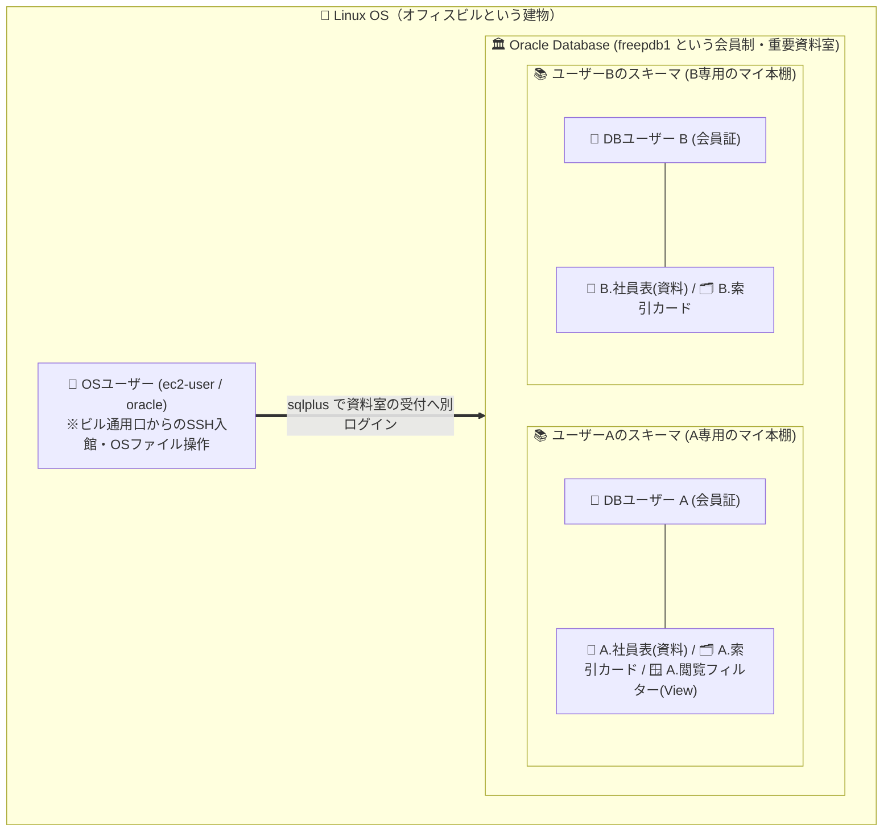

#### 🛠️ 【HOW】Oracleの正式用語とSQL仕様
- **データベース・ユーザー**: Oracleに接続するためのアカウント（`CREATE USER ユーザー名 IDENTIFIED BY パスワード;` で作成）。
- **スキーマ（Schema）**: ユーザーが所有するデータベース・オブジェクト（表、索引、ビュー等）の集合（マイ本棚）。Oracleでは**ユーザー作成時にユーザー名と同じ名前のスキーマが自動作成されます（スキーマ名 ＝ ユーザー名）**。
- **スキーマ・オブジェクト**: 特定のスキーマ（マイ本棚）の中に置かれるオブジェクト（表 `TABLE`、索引 `INDEX`、ビュー `VIEW` など）。
- **他人の本棚の資料を参照する書き方（スキーマ修飾）**:
  - 自分の本棚の表を見る時：`SELECT * FROM emp;`
  - 他人（`bold`）の本棚の表を見る時：`SELECT * FROM bold.emp;` （`スキーマ名.オブジェクト名` と記述します。※ただし後述する閲覧許可が必要です）。

> 📝 **補足（試験対策・現場Tips：非スキーマ・オブジェクトとは？）**
> 特定の個人のマイ本棚（スキーマ）の中に置かれる資料ではなく、資料室全体の共有設備・インフラにあたるオブジェクト（**表領域＝書庫フロア `TABLESPACE`、ユーザー `USER`、ロール `ROLE`、ディレクトリ `DIRECTORY`** など）は、特定の1人の所有物ではないため**「非スキーマ・オブジェクト」**と呼ばれます。

---

### Topic 2：初期管理ユーザー（`SYS` vs `SYSTEM`）と `SYSDBA`

> 📍 **現在地**：第1部（第7章：ユーザーとセキュリティ） ＞ **Topic 2/10：初期管理ユーザー（`SYS` vs `SYSTEM`）と `SYSDBA`**

#### 💬 導入（スリー・ソー）
- **そうだよね**: Windowsには `Administrator`、Linuxには `root` という「最初から用意されている最強の管理者アカウント」がありますよね。
- **そういえば**: Oracleをインストールした直後にも、`SYS` と `SYSTEM` という2つの初期管理ユーザーが存在していました。なぜ最強の管理者が1人ではなく、わざわざ2人も用意されているのでしょうか？
- **そうなんだ！**: 実は、**`SYS` は「資料室の建物ごと解体・閉館できる創設オーナー（館長）」**であり、**`SYSTEM` は「建物は壊せないけれど、日々の会員登録や本棚案内を行う窓口の司書長」**として、オペレーションミスによる大事故を防ぐために役割が分かれているんです！

#### 💡 【WHY】なぜ「何でもできる最強権限」を日常業務や一般社員に使わせてはいけないのか？
ここで少し想像してみてください。**もし社長（館長）から一般社員まで全員に「何でもできる最強の権限（`SYS`）」を渡してしまったら、現場はどうなるでしょうか？**
- 「操作としてはDBの停止も全データの消去もできてしまうけれど、ルール上やってはダメ」という状態になると、**作業する社員は「あれを触ったら会社が潰れるかも…」と細かい禁止事項をすべて暗記して毎日ビクビクしながら作業する**ことになり、**管理者は「誰かが間違ったボタンを押さないか」を24時間監視し続けなければならなくなります**。
- 逆に、最初から「建物の解体や起動・停止ができる創設オーナー（`SYS`）」と「日常運営を行う司書長（`SYSTEM`）」や「一般会員」の権限を分けておけば、日常業務において**『実行できる操作＝すべて安心して使っていい安全な操作』**というガードレールが働き、管理する側もされる側も余計な心配なく自由に行動できるようになるのです！

#### 🏢 【WHAT】比喩と全体構造図（創設オーナー兼解体業者 vs 日常運営の司書長）
- **`SYS` ユーザー（＋ `SYSDBA` 権限）** ＝ **重要資料室の「創設オーナー（館長兼・解体業者）」**。資料室全体のシャッターを下ろして閉館する（`SHUTDOWN`）、資料室を更地から建てる・壊す、資料室の設計図原本（データディクショナリ）を所有する最高権力者。開館・閉館・緊急復旧時など特別な場面で出動します。
- **`SYSTEM` ユーザー** ＝ **重要資料室の「日常運営の司書長」**。新しい会員（一般ユーザー）を登録したり本棚を案内したりする日常管理が行えますが、**資料室自体のシャッターを閉めて閉館すること（インスタンスの起動・停止）や設計図原本の破壊はできない**よう安全ロックがかかっています。

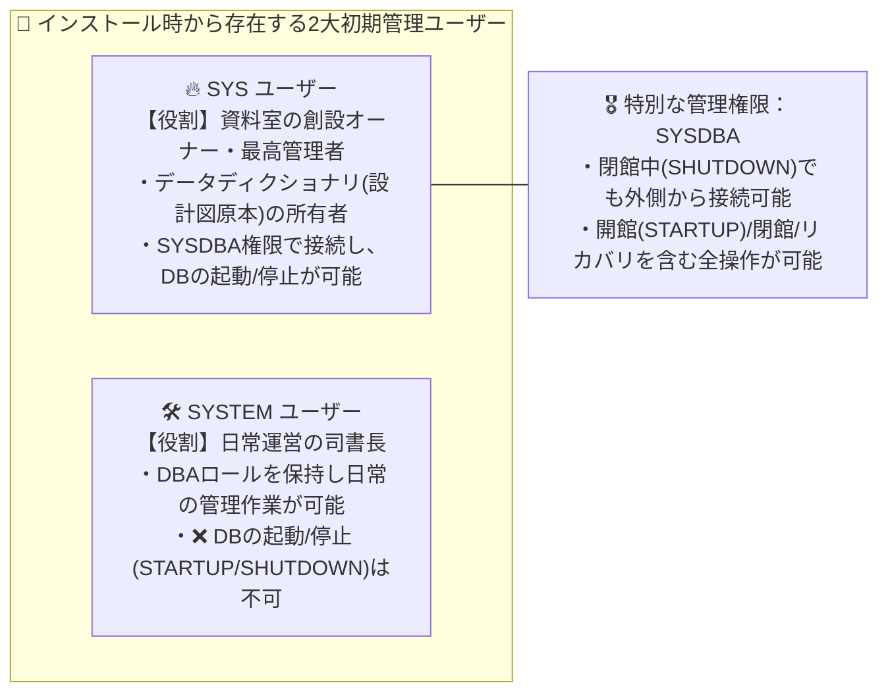

#### 🛠️ 【HOW】Oracleの正式用語と初期ユーザー比較表
| 初期ユーザー名 | 所有するもの・役割 | インスタンスの起動・停止 | 接続方法の特徴 |
| :--- | :--- | :---: | :--- |
| **`SYS`** | **データディクショナリ**（DB自身の設計図・管理台帳原本）の所有者。最高権限。 | **〇 可能** | **`AS SYSDBA`** を指定して接続する必要がある（例：`sqlplus sys/パスワード@... as sysdba`）。 |
| **`SYSTEM`** | 管理用の一時表やツール用オブジェクトを所有。**日常の管理作業用**。 | **× 不可能** | 通常のユーザーと同様に接続する（`AS SYSDBA` なしで接続）。 |

- **なぜDB停止中は `SYSDBA` が必要なのか？**:
  - 資料室が閉館（`SHUTDOWN`）している状態では、まだ館内の会員名簿（データファイル）を開くことができません。そのため、通常の会員証ではなく、建物の外側から特別なマスターキーである **`SYSDBA`** 管理権限を使って入り、`STARTUP`（開館）コマンドを発行します。

> 📝 **補足（試験対策・現場Tips：SYSDBA以外の特別な管理権限と廃止アカウント）**
> - **職務分掌用の管理権限**: 最高権限の `SYSDBA` のほかに、起動・停止はできるが本棚の資料の中身は見られない **`SYSOPER`**、バックアップ専用の **`SYSBACKUP`**、Data Guard専用の **`SYSDG`**、暗号化鍵管理専用の **`SYSKM`** が存在します。
> - **旧バージョンの初期アカウント**: 古い参考書に登場する `SYSMAN` 等は旧Enterprise Manager用のアカウントであり、現行のOracle 26aiでは使用しません。

---

### Topic 3：アカウント状態管理（ロック・期限切れ）とクォータ（`QUOTA`）・プロファイル（`PROFILE`）

> 📍 **現在地**：第1部（第7章：ユーザーとセキュリティ） ＞ **Topic 3/10：アカウント状態管理とクォータ・プロファイル**

#### 💬 導入（スリー・ソー）
- **そうだよね**: 会社の重要資料室に新入社員を会員登録するとき、司書（管理者）はただ会員証を渡すだけでなく、「最初に設定すべき3つの安全ルール（利用条件）」を決めますよね。
- **そういえば**: 具体的には、①「渡した仮の暗証番号は初回入館時にすぐ本人のものへ変更させる（退職したら会員証を一時停止する）」、②「共有の書庫フロアを1人で占領しないよう、マイ本棚に置ける資料の最大幅（容量上限）を決める」、③「暗証番号を何回間違えたらロックするか等の利用規約を適用する」という3つのルールが必要になりませんか？
- **そうなんだ！**: まさにその通り！だからOracleのユーザー管理（`CREATE USER` / `ALTER USER`）には、**①アカウント状態（`ACCOUNT LOCK` / `PASSWORD EXPIRE`）、②本棚の容量上限（クォータ `QUOTA`）、③資料室の利用規約（プロファイル `PROFILE`）**の3つをセットで管理する仕組みが備わっているんです！

#### 💡 【WHY】なぜ3つの利用条件（ガードレール）が必要なのか？
1. **不正入館の防止**: 司書が決めた初期パスワードのまま使い続けられたり、退職・異動した人の会員証が有効なまま放置されたりすると、なりすまし入館の温床になります。
2. **共有書庫（ディスク・CPU）の保護**: 1人の会員がテスト資料を無制限に本棚へ詰め込んだ結果、共有の書庫フロア（表領域）が100%満杯になると、同じフロアを使う他の業務システム全員が資料を追加できなくなり業務停止に陥ります。

#### 🏢 【WHAT】比喩と全体構造図（会員を守る3つの管理ルール）
- **① アカウント状態（`ACCOUNT LOCK` / `PASSWORD EXPIRE`）** ＝ **会員証の「一時停止（凍結）」と「初回暗証番号変更モード」**。退職・休職時は会員証を凍結（`LOCK`）して入館を止め、新規登録時は「最初の1回だけ受付を通れるが、その場で新しい暗証番号に変えないと入館できない状態（`EXPIRE`）」で渡します。
- **② クォータ（`QUOTA`：表領域の割り当て制限）** ＝ 共有書庫フロア（表領域）の中で**「あなたのマイ本棚に置ける資料は合計100MBまで！」という個人別の容量上限**。
- **③ プロファイル（`PROFILE`）** ＝ 全会員に適用される**「資料室の利用規約書」**。「暗証番号を何回間違えたらロックする」「何日ごとに暗証番号を更新する」「1回の利用時間（CPU）は何分まで」といった規定をまとめたテンプレート。

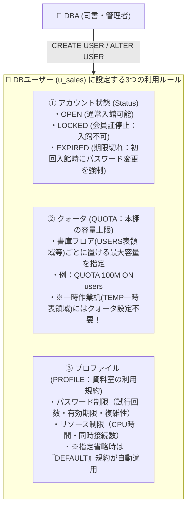

#### 🛠️ 【HOW】Oracleの正式用語・SQL構文と試験の3大鉄則
```sql
-- 新規作成時（デフォルト表領域・一時表領域・クォータ・初期パスワード期限切れを一括指定）
CREATE USER u_sales IDENTIFIED BY Pass1234
  DEFAULT TABLESPACE users
  TEMPORARY TABLESPACE temp
  QUOTA 100M ON users
  PASSWORD EXPIRE;

-- 既存ユーザーのアカウントロック／ロック解除
ALTER USER u_sales ACCOUNT LOCK;
ALTER USER u_sales ACCOUNT UNLOCK;
```

- **🎯 資格試験・実務で狙われる3大鉄則（ひっかけ対策）**:
  1. **`PASSWORD EXPIRE` の挙動**: アカウントがロック（`LOCKED`）されるわけではありません。そのユーザーが次回（初回）ログインした際に、SQL*Plus等が自動的に新しいパスワードの入力を促し、変更すればそのまま入館（ログイン）できます。
  2. **一時表領域（`TEMP`）とクォータ**: 大量データの並び替え（ディスクソート）等に使われる一時作業スペース（`TEMPORARY TABLESPACE`）には、**クォータ（`QUOTA`：本棚の所有枠）を設定する必要はありません（設定自体が不可）**。`temp` にクォータ指定がなくてもディスクソートは正常に実行できます。
  3. **プロファイル（`PROFILE`）の省略時挙動**: `CREATE USER` 文で `PROFILE` の指定を省略しても構文エラーにはならず、自動的に標準規約である **`DEFAULT` プロファイル**が割り当てられます。

> 📝 **補足（試験対策・現場Tips：QUOTAが0のときに発生する `ORA-01950` のタイミング）**
> たとえ資料を作る権利（`CREATE TABLE`）を持っていても、対象の表領域（書庫フロア）に対する `QUOTA`（本棚の容量枠）が0（未指定時のデフォルト）のままだと、表にデータを `INSERT` して物理領域（セグメント）を確保しようとした瞬間に `ORA-01950: 表領域'...'に対する権限がありません` エラーになります（※Oracleには「遅延セグメント作成」という仕組みがあり、`CREATE TABLE` で空の表紙を作った瞬間ではなく、最初の1件を `INSERT` して本棚に置こうとした瞬間に領域確保が走るためです）。

---

### Topic 4：最小権限の原則：システム権限とオブジェクト権限

> 📍 **現在地**：第1部（第7章：ユーザーとセキュリティ） ＞ **Topic 4/10：最小権限の原則（システム権限 vs オブジェクト権限）**

#### 💬 導入（スリー・ソー）
- **そうだよね**: `CREATE USER` コマンドで新しいユーザー `u1` を作成（会員登録）しました。これで `u1` さんは自分のパスワードを使って資料室（Oracle）に入れると思いますよね？
- **そういえば**: ところが、作ったばかりの `u1` でログインしようとすると、Oracleから「権限がありません、ログオンが拒否されました（`ORA-01045`）！」と受付ゲートで門前払いされてしまいます。せっかく会員登録したのに、なぜ入館すらできないのでしょうか？
- **そうなんだ！**: 実はOracleは**「最小権限の原則（作成直後はゼロ権限。明示的に許可された操作以外はできない）」**で作られているんです！そしてOracleの権限には、**「①資料室という建物全体で何ができるか（システム権限）」**と**「②館内にある『誰の本棚のどの資料』を触れるか（オブジェクト権限）」**の2種類があるんです！

#### 💡 【WHY】なぜ最初から権限を絞るのか？（管理する側もされる側も幸せになるガードレール）
Topic 2でも触れた通り、もし会員全員に「どの本棚の資料でも自由に見て書き換えられる権限」を最初から渡してしまったら、「操作としては他部署の極秘資料も消せてしまうけれど、就業規則でやってはダメ」という状態になります。これでは**利用者は「間違えて他人の資料を壊したらどうしよう」と常に萎縮し、管理者は全社員のSQL操作を監視し続けなければなりません**。
だからこそOracleでは、最初はゼロ権限からスタートし、必要な権限だけを渡します。これにより、利用者にとっては**「自分が実行できる操作＝すべてシステム的に許可された安全な操作」**となり、余計な心配なく自分の業務に100%集中できるようになります。

#### 🏢 【WHAT】比喩と全体構造図（資料室への入館・バインダー作成権 vs 他人の本棚の資料閲覧権）
- **① システム権限（System Privileges）** ＝ **「資料室（図書館）という大きな建物に入る権利や、自分の本棚に新しい資料バインダーを作る権利」**。
  - 例：「資料室の入館ゲートを通る権利（`CREATE SESSION` ※これがないとそもそも資料室に入れない！）」「自分のマイ本棚に新しい資料（表）を作って置く権利（`CREATE TABLE`）」「新しい会員を登録する権利（`CREATE USER`）」。特定の誰かの資料に対するものではないため、**『`ON 資料名`』という指定がつかない**のが特徴です。
- **② オブジェクト権限（Object Privileges）** ＝ **「資料室に入ったユーザーBさんが、そこにある『ユーザーAさんの本棚の特定の資料』を開いて見る権利や書き込む権利」**。
  - 例：「`bold` さんの本棚にある `社員表` を開いて読む権利（`SELECT ON bold.社員表`）」「そこに新しい行を書き込む権利（`INSERT ON bold.社員表`）」。対象となる特定の資料を指名するため、**『`ON スキーマ.オブジェクト名`』を指定する**のが特徴です。

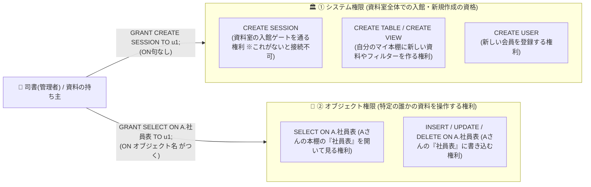

#### 🛠️ 【HOW】システム権限 vs オブジェクト権限の徹底比較表
| 比較項目 | システム権限 (System Privilege) | オブジェクト権限 (Object Privilege) |
| :--- | :--- | :--- |
| **何に対する権限か** | データベース（資料室）全体の操作、またはオブジェクトの新規作成・削除 | **特定のオブジェクト**（特定の誰かの表、ビュー、順序など）のデータ操作 |
| **代表例** | `CREATE SESSION`（資料室への入館・接続）<br>`CREATE TABLE`（表の作成）<br>`CREATE VIEW`（ビューの作成）<br>`CREATE USER`（ユーザーの作成） | `SELECT`（資料の検索・閲覧）<br>`INSERT`（データの記入・挿入）<br>`UPDATE`（データの書き換え・更新）<br>`DELETE`（データの削除） |
| **付与（GRANT）構文** | `GRANT 権限名 TO ユーザー名;` <br>（※ **`ON` 句はつかない**） | `GRANT 権限名 ON オブジェクト名 TO ユーザー名;` <br>（※ **`ON オブジェクト名` がつく**） |
| **剥奪（REVOKE）構文** | `REVOKE 権限名 FROM ユーザー名;` | `REVOKE 権限名 ON オブジェクト名 FROM ユーザー名;` |

- **🎯 重要ルール（本棚の持ち主が会員証停止になったときの他者からの閲覧）**:
  - ある会員 `user_a` のアカウントがロック（`ACCOUNT LOCK`）されたり暗証番号期限切れ（`PASSWORD EXPIRE`）になったりしても、それは「`user_a` 本人が入館ゲートを通れない」だけです。館内にある `user_a` のマイ本棚自体が撤去されるわけではないため、**すでに `user_a.emp` 資料に対する `SELECT` オブジェクト権限を持っている他の会員 `user_b` は、`user_a` がロック中であっても問題なく `user_a.emp` を開いて閲覧できます**！

---

### Topic 5：ロール（Role：役職バッジ）と権限委譲オプション（`WITH ADMIN OPTION` vs `WITH GRANT OPTION`）

> 📍 **現在地**：第1部（第7章：ユーザーとセキュリティ） ＞ **Topic 5/10：ロールと権限委譲オプションの連鎖挙動**

#### 💬 導入（スリー・ソー）
- **そうだよね**: 会員が500人いて、業務で閲覧すべき資料（表）が100冊ある会社を想像してみてください。1人ずつ100冊分の閲覧許可証を `GRANT` していたら、500人×100冊＝50,000回も手続きが必要になり、人事異動のたびに付与漏れや回収漏れが起きますよね。
- **そういえば**: 会社の入館システムでも、個人に直接100枚の許可証を渡すのではなく、「営業部バッジ」「一般社員バッジ」という『役職バッジ（ロール）』に許可をまとめて登録しておき、そのバッジを社員に渡しますよね。また、「他の人に権限を分け与える（委譲する）オプション」を使ったとき、後から中間の人の権限を取り消したら、その先の人の権限はどうなるのでしょうか？
- **そうなんだ！**: それがOracleの**「ロール（Role）」**と**「権限委譲オプション」**です！そして委譲オプションでは、**「その権限に『特定の個人の持ち主（オーナー）』がいるかどうか」によって、親から権限を取り上げたときに子の権限まで消えるか・残るかが決まる**という、極めて合理的なルールがあるんです！

#### 💡 【WHY】なぜシステム権限の委譲は連鎖せず、オブジェクト権限の委譲は連鎖するのか？
丸暗記ではなく、「誰の持ち物か？」という本質（WHY）から理解すると一生忘れません。
1. **システム権限（`WITH ADMIN OPTION`）には「特定の個人の持ち主」がいない**:
   - 「資料室に入館する権利（`CREATE SESSION`）」や「新しい会員を登録する権利（`CREATE USER`）」は、資料室全体の公的な資格です。人事・司書担当のAさんが、その採用権限を使って新入社員Bさんに入館証を発行したあと、Aさんが他部署へ異動して採用権限を失った（`REVOKE`された）からといって、**過去にAさんが正規の手続きで採用した社員Bさんの入館証まで無効になってしまったら会社が困りますよね？だからシステム権限の剥奪は連鎖しません（子は残る）**。
2. **オブジェクト権限（`WITH GRANT OPTION`）には「明確な個人の持ち主（オーナー）」がいる**:
   - 「Aさんのマイ本棚にある『Aさんの社員表』を見る権利（`SELECT ON A.emp`）」は、**持ち主であるAさんの私物の貸し出し**です。持ち主AさんがBさんに「私の資料を見ていいよ。必要ならCさんにも又貸ししていいよ」と許可したあと、Aさんが「やっぱりBさんに貸すのはやめた（`REVOKE`）！」と私物を引き上げたなら、**BさんがCさんに又貸ししていた閲覧権も当然すべて一緒に回収されます（子も芋づる式に消える＝連鎖する）**。

#### 🏢 【WHAT】比喩と全体構造図（役職バッジと「公的資格の発令 vs 私物の又貸し」）
- **ロール（Role）** ＝ 複数のシステム権限やオブジェクト権限、さらには別のロールまで束ねて登録しておける**「役職バッジ（腕章）」**。
- **`WITH ADMIN OPTION`（システム権限・ロールの委譲）** ＝ **「公的な資格発令（代行任命）」**。特定の個人の所有物ではないため、任命担当者Bの権限が取り消されても、Bが過去に発令したCの資格は**そのまま有効に残ります（連鎖しない）**！
- **`WITH GRANT OPTION`（オブジェクト権限の委譲）** ＝ **「Aさんの私物（本棚の資料）の又貸し許可」**。明確な持ち主（オーナーAさん）がいるため、持ち主AさんがBさんからの貸出を取り上げたら、BさんがCさんに又貸ししていた権利も**すべて回収されて消滅します（連鎖する）**！

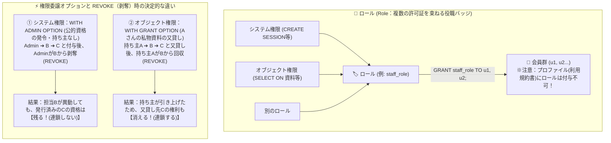

#### 🛠️ 【HOW】ロールの4大仕様と委譲オプション比較表
- **🎯 ロールの重要仕様（試験頻出の4大チェックポイント）**:
  1. ロールには、**システム権限とオブジェクト権限の両方**を含めることができます（後半のハンズオン実験2で実践します）。
  2. **ロールの中に別のロールを付与（階層化・ネスト）することも可能**です。
  3. ロールは「ユーザー」または「別のロール」に付与するものであり、**「プロファイル（`PROFILE`：利用規約書）」に対してロールを付与することはできません**。
  4. ロールの作成（`CREATE ROLE`）は `SYSDBA` に限定されておらず、`CREATE ROLE` システム権限（または `DBA` ロール）を持つ管理ユーザーであれば実行できます。

- **🎯 権限委譲オプション比較表**:
  | 比較項目 | `WITH ADMIN OPTION` | `WITH GRANT OPTION` |
  | :--- | :--- | :--- |
  | **対象となるもの** | **システム権限** および **ロール**（特定の個人の所有物ではない） | **オブジェクト権限**（明確な所有者＝オーナーがいる私物） |
  | **付与構文の例** | `GRANT CREATE TABLE TO b WITH ADMIN OPTION;` | `GRANT SELECT ON emp TO b WITH GRANT OPTION;` |
  | **A➔B➔Cと委譲後、AがBからREVOKEした時、Cの権限はどうなる？** | **Cの権限は残る（連鎖しない）** | **Cの権限も同時に消滅する（連鎖する）** |

> 📝 **補足（試験対策・現場Tips：最初から用意されている代表的な事前定義ロール）**
> - **`DBA`**: データベース管理者用の強力なロール（ほぼすべてのシステム権限を含む。※ただし `SYSDBA` 管理権限ではないためインスタンスの起動・停止は含みません）。
> - **`CONNECT`**: 資料室へ入館（接続）するためのロール（`CREATE SESSION` 権限を含む）。
> - **`RESOURCE`**: 開発者向けのロール（`CREATE TABLE` など基本的なスキーマオブジェクト作成権限を含む）。
> - **`SELECT_CATALOG_ROLE`**: データディクショナリビューを参照するためのロール。

---

## 📝 練習問題①：第7章【本質編 5問】（00:30 - 00:38 / 8分間）

> 📍 **現在地**：第1部まとめ ＞ **📝 練習問題①：第7章【本質編 5問】（Google Forms）**

ここで前半（第7章：ユーザーおよびセキュリティの管理）の理解を定着させるため、Google Formsで**練習問題①（Q1〜Q5：本質編）**にチャレンジしましょう！（回答4分 ＋ ポイント解説4分）
- **確認する5つの設計判断軸**:
  1. なぜビル通用口（OSユーザー）と資料室の会員証・マイ本棚（DBユーザー・スキーマ）を分離するのか？
  2. なぜ日常の定型運用で創設オーナー（`SYS`）の最強権限をそのまま使わないのか？
  3. 共有の書庫フロア（表領域）を1人のユーザーが占領する事故をどう予防するか？
  4. 最小権限の原則に基づき、入館証（システム権限）と他人の資料の閲覧許可（オブジェクト権限）をどう組み合わせるか？
  5. 役職バッジ（ロール）という中間層を導入することで権限管理はどう改善されるか？

---

## 第2部：第8章 スキーマオブジェクトの管理（00:38 - 01:03）

---

### Topic 6：スキーマオブジェクトの全体像と「表（Table）・基本データ型」

> 📍 **現在地**：第2部（第8章：スキーマオブジェクト） ＞ **Topic 6/10：表（資料）と基本データ型（記入欄テンプレート）**

#### 💬 導入（スリー・ソー）
- **そうだよね**: 第7章で、重要資料室の中に自分の「マイ本棚（スキーマ）」を作って入館する方法がわかりました。本棚の前に立ったら、いよいよ情報を記録するための**「資料（表：Table）」**を作って並べていきますよね。
- **そういえば**: Excelや紙の自由記述ノートでは、金額を書くはずの欄にうっかり「未定」という文字を書いてしまったり、日付の書き方が人によってバラバラで集計できなくなったりした経験はありませんか？
- **そうなんだ！**: だからRDBMSでマイ本棚に「資料（表：Table）」を作るときは、最初に白紙の台帳を作る時点で**「この項目（列）には、どういう形式でデータを記入するか」という『記入欄テンプレート（データ型：`VARCHAR2`, `CHAR`, `NUMBER`, `DATE`）』を厳格に決める**んです！

#### 💡 【WHY】なぜ資料（表）の列ごとに厳密な「記入欄テンプレート（データ型）」を定義するのか？
列ごとに記入フォーマット（データ型や最大文字数）を定義しないと、数値計算の欄に文字列が混入して業務プログラムが異常終了したり、不要な空白文字で本棚のスペース（ディスク容量）を浪費したりします。記録したい情報の性質（「氏名」のように人によって文字数が変わるのか、「都道府県コード」のように文字数が固定なのか、計算する数値なのか、日付なのか）に応じた最適なテンプレートを選ぶ必要があります。

#### 🏢 【WHAT】比喩と全体構造図（マイ本棚に置く資料と、4つの記入欄テンプレート）
- **表（`TABLE`）** ＝ マイ本棚に置く**「情報をまとめた資料（台帳バインダー）」**。
- **データ型（Data Types）** ＝ 資料の各列に設定する**「記入欄テンプレート（フォーマット）」**：
  - **`VARCHAR2(n)`（可変長文字型）** ＝ **「書いた文字数に合わせて枠が縮む可変テキスト欄」**。最大10バイトの欄に3文字（`'ABC'`）記入したら、実データ分の3バイトしか本棚の容量を使いません（無駄がないため最もよく使う標準の文字列型）。
  - **`CHAR(n)`（固定長文字型）** ＝ **「マス目の数が固定された原稿用紙欄」**。10マスの欄に3文字（`'ABC'`）しか書かなくても、残り7マス分は後ろに空白（スペース `'ABC       '`）が自動で埋められて常に10バイト分の容量を消費します。
  - **`NUMBER(p, s)`（数値型）** ＝ 金額や数量など、電卓で計算できる数字専用の記入欄。
  - **`DATE`（日付型）** ＝ カレンダーと時計（年月日時分秒）がセットになった日付専用の記入欄。

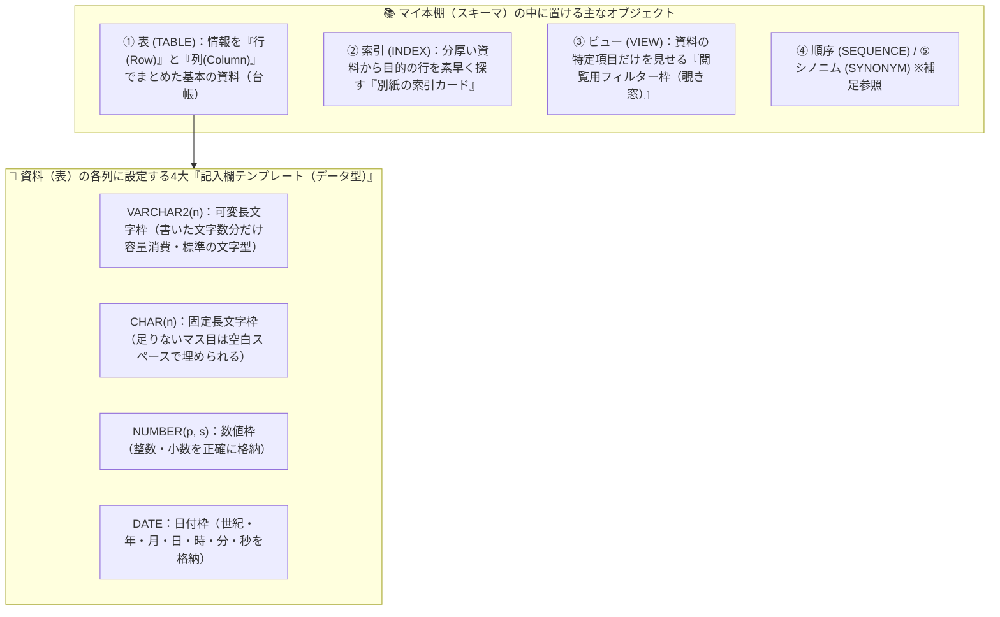

#### 🛠️ 【HOW】表作成の基本SQL構文とデータ型の仕様
```sql
CREATE TABLE emp (
  emp_id    NUMBER(6),       -- 最大6桁の数値枠
  emp_name  VARCHAR2(30),    -- 最大30バイトの可変長文字枠
  dept_code CHAR(4),         -- 固定長4バイトの文字枠
  hire_date DATE             -- 日付枠（年月日時分秒）
);
```
- **🎯 データ型の試験ポイント**:
  - Oracleで可変長文字列を扱う際は **`VARCHAR2(サイズ)`** を使用します。
  - `CHAR(10)` 列に `'ABC'`（3バイト）を格納すると、後ろに7つの空白が埋められて10バイト分消費します。一方、`VARCHAR2(10)` 列に `'ABC'` を格納すると、実データの長さである3バイト分だけ領域を消費します。

> 📝 **補足（試験対策・現場Tips：順序 `SEQUENCE` と シノニム `SYNONYM`）**
> 表・索引・ビューのほかに、マイ本棚に置かれる代表的なオブジェクトとして以下の2つがあります。
> - **順序（`SEQUENCE`）**: 資料の受付番号や社員番号などを「1, 2, 3...」と重複なく自動発番してくれる「自動ナンバリングスタンプ（番号発券機）」。
> - **シノニム（`SYNONYM`）**: 他人の本棚の長い資料名（例：`bold.emp_secret`）に対して、短い別名（ラベル）をつけるオブジェクト。

---

### Topic 7：データの整合性を守る「5つの書き方ルール（5大制約：Constraints）」

> 📍 **現在地**：第2部（第8章：スキーマオブジェクト） ＞ **Topic 7/10：データの整合性を守る「5つの書き方ルール（5大制約）」**

#### 💬 導入（スリー・ソー）
- **そうだよね**: Topic 6の「記入欄テンプレート（データ型）」を決めれば、「社員番号の欄に文字を書いてしまう」といった書式ミスは防げますよね。
- **そういえば**: でも、もし記入する人がうっかり「新入社員の社員番号欄を『空欄（NULL）』のまま提出した」とか、「すでに存在する田中さんと同じ社員番号『101番』を佐藤さんの行にも重複して書いてしまい、給料が二重振り込みになった」らどうしますか？「Web画面の入力チェックで弾けばいい」と思うかもしれませんが、もし別システムの夜間バッチや手動SQLから直接資料に書き込まれたら突破されてしまいますよね？
- **そうなんだ！**: だからこそ、最後の砦であるデータベースの資料（表）自体に**「このテンプレートにはこう書かなければ受け付けない！という『5つの書き方ルール（5大制約）』」**を設定するんです！特に**「主キー（`PRIMARY KEY`）」と「一意制約（`UNIQUE`）」の書き方ルールの違い**は開発でも試験でも最重要ポイントです！

#### 💡 【WHY】なぜアプリ側のチェックだけでなくDBの資料自体にも「書き方ルール（制約）」を課すのか？
実際のシステムでは、Web画面からだけでなく、夜間バッチ処理、外部システム連携、保守担当者の手動SQLなど複数の窓口から資料（表）へデータが書き込まれます。アプリケーション側の入力チェックだけに頼ると、プログラムのバグや別ルートからの書き込みによって「重複した背番号」「必須項目の記入漏れ（NULL）」「実在しない部署コード」「マイナス金額」などの不正な記述が混入し、資料室全体の信頼性（データ整合性）が崩壊します。資料（表）自体に書き方ルール（制約）を定義しておけば、どのルートからの書き込みであってもOracleが自動的に違反を検知して拒絶してくれます。

#### 🏢 【WHAT】比喩と全体構造図（資料テンプレートに対する「5つの書き方ルール」）
1. **`NOT NULL`（非NULL制約）** ＝ **「空欄（記入漏れ）禁止ルール」**。「氏名欄が白紙（NULL）の行は登録を受け付けません！」
2. **`UNIQUE`（一意制約）** ＝ **「重複記入禁止ルール（※空欄はOK）」**。「メールアドレスや個人番号が他の行とダブるのはダメ！ただし、まだ発行されておらず空欄（NULL）の人が複数行いるのは許します。」
3. **`PRIMARY KEY`（主キー制約）** ＝ **「1行を特定する背番号ルール（`NOT NULL` ＋ `UNIQUE` の最強セット）」**。「社員番号は、他の行とのダブり（重複）も、空欄（NULL）も一切許さない！1つの資料（表）につき1つだけ設定できる絶対の背番号！」
4. **`FOREIGN KEY`（外部キー制約／参照整合性制約）** ＝ **「親マスタ照合ルール」**。「別資料である『部署マスタ表』に実在する部署コード（またはNULL）しか記入できません！（存在しない架空の部署コードは拒否）」
5. **`CHECK`（チェック制約）** ＝ **「条件チェックルール」**。「給与（salary）欄には『0以上（`salary >= 0`）』を満たす数値しか記入できません！」

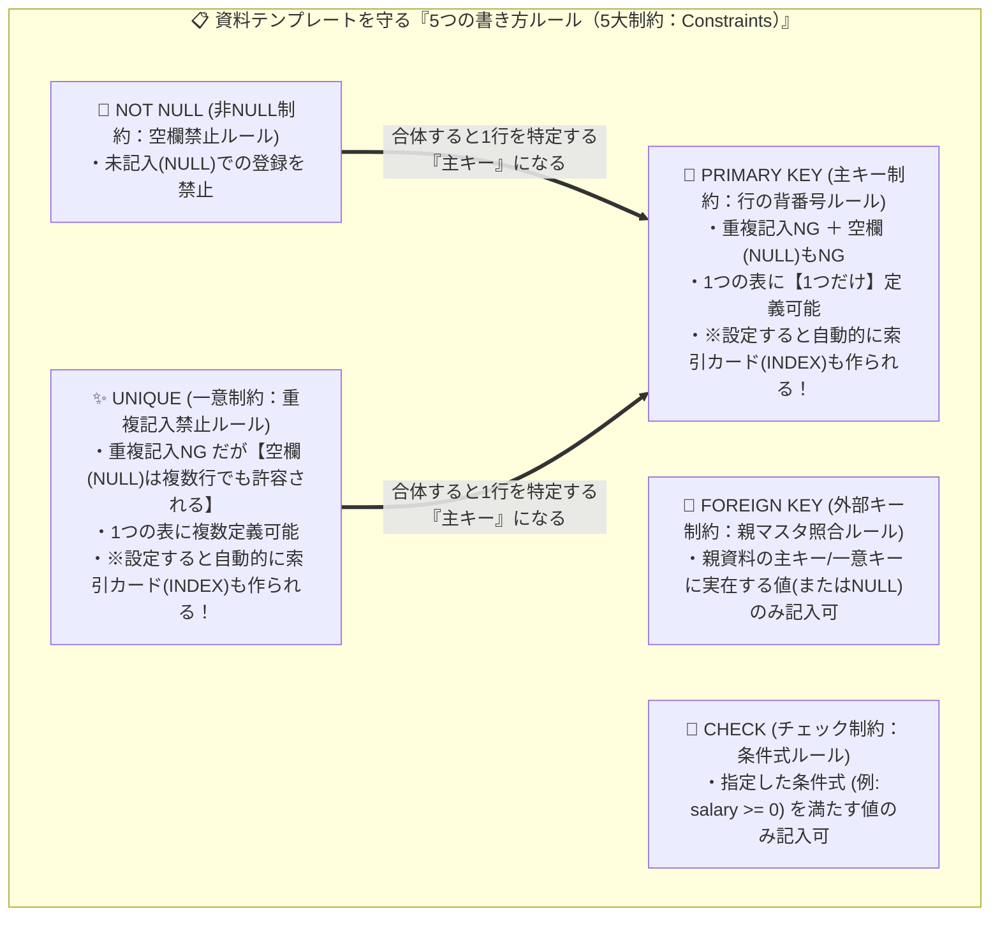

#### 🛠️ 【HOW】5大制約の徹底比較マトリクスとSQL構文
| 制約名（書き方ルール） | キーワード | 重複値の記入 | NULL（空欄）の記入 | 1つの表に複数定義できるか | 自動でINDEXが作られるか |
| :--- | :--- | :---: | :---: | :---: | :---: |
| **主キー制約** | `PRIMARY KEY` | **× 不可**（`ORA-00001`） | **× 不可**（`ORA-01400`） | **× 不可（1表につき1つ）** | **〇 自動作成される** |
| **一意制約** | `UNIQUE` | **× 不可**（`ORA-00001`） | **〇 可能（複数行でも可）** | **〇 可能** | **〇 自動作成される** |
| **非NULL制約** | `NOT NULL` | 〇 可能 | **× 不可**（`ORA-01400`） | 〇 可能 | × 作られない |
| **外部キー制約** | `FOREIGN KEY` (`REFERENCES`) | 〇 可能 | 〇 可能 | 〇 可能 | × 作られない |
| **チェック制約** | `CHECK (条件)` | 〇 可能 | 〇 可能 | 〇 可能 | × 作られない |

```sql
CREATE TABLE emp_secret (
  emp_id    NUMBER(4)    PRIMARY KEY,          -- 主キー（重複NG・空欄NG・自動でINDEX作成）
  emp_name  VARCHAR2(20) NOT NULL,             -- 非NULL（空欄NG）
  dept_name VARCHAR2(20),
  salary    NUMBER(10)   CHECK (salary >= 0)   -- チェック制約（0以上のみ記入可）
);
```

---

### Topic 8：索引（Index）の仕組みと「光と影（更新時の書き直しオーバーヘッド）」

> 📍 **現在地**：第2部（第8章：スキーマオブジェクト） ＞ **Topic 8/10：索引（Index）の仕組みと更新性能劣化のトレードオフ**

#### 💬 導入（スリー・ソー）
- **そうだよね**: 資料室にある1,000ページの分厚い社員台帳から「鈴木さん」の行を探すとき、1ページ目から最後のページまで全部めくって探す（全表走査：Full Scan）のは大変ですよね。別紙の「索引カード（インデックス）」を見れば、「鈴木さんは245ページの3行目！」と一瞬で開けますよね。
- **そういえば**: だから開発現場でも「検索（SELECT）を速くしたいなら、資料にある15個すべての項目（列）について別紙の索引カード（INDEX）を作っておけばいいのでは？」と要望が出ることがあります。でも、もし15種類の索引カードを作ったら、資料に新しい社員を1行書き加える（INSERTする）ときに何が起きると思いますか？
- **そうなんだ！**: 実は、**索引カードを作るということは、元の資料（表）の内容が変わる（追加・更新・削除される）たびに、それに合わせて別紙の索引カードも毎回すべて書き直して更新する必要がある**んです！だから索引カードを作りすぎると、**検索は速くなっても、データを書き込むときの更新オーバーヘッド（性能劣化）が跳ね上がる（トレードオフ）**んです！

#### 💡 【WHY】なぜ索引（INDEX）を増やすと書き込み（INSERT/UPDATE/DELETE）が遅くなるのか？
数百万行の資料（表）から特定のデータを探す際、1ページ目から全ブロックを読み込むと大量のディスクI/Oが発生します。別紙の「索引カード（INDEX）」を作れば、検索（`SELECT`）時のディスクI/Oを劇的に減らせます。
しかし、**元の資料（表）に1行データを追加（`INSERT`）したり書き換え（`UPDATE`）・削除（`DELETE`）したりするたび、Oracleは裏で自動的に「関連するすべての索引カード」も正しい順番に並べ替えて書き直す（自動メンテナンスする）**仕様になっています。もし1つの資料に15枚の索引カードが付いていたら、本体を1行書くたびに15枚の索引カードの書き直しが走るため、更新処理が重くなってしまうのです。

#### 🏢 【WHAT】比喩と全体構造図（別紙の索引カードによる高速検索 vs 毎回のカード書き直し負荷）
- **☀️ 索引（Index）の『光』（メリット）** ＝ **「別紙の索引カード（五十音順・番号順の早見表）」**。探したいキーワードと、その行が書かれている物理的なページ・行番号（`ROWID`）をペアで記録しておくことで、ディスクを読む回数（I/O）を大幅に減らし、`SELECT` を高速化します。
- **🌑 索引（Index）の『影』（デメリット・副作用）** ＝ **「資料を書き換えるたびに発生する、索引カードの書き直しオーバーヘッド」**。本体の資料（表）が変更（`INSERT` / `UPDATE` / `DELETE`）されるたび、Oracleが裏で自動的にすべての索引カードを書き直します。そのため、使われない索引カードをむやみに乱造すると書き込み性能が劣化します。

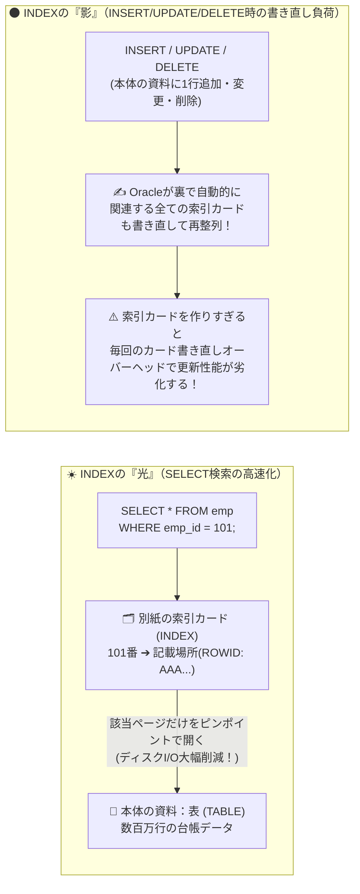

#### 🛠️ 【HOW】索引の基本SQL構文と「試験に出る5大仕様」
```sql
-- 単一列の索引作成
CREATE INDEX idx_emp_dept ON emp_secret(dept_name);

-- 複合索引（複数の列を組み合わせた索引カード）の作成
CREATE INDEX idx_emp_dept_name ON emp_secret(dept_name, emp_name);
```

- **🎯 資格試験・過去問で問われる「索引の5大仕様」（完全網羅）**:
  1. **自動メンテナンス**: 表のデータが更新（`INSERT` / `UPDATE` / `DELETE`）されると、**索引はOracleによって自動的にメンテナンス（書き直し・更新）されます**（人間が手動で索引を更新する必要はありませんが、その分DML更新時のオーバーヘッドが生じます）。
  2. **複数列への作成（複合索引）**: 索引は1つの列だけでなく、**表の複数の列を組み合わせて1つの索引を作成できます**（複合索引）。
  3. **重複値のある列への作成**: 主キーのような一意（ユニーク）な列だけでなく、**重複値やNULLを含む通常の列（部署名 `dept_name` など）にも作成できます**。
  4. **自動作成タイミング**: 表に **`PRIMARY KEY`（主キー）制約または `UNIQUE`（一意）制約を定義すると、裏で自動的に一意索引が作成されます**。
  5. **親テーブル削除時の運命**: 元の資料である表を **`DROP TABLE` で削除（廃棄）すると、その表に付属していた索引カード（INDEX）も道連れで自動的に削除（消滅）されます**（「無効になって残る」のではありません！※次のVIEWとの決定的な違いです）。

---

### Topic 9：ビュー（View）の正体と2大目的 ＆ 親テーブル `DROP` 時の連鎖

> 📍 **現在地**：第2部（第8章：スキーマオブジェクト） ＞ **Topic 9/10：ビュー（閲覧用フィルター窓）と `DROP TABLE` 時の連鎖**

#### 💬 導入（スリー・ソー）
- **そうだよね**: 資料室のマイ本棚にある「社員秘密台帳（`emp_secret` 表）」には、「社員番号・名前・部署」といった公開項目だけでなく、「年収」や「人事評価」といった極秘項目も同じ1冊の台帳に記入されていますよね。
- **そういえば**: 一般社員に社内名簿を見せるために、元の台帳そのものへの閲覧許可（`GRANT SELECT ON emp_secret`）を渡してしまったら、裏でSQLを叩けば同僚の「年収欄」まで丸見えになってしまいます！かといって「年収欄を除いた別冊の台帳」を物理的に書き写して（コピーして）もう1冊作ったら、部署異動のたびに2冊とも書き直さなければならずデータがズレてしまいますよね？
- **そうなんだ！**: それを解決する仕組みが**「ビュー（View：閲覧用フィルター窓）」**です！ビュー自身は**実データを1行も持たず、「元の資料の特定の列や行だけを抜き出して見せるSELECT文」に名前をつけて保存した『閲覧用フィルター枠（仮想の表）』**なんです！

#### 💡 【WHY】なぜ別冊の表を物理コピーするのではなく「ビュー（閲覧用フィルター）」を使うのか？
1. **二重管理なしのアクセス制限（機密保護）**: 実データを別冊として複製することなく（本棚の容量消費や、元資料更新時の同期ズレを起こさずに）、機密欄（年収など）をマスキングして隠した「閲覧用フィルター窓」だけを公開して閲覧権限を付与するため。
2. **複雑なSQLの簡素化**: 複数の資料を突き合わせ（JOIN）たり集計したりする複雑な手順をあらかじめビューとして登録しておき、利用者がシンプルな `SELECT * FROM ビュー名` だけで必要な情報を引き出せるようにするため。

#### 🏢 【WHAT】比喩と全体構造図（年収欄を隠す閲覧用フィルター枠 ＆ 元資料廃棄時の連鎖）
- **ビュー（View）** ＝ 元の資料の上に重ねて覗く**「特定項目だけをくり抜いた閲覧用フィルター枠（実データを持たない仮想の表）」**。フィルター枠自体には文字（実データ）は書かれておらず、フィルターを通して覗いた（`SELECT` した）瞬間に、裏で登録された `SELECT` 文が実行されて元の資料の公開項目だけが透けて見えます。
- **💥 大元の資料（親テーブル）を `DROP TABLE`（廃棄）したときの運命の分かれ道**:
  - **データ・索引カード（INDEX）・書き方ルール（制約）** ＝ 元の資料バインダーに直接挟み込まれている「ページ・別紙の索引カード・表紙の記入規約」。バインダーごとシュレッダーで廃棄（`DROP`）したら**すべて一緒に消滅（削除）**します。
  - **ビュー（View）** ＝ 別の棚に置かれた「『あの資料の1列目と2列目を見る』と書かれたプラスチックの閲覧用フィルター枠（独立したオブジェクト）」。大元の資料バインダーが廃棄されてもフィルター枠自体は消えずに残りますが、いざフィルターを覗き込む（`SELECT` する）と「見る先の元資料がありません！（**無効：`INVALID` 状態**）」とエラー（`ORA-04063`）になります！

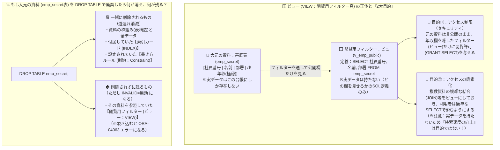

#### 🛠️ 【HOW】ビューの基本SQL構文と「試験に出る4大鉄則」
```sql
-- 機密列（salary）を除外した公開用ビュー（閲覧フィルター）の作成
CREATE OR REPLACE VIEW v_emp_public AS
  SELECT emp_id, emp_name, dept_name FROM emp_secret;

-- 一般会員には「元の資料(emp_secret)」ではなく「閲覧フィルター(v_emp_public)」のSELECT権限だけを付与する！
GRANT SELECT ON v_emp_public TO u1;
```

- **🎯 資格試験・過去問で押さえるべき4大鉄則**:
  1. **ビューの2大目的**: **「① アクセス制限（セキュリティ保護）」** と **「② アクセスの簡素化（複雑クエリの隠蔽）」** の2つです。
  2. **目的のひっかけ対策**: **「× 検索速度の向上」はビューの目的ではありません！**（通常のビューは実データを持たず、アクセス時に毎回元の表へSELECTを発行するためです。速度向上は「索引（INDEX）」や「マテリアライズド・ビュー」の役割です）。また「× 権限管理の簡素化」は「ロール（Role）」の目的です。
  3. **ビュー参照時の権限ルール（実験2で実証）**: 一般ユーザー（`u1`）にビューを検索させる場合、**ビュー（`v_emp_public`）に対する `SELECT` 権限さえ付与すればよく、元の基底表（`emp_secret`）に対する `SELECT` 権限を付与する必要はありません**（もし元の資料自体のSELECT権限まで付与してしまうと、年収欄まで直接めくって見ることができてしまい、閲覧フィルターを作った意味がなくなります！）。
  4. **`DROP TABLE` 時の消滅リスト（実験3で実証）**:
     - **削除される（消える）**: ①表構造、②表内のデータ、③**索引（INDEX）**、④**制約（Constraint）**
     - **削除されない（無効 `INVALID` になって残る）**: **ビュー（VIEW）**

---

### Topic 10：大量データの移動ツール（`SQL*Loader` vs `Oracle Data Pump`）

> 📍 **現在地**：第2部（第8章：スキーマオブジェクト） ＞ **Topic 10/10：大量データの移動ツール（`SQL*Loader` vs `Data Pump`）**

#### 💬 導入（スリー・ソー）
- **そうだよね**: 資料（表）にデータを1行ずつ手書きで記入するときは、`INSERT INTO 表 VALUES (...)` を使いますよね。
- **そういえば**: でも、もし外部の取引先から届いた「100万行の紙の原稿束（CSVファイル）」を資料室の台帳へ書き写すことになったり、本館の資料室にある「マイ本棚（スキーマ）の資料一式1,000万行」を別館の新しい資料室へ丸ごと引っ越し（複製）することになったら、100万回 `INSERT` 文を手書きしますか？日が暮れてしまいますよね！
- **そうなんだ！**: そこで登場するのが、Oracleが備える2大大量データ移動ツール**「`SQL*Loader`（外部のCSV原稿束を指示書通りに資料へ一括転記する高速自動転記マシン）」**と**「`Oracle Data Pump`（本棚の資料を専用コンテナ `.dmp` に詰めて別館へ丸ごと運ぶ専用引っ越し便）」**なんです！

#### 💡 【WHY】なぜ通常の `INSERT` 文ではなく2種類の専用ツールを使い分けるのか？
数百万件のデータを通常の `INSERT` 文で1件ずつ処理すると、SQL構文解析や通信のオーバーヘッドで膨大な時間がかかります。また、「① 資料室の外から届いた異種フォーマットの原稿束（CSVテキスト等）を、区切りルールに沿って台帳へ一気に転記する場面」と、「② Oracle資料室から別のOracle資料室へ、本棚の構造や資料データを丸ごと梱包して高速移送・保管する場面」では扱うデータの性質が異なるため、それぞれに特化した専用ツールを使い分けます。

#### 🏢 【WHAT】比喩と全体構造図（外部原稿の高速自動転記マシン vs 資料室専用の引っ越しコンテナ便）
- **`SQL*Loader`（`sqlldr` コマンド）** ＝ **「外部から届いた大量のCSV原稿束を、指示書（制御ファイル `.ctl`）通りに台帳へ一気に書き写す『高速自動転記マシン』」**。OS上の外部テキストファイル（`.csv` 等）を、どういう区切り文字でどの列に転記するかを書いた指示書（**制御ファイル `.ctl`**）に従って一括ロードします。記入ルール違反で弾かれた不良行は `.bad` ファイルへ自動で仕分けられます。
- **`Oracle Data Pump`（`expdp` / `impdp` コマンド）** ＝ **「本棚や資料を専用コンテナ（ダンプファイル `.dmp`）に梱包して別館へ丸ごと運ぶ『資料室専用の引っ越しコンテナ便（論理バックアップ）』」**。Oracleの表やマイ本棚（スキーマ）を、Oracle専用のバイナリ圧縮コンテナ（**ダンプファイル `.dmp`**）に梱包して搬出（エクスポート：`expdp`）し、別のOracle（または同じOracle）へ高速に搬入・復元（インポート：`impdp`）します。

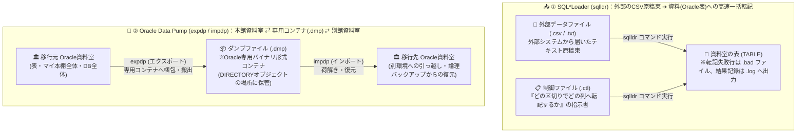

#### 🛠️ 【HOW】`SQL*Loader` と `Oracle Data Pump` の徹底比較表
| 比較項目 | `SQL*Loader`（高速自動転記マシン） | `Oracle Data Pump`（専用引っ越しコンテナ便） |
| :--- | :--- | :--- |
| **OSコマンド名** | `sqlldr` | エクスポート：`expdp` ／ インポート：`impdp` |
| **主な用途（いつ使う？）** | **OS上の外部ファイル（CSVや固定長テキスト）**からOracleの表へ大量データを一括ロードするとき | **Oracleデータベース間で高速にデータを移動**するとき、または**表・スキーマ単位で論理バックアップ（退避・復元）**するとき |
| **使用するファイル** | ・**データファイル**（`.csv` 等：テキスト形式の実データ）<br>・**制御ファイル**（`.ctl`：ロード方法の指示書）<br>・ログファイル（`.log`）、不良ファイル（`.bad`） | ・**ダンプ・ファイル**（`.dmp`：Oracle独自の**バイナリ形式**ファイル。テキストエディタでは直接読めない） |
| **方向性** | 外部ファイル ➔ Oracle表（**ロード専用**） | Oracle ➔ `.dmp`（`expdp`）および `.dmp` ➔ Oracle（`impdp`）の**双方向** |

- **🎯 論理バックアップ（Data Pump）と物理バックアップ（RMAN）の区別**:
  - `Oracle Data Pump` は特定の資料（表）やマイ本棚（スキーマ）単位でデータを抜き出す**「論理バックアップ」**であり、うっかり資料を `DROP TABLE` で廃棄してしまったときの単位復元や環境間移行に活躍します。一方、サーバーのディスク故障（書庫自体の火災・破損＝メディア障害）に備えてデータファイル（`.dbf`）や制御ファイル・REDOログを丸ごと保護する**「物理バックアップ」には、第5回で学ぶ `RMAN`（Recovery Manager）を使用します**（Data Pumpは物理バックアップの代替にはなりません）。

---

## 📝 練習問題②：第8章【本質編 5問】（01:03 - 01:10 / 7分間）

> 📍 **現在地**：第2部まとめ ＞ **📝 練習問題②：第8章【本質編 5問】（Google Forms）**

後半（第8章：スキーマオブジェクトの管理）の座学内容について、Google Formsで**練習問題②（Q6〜Q10：本質編）**を解いて頭の中を整理しましょう！（回答4分 ＋ ポイント解説3分）
- **確認する5つの設計判断軸**:
  1. 画面プログラムの入力チェックがあるのに、なぜDBの資料（表）側にも「書き方ルール（制約）」を定義すべきなのか？
  2. 「空欄を許さない行の背番号（主キー）」と「空欄を許容する重複記入禁止ルール（一意制約）」をどう使い分けるか？
  3. 別紙の索引カード（INDEX）をむやみに多くの列へ作ると、なぜ資料の書き込み（更新）性能が劣化するのか？
  4. 別冊の資料を物理コピーするのではなく、実データを持たない「閲覧用フィルター（ビュー）」を使う利点は何か？
  5. 大量データの投入・移行において、なぜ通常の `INSERT` 文ではなく2種類の専用ユーティリティを使い分けるのか？

---

## ☕ 中盤リフレッシュコーナー：エンジニアの脳と身体のリセット術（01:10 - 01:20 / 10分間）

> 📍 **現在地**：中盤リフレッシュ ＞ **☕ 休憩 ＆ 上半身ストレッチ・スタンフォード流ミニNSDR**

ここまで約70分間、第7章・第8章の濃密なアーキテクチャをインプット＆アウトプットしてきました。
後半の実機ハンズオンと専門編クイズに向けて、**前半5分のフリー休憩**と**後半5分の「身体ほぐし＆ミニNSDR（科学的脳リセット）」**を行います！

### 📵 前半5分（01:10 - 01:15）：完全フリー休憩（デジタル・デトックスのお願い）
- トイレ・水分補給を済ませてください。
- **💡 なぜ休憩中にスマホを見てはいけないのか？（脳科学の知見）**:
  - 脳が消費するエネルギーの約80%は「視覚情報の処理」に使われます。休憩時間にスマホでSNSやチャット・ニュースを読むと、海馬（短期記憶の作業机）に新しい文字情報が次々と流し込まれ、**直前の授業で学んだ第7章・第8章の記憶が上書き（干渉）されて消えてしまいます**。この5分間は画面から目を離して過ごしましょう！

### 🧘‍♂️ 後半5分（01:15 - 01:20）：講師と一緒に実践！「上半身ストレッチ ＆ ミニNSDR」

#### STEP 1：デスクワーカーのための上半身（肩甲骨・首・胸郭）ほぐし（2分）
PC作業で固まった「巻き肩」と「首の緊張」を解き、脳へ酸素たっぷりの血液を送ります。
1. **胸郭オープン（肩甲骨はがし）**:
   - 背筋を伸ばし、両手を背中の後ろで組む（または両肘を後ろへ引く）ようにして、左右の肩甲骨をギュッと寄せます。
   - 胸を大きく開いた状態で、鼻から深く息を吸って、口からゆっくり吐き出します（2回）。
2. **首・僧帽筋リリース**:
   - 左肩を下にストンと落とし、右手を頭に添えて、頭を右斜め前へゆっくり倒します（左の首筋〜肩が心地よく伸びるところで15秒キープ）。
   - 反対側（左斜め前）も同様に15秒伸ばし、脳への血流ルートである首まわりの緊張を解放します。

#### STEP 2：スタンフォード流「ミニNSDR（Non-Sleep Deep Rest：眠らない深い休息）」（3分）
Googleのエンジニア研修等でも取り入れられている、短時間でワーキングメモリ（脳の作業机）をクリアにする科学的プロトコルです。
1. **① 視覚の遮断（アイ・クローズ）**:
   - 椅子に深くゆったりと腰掛け、両手を太ももの上に置き、**軽く目を閉じます**。目を閉じるだけで脳の視覚野の稼働が止まり、前半に学んだ知識の整理（メモリからディスクへの書き出し＝記憶の定着）が裏で自動的に始まります。
2. **② 生理的ため息（Physiological Sigh）× 3セット**:
   - **吸う（2段階）**: 鼻から大きく息を吸い込み（肺の8割）、止めたところから**さらに鼻で「スッ」ともうひと吸い**して肺胞を100%広げます。
   - **吐く（長く）**: 口をすぼめて、吸ったときの**倍以上の時間をかけて「フーッ……」と細く長く最後まで吐き切ります**。
   - これをゆっくり3回繰り返します。心拍数がスッと下がり、副交感神経が働いて頭がクリアになった状態で、後半のハンズオン実験へ進みましょう！

---

## 第3部：後半ハンズオン「本日の総まとめ実験」（01:20 - 01:45 / 25分間）

> 📍 **現在地**：第3部（後半ハンズオン） ＞ **全体ストーリーと事前準備（管理者 `bold` での入館確認）**

### 🧪 実験の全体ストーリー：「社内人事資料（年収データ）の構築と、一般社員への安全な公開」
後半のハンズオンは、単なるコマンドの作業ではありません。前半で学んだ**第7章（会員証・権限・役職バッジ）**と**第8章（資料・記入ルール・索引カード・閲覧フィルター・廃棄時の連鎖）**を1つに融合し、**「普段は見えないOracleの壁（エラーによる防御）と威力（Before / After）」を自分の手で引き起こして目撃する『理科の実験』**です！
- 別添の **`handson_commands.txt`** からブロックごとにコピー＆ペーストして実行し、**「実行前の予測（Predict）➔ 画面出力の観察（Observe）➔ 結論（Explain）」**を体感してください。

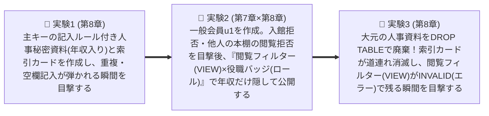

---

### 【事前準備】管理者ユーザー `bold` での接続確認（所要時間：2分）

EC2（`ec2-user`）にSSH接続後、`oracle` OSユーザーに切り替えて、管理者ユーザー `bold` で重要資料室（`freepdb1`）に接続します。
（※もし `@freepdb1` で `ORA-12154` エラーになる場合は、簡易接続 `sqlplus bold/bold@localhost:1521/freepdb1` を使用してください）。

```bash
# 1. OSユーザーを oracle に切り替え
sudo su - oracle

# 2. 管理者ユーザー bold で freepdb1 に接続
sqlplus bold/bold@freepdb1
```

```sql
-- 3. 接続中のユーザー（マイ本棚の持ち主）とコンテナ（PDB）を確認
SET LINESIZE 120
SET PAGESIZE 50
SHOW USER
SHOW CON_NAME
```

- **📺 期待されるターミナル出力**:
  ```text
  ユーザーは"BOLD"です。 (USER is "BOLD")

  CON_NAME
  ------------------------------
  FREEPDB1
  ```

---

### 🧪 実験1：表（資料）の作成と「主キー制約（書き方ルール）」の威力（所要時間：7分）

> 📍 **現在地**：第3部（後半ハンズオン） ＞ **実験1/3：表の作成と「主キー制約（書き方ルール）」の威力**

- **① いつ使うか（現場のシチュエーション）**:
  - `bold` さんのマイ本棚に、人事システムの核となる「社員秘密台帳（`emp_secret` 表）」を作成します。ここには社員番号、名前、部署、そして機密情報である「年収（`salary`）」の記入欄を設けます。社員番号の重複記入や記入漏れ（NULL）が起きないよう「主キー制約（`PRIMARY KEY`：背番号の書き方ルール）」を設定し、部署名で素早く探すための「別紙の索引カード（`INDEX`）」も作成します。
- **② Predict（実行前の予測）**:
  - 主キー（`emp_id`）に正常なデータ（101番、102番）を記入した後、わざと**「すでに存在する101番（重複記入）」**や**「社員番号が空欄（`NULL`）」**の行を `INSERT` したら、Oracleはどう反応するでしょうか？

- **③ Observe（実行コマンドとターミナル出力の観察）**:

```sql
-- [Step 1-1] 既存の同名表があれば削除（Oracle 26ai の IF EXISTS 構文で初回もエラーになりません）
DROP TABLE IF EXISTS emp_secret CASCADE CONSTRAINTS;

-- [Step 1-2] 主キー(PRIMARY KEY)と非NULL(NOT NULL)の書き方ルールつきの社員秘密表を作成
CREATE TABLE emp_secret (
  emp_id    NUMBER(4)    PRIMARY KEY,
  emp_name  VARCHAR2(20) NOT NULL,
  dept_name VARCHAR2(20),
  salary    NUMBER(10)
);

-- [Step 1-3] 部署名(dept_name)での検索を高速化する別紙の索引カード(INDEX)を作成
CREATE INDEX idx_emp_dept ON emp_secret(dept_name);

-- [Step 1-4] 正常な社員データを2件記入して確定(COMMIT)
INSERT INTO emp_secret VALUES (101, 'Sato',   'Sales', 6000000);
INSERT INTO emp_secret VALUES (102, 'Suzuki', 'Dev',   7500000);
COMMIT;

-- [Step 1-5] 登録されたデータを確認
SELECT * FROM emp_secret;
```

- **📺 期待される出力（正常登録）**:
  ```text
  表が削除されました。 (Table dropped.)
  表が作成されました。 (Table created.)
  索引が作成されました。 (Index created.)
  1行が作成されました。 (1 row created.)
  1行が作成されました。 (1 row created.)
  コミットが完了しました。 (Commit complete.)

      EMP_ID EMP_NAME             DEPT_NAME                SALARY
  ---------- -------------------- -------------------- ----------
         101 Sato                 Sales                   6000000
         102 Suzuki               Dev                     7500000
  ```

```sql
-- ⚡ [Step 1-6] 【壁の目撃①】わざと既存の社員番号「101」を重複記入してみる！
INSERT INTO emp_secret VALUES (101, 'Takahashi', 'HR', 5000000);
```

- **📺 期待される出力（書き方ルールによる重複拒絶！）**:
  ```text
  INSERT INTO emp_secret VALUES (101, 'Takahashi', 'HR', 5000000)
  *
  行1でエラーが発生しました。:
  ORA-00001: 一意制約(BOLD.SYS_C00...)に反しています
  (ORA-00001: unique constraint (BOLD.SYS_C00...) violated)
  ```

```sql
-- ⚡ [Step 1-7] 【壁の目撃②】わざと社員番号を「NULL（空欄）」にして記入してみる！
INSERT INTO emp_secret VALUES (NULL, 'Tanaka', 'Sales', 4500000);
```

- **📺 期待される出力（書き方ルールによる空欄拒絶！）**:
  ```text
  INSERT INTO emp_secret VALUES (NULL, 'Tanaka', 'Sales', 4500000)
                                 *
  行1でエラーが発生しました。:
  ORA-01400: ("BOLD"."EMP_SECRET"."EMP_ID")にはNULLは挿入できません
  (ORA-01400: cannot insert NULL into ("BOLD"."EMP_SECRET"."EMP_ID"))
  ```

- **④ Explain（この実験の結論）**:
  - 万が一アプリケーションの画面チェックにバグがあっても、DBの資料（表）自体に **`PRIMARY KEY`（主キー制約：背番号の書き方ルール）** を設定しておけば、`ORA-00001`（重複違反）や `ORA-01400`（空欄違反）を出して、不正データの混入を水際で防いでくれます！

---

### 🧪 実験2：マイ本棚の壁と「閲覧フィルター（VIEW）× 役職バッジ（ロール）」による機密欄の保護（所要時間：10分）

> 📍 **現在地**：第3部（後半ハンズオン） ＞ **実験2/3：マイ本棚の壁と「VIEW × ロール」による機密欄（年収）の保護**

- **① いつ使うか（現場のシチュエーション）**:
  - 一般社員用の会員アカウント `u1` を作成し、社内名簿として「社員番号・名前・部署」だけを閲覧させたいとします。しかし、`bold` さんの本棚にある `emp_secret` 台帳には極秘の「年収（`salary`）」欄が入っています。どうやって年収欄を隠したまま安全に資料を公開するでしょうか？
- **② Predict（実行前の予測）**:
  1. `CREATE USER u1` で会員登録した直後（権限ゼロ）に入館（ログイン）しようとしたらどうなるか？
  2. 入館証（`CREATE SESSION`）だけ渡して、他人（`bold`）の本棚の資料（`bold.emp_secret`）を勝手に開こう（`SELECT` しよう）としたらどうなるか？
  3. 年収欄を隠した閲覧用フィルター（`v_emp_public` ビュー）を作り、その閲覧許可だけを役職バッジ（`staff_role` ロール）に入れて `u1` に渡したら、`u1` からは何が見えて、何が見えないか？

- **③ Observe（実行コマンドとターミナル出力の観察）**:

```sql
-- [Step 2-1] 管理者 bold であることを確認し、一般社員 u1 とロールを初期化・新規作成
CONN bold/bold@freepdb1
DROP USER IF EXISTS u1 CASCADE;
DROP ROLE IF EXISTS staff_role;

-- 一般社員 u1 を会員登録（まだ何の権限も付与しないゼロ権限状態！）
CREATE USER u1 IDENTIFIED BY benkyokai;
```

```sql
-- ⚡ [Step 2-2] 【壁の目撃①】作ったばかりの u1（権限ゼロ）で資料室に入館してみる！
CONN u1/benkyokai@freepdb1
```

- **📺 期待される出力（最小権限の原則による入館ゲートでの門前払い！）**:
  ```text
  ERROR:
  ORA-01045: ユーザーU1にはCREATE SESSION権限がありません。ログオンが拒否されました
  (ORA-01045: user U1 lacks CREATE SESSION privilege; logon denied)
  警告: Oracleにはもう接続されていません。
  ```

```sql
-- [Step 2-3] 管理者 bold に戻り、u1 に資料室の入館証（CREATE SESSION システム権限）を付与
CONN bold/bold@freepdb1
GRANT CREATE SESSION TO u1;

-- [Step 2-4] 今度は u1 で入館成功！そのまま bold さんの本棚の社員秘密台帳を覗き見してみる！
CONN u1/benkyokai@freepdb1
SHOW USER
SELECT * FROM bold.emp_secret;
```

- **📺 期待される出力（マイ本棚の壁とオブジェクト権限不足による拒絶！）**:
  ```text
  接続されました。
  ユーザーは"U1"です。 (USER is "U1")

  SELECT * FROM bold.emp_secret
                     *
  行1でエラーが発生しました。:
  ORA-00942: 表またはビュー"BOLD"."EMP_SECRET"が存在しません。
  (ORA-00942: table or view "BOLD"."EMP_SECRET" does not exist)
  ```
  - 💡 **注目**: `bold.emp_secret` という資料は実際には存在しますが、閲覧許可（オブジェクト権限）を持っていない `u1` に対しては「そんな資料は存在しません（`ORA-00942`）」と返して存在自体を隠蔽します！

```sql
-- ✨ [Step 2-5] 【解決策の実装】管理者 bold に戻り、「年収(salary)欄を隠す閲覧フィルター(VIEW)」と「社員バッジ(ロール)」を作成！
CONN bold/bold@freepdb1

-- ① 年収(salary)欄を除外した「閲覧用フィルター枠（ビュー v_emp_public）」を作成
CREATE OR REPLACE VIEW v_emp_public AS
  SELECT emp_id, emp_name, dept_name FROM emp_secret;

-- ② 役職バッジ「staff_role（一般社員ロール）」を作成
CREATE ROLE staff_role;

-- ③ 役職バッジ(staff_role)に、「元の資料」ではなく「閲覧用フィルター(v_emp_public)」のSELECT権限だけを入れる！
GRANT SELECT ON v_emp_public TO staff_role;

-- ④ 一般社員 u1 に役職バッジ(staff_role)を渡す！
GRANT staff_role TO u1;
```

```sql
-- 🎉 [Step 2-6] 【Afterの確認】再び一般社員 u1 でログインし、「元の資料」と「閲覧フィルター」の両方をSELECTして比較！
CONN u1/benkyokai@freepdb1
SHOW USER

-- 1) まず、年収が入った元の資料（bold.emp_secret）を直接見ようとすると…？
SELECT * FROM bold.emp_secret;
```

- **📺 期待される出力（元の資料は相変わらずブロックされる！）**:
  ```text
  行1でエラーが発生しました。:
  ORA-00942: 表またはビュー"BOLD"."EMP_SECRET"が存在しません。
  ```

```sql
-- 2) 次に、許可された閲覧フィルター（bold.v_emp_public）を通して覗いてみると…？
SELECT * FROM bold.v_emp_public;
```

- **📺 期待される出力（元の資料の権限を渡していなくても、フィルター越しに公開欄だけが見える！）**:
  ```text
      EMP_ID EMP_NAME             DEPT_NAME
  ---------- -------------------- --------------------
         101 Sato                 Sales
         102 Suzuki               Dev
  ```

- **④ Explain（この実験の結論）**:
  - これぞ第7章（権限・ロール）と第8章（ビュー）を組み合わせた現場の王道設計です！
  - **元の資料（`emp_secret`）の閲覧権限は付与せず、機密欄を隠した閲覧フィルター（`VIEW`）に対する閲覧権限だけを役職バッジ（`ROLE`）に入れて付与する**ことで、資料を別冊コピー（二重管理）することなく安全・スマートに公開できます！

---

### 🧪 実験3：親テーブル `DROP`（元資料の廃棄）の連鎖とオブジェクトの寿命（所要時間：6分）

> 📍 **現在地**：第3部（後半ハンズオン） ＞ **実験3/3：親テーブル `DROP` の連鎖とオブジェクトの寿命**

- **① いつ使うか（現場のシチュエーション）**:
  - システム改修などで、管理者が大元の資料である `emp_secret` 表を `DROP TABLE` で廃棄してしまったとします。このとき、付属していた「別紙の索引カード（`idx_emp_dept`）」と「閲覧用フィルター枠（`v_emp_public` ビュー）」はそれぞれどうなるでしょうか？
- **② Predict（実行前の予測）**:
  - `DROP TABLE emp_secret;` を実行したあと、索引カード（INDEX）と閲覧フィルター（VIEW）はどちらも消えるでしょうか？それともどちらかだけ残るでしょうか？

- **③ Observe（実行コマンドとターミナル出力の観察）**:

```sql
-- [Step 3-1] 管理者 bold に戻り、廃棄前の「索引カード(INDEX)」と「閲覧フィルター(VIEW)」の存在と状態を確認
CONN bold/bold@freepdb1
COLUMN object_name FORMAT A20
COLUMN object_type FORMAT A15
COLUMN status FORMAT A10

SELECT index_name, table_name FROM user_indexes WHERE table_name = 'EMP_SECRET';
SELECT object_name, object_type, status FROM user_objects WHERE object_name IN ('EMP_SECRET', 'IDX_EMP_DEPT', 'V_EMP_PUBLIC');
```

- **📺 期待される出力（廃棄前はすべて VALID＝有効 で存在している）**:
  ```text
  INDEX_NAME                     TABLE_NAME
  ------------------------------ ------------------------------
  SYS_C00...                     EMP_SECRET   <-- 主キーが自動作成した索引カード
  IDX_EMP_DEPT                   EMP_SECRET   <-- 手動作成した索引カード

  OBJECT_NAME          OBJECT_TYPE     STATUS
  -------------------- --------------- ----------
  EMP_SECRET           TABLE           VALID
  IDX_EMP_DEPT         INDEX           VALID
  V_EMP_PUBLIC         VIEW            VALID
  ```

```sql
-- 💥 [Step 3-2] 大元の資料 emp_secret 表を DROP TABLE で廃棄する！
DROP TABLE emp_secret;

-- 🔍 [Step 3-3] 廃棄直後、もう一度「索引カード」と「オブジェクト一覧」を確認してみる！
SELECT index_name, table_name FROM user_indexes WHERE table_name = 'EMP_SECRET';
SELECT object_name, object_type, status FROM user_objects WHERE object_name IN ('EMP_SECRET', 'IDX_EMP_DEPT', 'V_EMP_PUBLIC');
```

- **📺 期待される出力（INDEXは道連れで消滅し、VIEWは INVALID＝無効 になって残っている！）**:
  ```text
  レコードが選択されませんでした。 (no rows selected)
  👉 索引カード(INDEX)は2枚とも大元の資料と運命を共にして消滅した！

  OBJECT_NAME          OBJECT_TYPE     STATUS
  -------------------- --------------- ----------
  V_EMP_PUBLIC         VIEW            INVALID
  👉 閲覧用フィルター枠(VIEW)は削除されずに残っているが、ステータスが「INVALID(無効)」に変わった！
  ```

```sql
-- ⚡ [Step 3-4] 【壁の目撃】残っている閲覧フィルター（v_emp_public）を SELECT して覗いてみる！
SELECT * FROM v_emp_public;
```

- **📺 期待される出力（見る先の元資料がなくなったためエラー！）**:
  ```text
  SELECT * FROM v_emp_public
                *
  行1でエラーが発生しました。:
  ORA-04063: view "BOLD.V_EMP_PUBLIC"にエラーがあります
  (ORA-04063: view "BOLD.V_EMP_PUBLIC" has errors)
  ```

```sql
-- [Step 3-5] 実験終了後のクリーンアップ（お片付け）
DROP VIEW IF EXISTS v_emp_public;
DROP USER IF EXISTS u1 CASCADE;
DROP ROLE IF EXISTS staff_role;
EXIT
```

- **④ Explain（この実験の結論）**:
  - 大元の資料（親テーブル）を `DROP TABLE` で廃棄すると、**「表構造・データ・索引カード（INDEX）・書き方ルール（制約）」は道連れで削除（消滅）されます**が、**「閲覧用フィルター枠（VIEW）」は独立したオブジェクト（保存されたSELECT文）なので削除されず、`INVALID`（無効状態）として残ります**！

---

### 🎁 おまけ実験（時間が余った方・自宅復習用）：`SQL*Loader` と `Data Pump` の完全自己完結デモ

> 📍 **現在地**：第3部（後半ハンズオン） ＞ **🎁 おまけ実験：自動転記マシン `SQL*Loader` と引っ越し便 `Data Pump`**

Topic 10で学んだ大量データ移動ツール2種（`sqlldr` と `expdp`/`impdp`）を、Linuxシェル（`oracle` ユーザー）からコピペ1発で体験できる自己完結スクリプトです（`handson_commands.txt` の末尾に収録しています）。

#### 【おまけA】高速自動転記マシン `SQL*Loader` で外部CSV原稿から一括データ投入
```bash
# 1. oracle ユーザーの状態で、転記先の資料 (load_test表) と Data Pump用ディレクトリ (dp_dir) を作成
sqlplus bold/bold@freepdb1 << 'EOF'
DROP TABLE IF EXISTS load_test;
CREATE TABLE load_test (
  id   NUMBER(4) PRIMARY KEY,
  name VARCHAR2(20),
  role VARCHAR2(20)
);
CREATE OR REPLACE DIRECTORY dp_dir AS '/tmp';
EXIT
EOF

# 2. 外部のCSV原稿ファイル (/tmp/members.csv) をその場で自動作成
cat << 'EOF' > /tmp/members.csv
1,Sato,Infra
2,Suzuki,Developer
3,Takahashi,Manager
EOF

# 3. 制御ファイル (/tmp/members.ctl：転記方法の指示書) をその場で自動作成
cat << 'EOF' > /tmp/members.ctl
LOAD DATA
INFILE '/tmp/members.csv'
INTO TABLE load_test
FIELDS TERMINATED BY ','
(id, name, role)
EOF

# 4. SQL*Loader (sqlldr) を実行して一括転記！
sqlldr bold/bold@freepdb1 CONTROL=/tmp/members.ctl LOG=/tmp/members.log BAD=/tmp/members.bad

# 5. 資料(表)に3件のデータが入ったことを確認！
sqlplus -s bold/bold@freepdb1 << 'EOF'
SET PAGESIZE 20
SELECT * FROM load_test;
EXIT
EOF
```

#### 【おまけB】専用引っ越しコンテナ便 `Oracle Data Pump (expdp / impdp)` で資料を丸ごと梱包＆廃棄からの復元
```bash
# 1. さっき3件データを入れた load_test 表を Data Pump (expdp) で /tmp (dp_dir) の専用コンテナ (.dmp) に梱包して搬出！
expdp bold/bold@freepdb1 TABLES=load_test DIRECTORY=dp_dir DUMPFILE=load_test_bk.dmp LOGFILE=exp_load_test.log REUSE_DUMPFILES=YES

# 2. OSの /tmp 配下にバイナリのダンプファイル (load_test_bk.dmp) が生成されたことを確認！
ls -lh /tmp/load_test_bk.dmp

# 3. わざと load_test 表を DROP TABLE で廃棄してしまう！
sqlplus -s bold/bold@freepdb1 << 'EOF'
DROP TABLE load_test;
SELECT * FROM load_test;
EXIT
EOF
# ➔ 「ORA-00942: 表またはビュー"BOLD"."LOAD_TEST"が存在しません。」と出て消滅したことを確認！

# 4. Data Pump (impdp) を使って、専用コンテナ (.dmp) から表とデータを丸ごと荷解きして復元！
impdp bold/bold@freepdb1 TABLES=load_test DIRECTORY=dp_dir DUMPFILE=load_test_bk.dmp LOGFILE=imp_load_test.log

# 5. 廃棄したはずの load_test 表と3件のデータが復活していることを確認し、最後にお片付け！
sqlplus -s bold/bold@freepdb1 << 'EOF'
SET PAGESIZE 20
SELECT * FROM load_test;
DROP TABLE IF EXISTS load_test;
EXIT
EOF
rm -f /tmp/members.csv /tmp/members.ctl /tmp/members.log /tmp/members.bad /tmp/load_test_bk.dmp /tmp/exp_load_test.log /tmp/imp_load_test.log
```

---

## 🏁 総仕上げ：練習問題③・④【Oracle専門編 5問×2セット】（01:45 - 02:00 / 15分間）

> 📍 **現在地**：総仕上げ ＞ **🏁 練習問題③・④：第7章・第8章【Oracle専門編 計10問】（Google Forms）**

実機ハンズオンで `ORA-00001`（主キー重複違反）、`ORA-01400`（空欄NULL違反）、`ORA-01045`（入館証 `CREATE SESSION` 不足）、`ORA-00942`（他人の本棚の資料へのアクセス拒否）、`ORA-04063`（元資料廃棄による閲覧フィルター `VIEW` の `INVALID` 化）を自分の目で目撃しました！
最後に、本日の総仕上げとしてGoogle Formsで**練習問題③（第7章・Oracle専門編 5問）**と**練習問題④（第8章・Oracle専門編 5問）**を解いて、座学と実機体験をOracleの正式用語・仕様として脳に完全定着させましょう！（回答7分 ＋ 総仕上げ解説8分）
