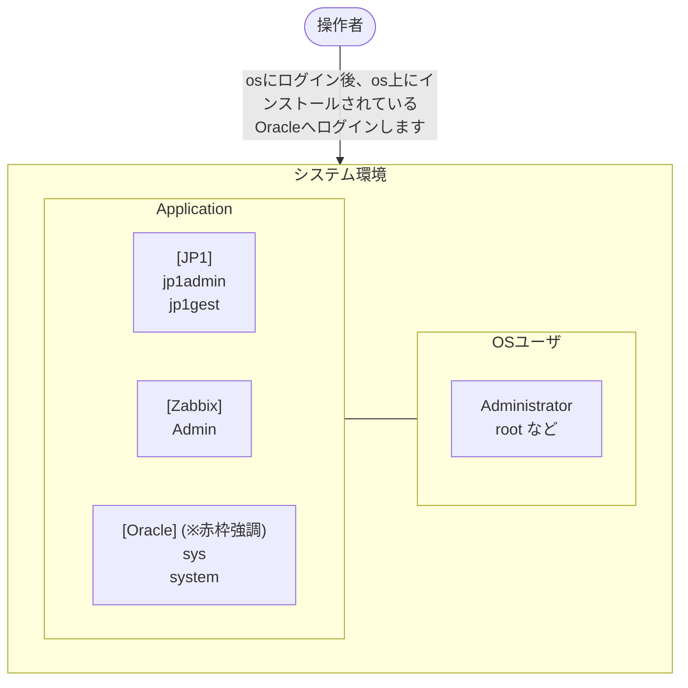
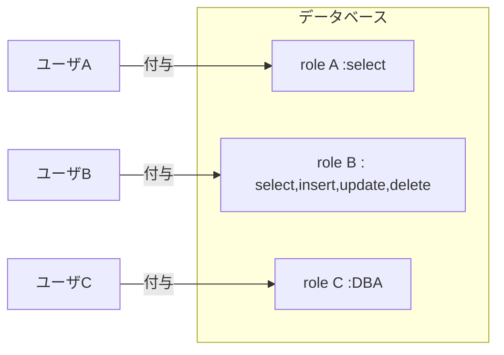
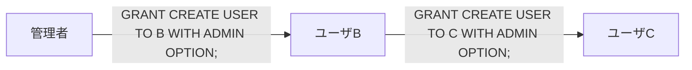
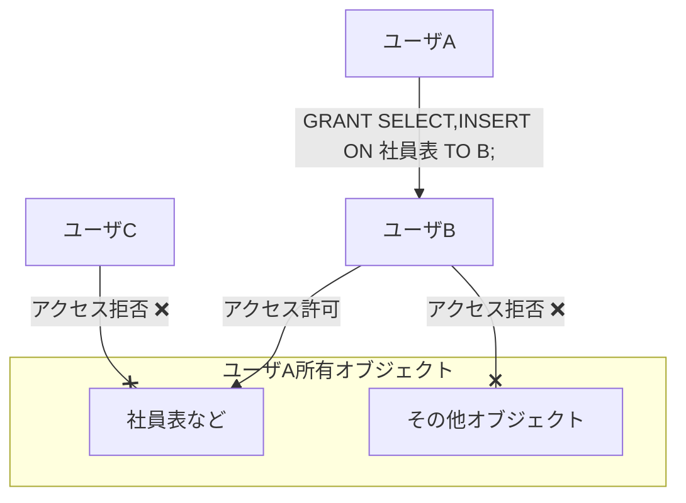
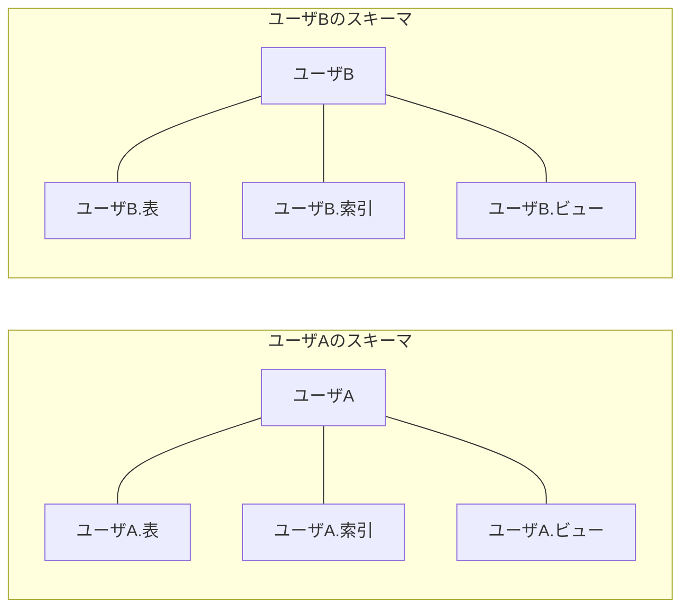
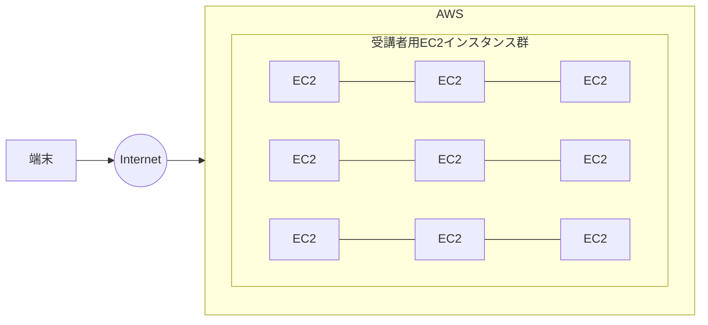

# 25上期 Oracle基礎勉強会 第4回テキスト

---

## 表紙

**25上期 Oracle基礎勉強会**  
**第4回テキスト**

---

## スケジュール

| 回数 | 日付 | 内容 |
| :--- | :--- | :--- |
| 第1回 | 2026/07/21 | 第1章：Oracleデータベース管理の概要<br>第2章：Oracleデータベースのインストールおよびデータベースの作成 |
| 第2回 | 2026/08/18 | 第3章：Oracle Enterprise Manager Database Express および SQL 管理ツールの使用<br>第4章：Oracle Network 環境の構成 |
| 第3回 | 2026/09/15 | 第5章：Oracleインスタンスの管理<br>第6章：データベース記憶域構造の管理 |
| **第4回**（※赤枠強調） | **2026/10/20** | **第7章：ユーザーおよびセキュリティの管理**<br>**第8章：スキーマオブジェクトの管理** |
| 第5回 | 2026/11/17 | 第9章：データベースの監視およびアドバイザの使用<br>第10章：バックアップ・リカバリの概要と可用性を高める構成 |
| 第6回 | 2026/12/15 | 全工程振り返り<br>最終テスト |

---

## 1. ユーザーおよびセキュリティの管理

### ■Oracleデータベースのユーザアカウント
Oracleデータベースを利用するにはデータベース管理者がユーザアカウントを作成する必要があ（※スライド右端ママ）  
Oracleデータベースインストールで追加される初期ユーザ  

| ユーザ名 | 説明 |
| :--- | :--- |
| SYS | すべての操作を実行できるユーザ |
| SYSTEM | SYSユーザとほぼ同じ。DBの起動・停止ができない。 |
| SYSMAN | EM操作用のユーザ |
| DBSMNP | EMCCのAgent用ユーザ |

#### OSユーザとアプリケーション/DBユーザの階層関係図


- **吹き出し**: `osにログイン後、os上にインストールされているOracleへログインします`  
- **OSユーザ**: `Administrator`, `root など`  
- **Application層**: `[JP1] jp1admin, jp1gest` / `[Zabbix] Admin` / `[Oracle] sys, system`（赤枠強調）


---

## 権限とロール

### ■権限とロール
OSと同じようにOracleデータベースユーザも権限付与が可能。（selectだけできる、updateはできないなど）  
ロールはこの各権限のまとめて定義したもの。  

#### ユーザ・ロール・権限の紐付け


| ユーザ | ロール | 権限 |
| :--- | :--- | :--- |
| A | A | select |
| B | B | select,insert,update,delete |
| C | C | DBA |

#### デフォルトロール

| ロール名 | 説明 |
| :--- | :--- |
| DBA | DB管理用権限 |
| CONNECT | 接続用ロール |
| SELECT_CATALOG_ROLE | ディクショナリ参照ロール |
| RESOURCE | 開発者向けのロール |
| EM_EXPRESS_BASIC | EM操作用のロール |
| EM_EXPRES_ALL | EM管理用のロール |

#### 特別な権限

| 権限名 | 説明 |
| :--- | :--- |
| SYSDBA | すべての操作を実行できる権限 |
| SYSOPER | 管理タスクを実行する権限 |
| SYSDG | DataGuard用の権限 |
| SYSKM | データ暗号化権限 |
| SYSBACKUP | バックアップおよびリカバリようの権限 |

---

## システム権限とオブジェクト権限

### ■システム権限


### ■オブジェクト権限


- **GRANT文例**: `GRANT SELECT,INSERT ON 社員表 TO B;`

---

## 2. スキーマオブジェクトの管理

### ■スキーマとは
スキーマ＝ユーザと考えてよいです。  
ユーザにオブジェクト（表、索引、ビューなど）が紐づいています。  
> 💬 **表や索引、ビューがスキーマオブジェクトとなります。**



---

### ■表
データを格納する基本単位。  
列と行で表現します。（Excelの表を思い出して下さい。）  
表は以下のSQLで作成します。  

```sql
SQL> CREATE TABLE [スキーマ名].表名
(
  列名 データ型,列名　データ型
);
```

#### 主なデータ型

| データ型 | 説明 |
| :--- | :--- |
| CHAR(n) | 固定長文字型 |
| VARCHAR2(n) | 可変長文字型 |
| DATE | 固定長日付型 |
| NUMBER | 可変長数値型 |


---

### ■索引
select文で検索する際、ディスクI/Oを減らし、高速化するためのオブジェクト。  
辞書を引く時の索引をイメージしてください。  
索引は以下のSQLで作成します。  
```sql
SQL> CREATE INDEX 索引名 ON 表名(列名);
```

### ■ビュー
１つもしくは複数の表をもとにして作成する「仮想の表」です。  
Excelで不要な列を非表示にしたり、フィルタで行を非表示のようにイメージしてください。  
ビューは以下のSQLで作成します。  
```sql
SQL> CREATE VIEW ビュー名 AS [SELECT文]
```

### ■SQL*Loader
表にデータを挿入するのはInsert文でできますが大量のデータを手動で挿入するのは非効率です。  
実際に挿入するデータを記載した「データファイル」とデータファイルの読み方等を記載した「制御ファイル」を使って一括挿入します。  

---

## ハンズオン：ツールの利用

AWSにみなさんのEC2を構築しております。  
事前にIPアドレスをお伝えしているのでvscodeのssh-remoteで接続してください。  
接続ユーザはec2-userです。鍵による認証となります。鍵は任意の場所に保管してください。  

※第１回と同様です。ただし、接続するIPアドレスは違います。  



---

## ユーザの作成（ハンズオン）

### ■ユーザの作成
PDB(orclpdb1)にログイン  
```bash
$ sqlplus bold/bold@freepdb1
```

以下のユーザを作成  

| ユーザ名 | パスワード |
| :--- | :--- |
| U1_[社員番号] | benkyokai |
| U2_[社員番号] | benkyokai |

```sql
SQL> create user U1_[社員番号] identified by benkyokai;
SQL> grant create session to U1_[社員番号];
SQL> create user U2_[社員番号] identified by benkyokai password expire;
SQL> grant create session to U2_[社員番号];
```

作成したユーザでログインしてみましょう。  
```bash
$ sqlplus U1_[社員番号]/benkyokai@freepdb1
$ sqlplus U2_[社員番号]/benkyokai@freepdb1
```


---

## アカウントロックとロック解除

### ■アカウントロック
U1_[社員番号] のアカウントをロックします。  

現状のアカウントの状態を確認  
```sql
select username,account_status from dba_users
where username like '%[社員番号]';
```

U1_[社員番号]をロックします。  
```sql
alter user U1_[社員番号] account lock;
```

ロックされているか確認  
```sql
select username,account_status from dba_users
where username like '%[社員番号]';
```

### ■アカウントロック解除
ロックしたU1_[社員番号]のロックを解除します。  
```sql
alter user U1_[社員番号] account unlock;
```

ロック解除できたか確認  
```sql
select username,account_status from dba_users
where username like '%[社員番号]';
```

---

## ユーザの削除とロールの付与

### ■ユーザの削除
boldユーザでログインして、U2_[社員番号]アカウントを削除  
```bash
$ sqlplus bold/bold@freepdb1
```
```sql
SQL> drop user U2_[社員番号];
```

### ■ロールの付与
U1_[社員番号]でテーブルを作成してみます。  
```bash
$ sqlplus U1_[社員番号]/benkyokai@freepdb1
```
```sql
SQL> create table table1 (id number);
```

U1_[社員番号]にDBA権限付与する。  
```bash
$ sqlplus bold/bold@freepdb1
```
```sql
SQL> grant dba to U1_[社員番号];
```

もう一度U1_[社員番号]でログインしてテーブルを作成してみます。  
```bash
$ sqlplus U1_[社員番号]/benkyokai@freepdb1
```
```sql
SQL> create table table1 (id number);
SQL> desc table1;
```

---

## 他ユーザのテーブル参照

boldユーザでログインし、U3_[社員番号]ユーザの作成、テーブル作成  
```bash
$ sqlplus bold/bold@freepdb1
```
```sql
SQL> create user U3_[社員番号] identified by benkyokai;
SQL> grant dba to U3_[社員番号];
```

```bash
$ sqlplus U3_[社員番号]/benkyokai@freepdb1
```
```sql
SQL> create table table1 (id number);
SQL> insert into table1 (id) values(1);
SQL> commit;
SQL> exit
```

U1_[社員番号]でログイン  
```bash
$ sqlplus U1_[社員番号]/benkyokai@freepdb1
```
```sql
SQL> desc U3_[社員番号].table1;
SQL> select * from U3_[社員番号].table1;
```


---

## 権限の削除

### ■権限の削除
boldユーザでログイン  
```bash
$ sqlplus bold/bold@freepdb1
```

U1_[社員番号]に付与したDBA権限を削除  
```sql
SQL> revoke dba from U1_[社員番号];
```

U1_[社員番号]で再度ログインしてテーブル作成、他ユーザのテーブルを参照  
```bash
$ sqlplus U1_[社員番号]/benkyokai@freepdb1
```
```sql
SQL> create table table2 (id number);
SQL> desc U3_[社員番号].table1;
```

---

## SQL*Loaderの使い方（準備）

### ■SQL*Loaderの使い方（準備）
boldユーザでログイン  
```bash
$ sqlplus bold/bold@freepdb1
```
```sql
SQL> grant dba to U1_[社員番号];
SQL> exit
```

U1_[社員番号]で再度ログイン  
```bash
$ sqlplus U1_[社員番号]/benkyokai@freepdb1
```

インポートするテーブルの作成  
```sql
SQL> create table table2 (id number,name varchar2(10));
```

データファイル（CSV）と制御ファイル（CTL）を/tmp配下にコピーします。  
```sql
SQL> exit
```
```bash
$ exit
$ sudo su -
# cp /home/ec2-user/SQLLoader* /tmp/.
# chmod 777 /tmp/SQLLoader*
# su - oracle
```

---

## SQL*Loaderの使い方

### ■SQL*Loaderの使い方
以下コマンドを実行します。  
```bash
$ sqlldr U1_[社員番号]/benkyokai@freepdb1 \
  CONTROL=/tmp/SQLLoader_data.ctl \
  LOG=/tmp/SQLLoader_data.log \
  BAD=/tmp/SQLLoader_data.bad skip=0
```

実際にデータがあるかselect文で確認します。  
```bash
$ sqlplus U1_[社員番号]/benkyokai@freepdb1
```
```sql
SQL> select * from table2;
```

---

## 索引の作成とビューの作成

### ■索引の作成
SQL Loaderでインポートしたデータに索引を付与してみます。  
```sql
create index table2_idx on table2(id);
```

作成した索引の確認  
```sql
select owner,index_name,table_name from all_indexes
where owner = 'U1_[社員番号]';
```

### ■ビューの作成
name列のみのビューを作成します。  
```sql
create view table2_v1 as select name from table2;
select * from table2_v1;
```

id列が50以上のビューを作成します。  
```sql
create view table2_v2 as select id,name from table2 where id >= 50;
select * from table2_v2;
```


---

## Data Pump（エクスポート）

### ■Data Pump
Oracleデータベース間でデータを移動するツール。  
DataPumpにてデータバックアップをとってリストアしてみましょう。  

### DataPump実行前準備
```bash
$ sqlplus bold/bold@freepdb1
```
```sql
SQL> grant read,write on directory DATA_PUMP_DIR to U1_[社員番号];
SQL> exit
```

### DataPump実行
```bash
$ expdp U1_[社員番号]/benkyokai@freepdb1 \
  tables=table1 directory=data_pump_dir \
  dumpfile=backup_[社員番号].dmp
```

`/opt/oracle/admin/FREE/dpdump` 配下を確認してみましょう。  

---

## データのインポート（Data Pump リストア）

### ■データのインポート
事前にtable1を削除しておく  

```bash
$ sqlplus U1_[社員番号]/benkyokai@freepdb1
```
```sql
SQL> drop table table1 cascade constraints;
SQL> exit
```

```bash
$ impdp U1_[社員番号]/benkyokai@freepdb1 \
  tables=table1 directory=data_pump_dir \
  dumpfile=backup_[社員番号].dmp
```

```bash
$ sqlplus U1_[社員番号]/benkyokai@freepdb1
```
```sql
SQL> desc table1
```

---

## 権限の委譲（総合演習）

### ■権限の委譲
U1_[社員番号]を管理者としてuser01,user02,user03に権限委譲をやってみましょう。  
現在、U1_[社員番号]はDBA権限があるので管理者と利用。  

#### ＜演習１＞
USER01,USER02,USER03を作成し、create session権限のみ付与してください。  
作成できたら各ユーザでログイン確認しましょう。  

#### ＜演習２＞
USER02にU1_[社員番号]が持っているCREATE USER権限を委譲しましょう。  
USER02でUSER04を作成してみましょう。  

#### ＜演習３＞
USER01にDBA権限を付与してSQLLoaderを使ってデータをインポートしましょう。  
インポートしたテーブルを確認してください。  

#### ＜演習４＞
USER02にUSER01のテーブルにSELECTとINSERTの権限を付与し  
実際にSELECTとINSERTを実行してみましょう。  
また、USER03からUSER01のテーブルを参照できないことも確認してみましょう。  

---

### コマンドメモ（テキスト共有分）

```sql
create user USER01 identified by USER01;				
grant create session to USER01;				
				
grant create user to USER02 with admin option;				
grant dba to USER01;				
create table table2(id number,name varchar2(10));				
```

```bash
sqlldr USER01/USER01@freepdb1 CONTROL=/tmp/SQLLoader_data.ctl LOG=/tmp/SQLLoader_data.log BAD=/tmp/SQLloader_data.bad skip=0				
```

```sql
select * from table2;				
				
grant select,insert on table2 to USER02;				
select * from USER01.table2;				
insert into USER01.table2(id,name) values(200,'data200');				
commit;				
```


---

---

## 第一章練習問題

### ■練習問題 1
- 25上期スライド上はURL空欄（未設定）だったが、**24下期版の過去問が存在**（参照: `docs/quiz_archive_24h2.md`）。
- **24下期 URL**: https://docs.google.com/forms/d/e/1FAIpQLSfjC05UEs-gC8ziX1CMz3U9jcec1HRSqUKjfoYZSiOYKdBxzg/viewform?usp=dialog
- **出題内容（24下期ベース）**:
  - 問.1: SQL実行結果（パスワード期限切れ、オブジェクトアクセス権等）
  - 問.2: 記憶域割り当て・クォータ・プロファイルに関するSQL実行結果
  - 問.3: ロールに関する正しい説明（ロールへのロール付与、プロファイル等）

---

## 第二章練習問題

### ■練習問題 2
- 25上期スライド上はURL空欄（未設定）だったが、**24下期版の過去問が存在**（参照: `docs/quiz_archive_24h2.md`）。
- **24下期 URL**: https://docs.google.com/forms/d/e/1FAIpQLSe3KiRoMfepvtTjl75RWLTkHDtCT32HfEoHUL6SUDf0uy9-bw/viewform?usp=dialog
- **出題内容（24下期ベース）**:
  - 問.1: DROP TABLEコマンド実行時に削除されるオブジェクト（表構造、データ、索引、制約、ビュー）
  - 問.2: 索引に関する正しい説明（複数列、自動メンテナンス、一意列等）
  - 問.3: ビューの目的（アクセス制限、アクセスの簡素化、検索速度等）

---

### [重要メモ] 練習問題に関する更新・設計方針
- 25上期では未作成だったが、24下期の過去問（上記）が発掘されたため、ゼロからの新規作成ではなく**24下期の良問をベースに最新化・リファクタリングして25上期向けFormsを作成可能**となった。

