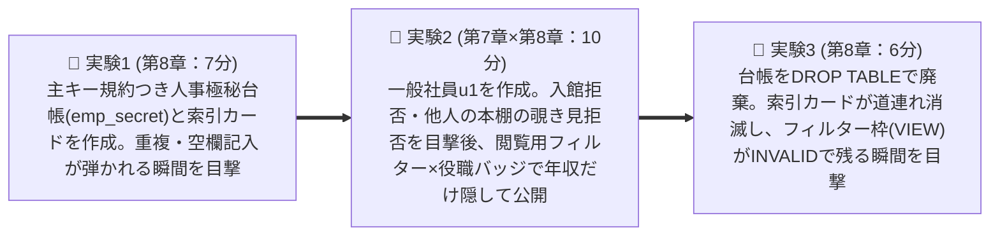

# 25上期 Oracle基礎勉強会 第4回：枠組み＋ハンズオン（サンドイッチ方式の「枠」ソース）

> 【スライド化ルール】本ファイルは NotebookLM「詳細なスライド」単一ソース生成用（全10枚）。`---` 区切り（`##` 見出し）＝ スライド1枚。見出しの【枠N】は、Googleスライド上で第7章（Part 1）・第8章（Part 2）を挿入する位置の目印（下記「結合位置」参照）。SQL全文は載せない（`handson_commands.txt` で配布）。「📝 補足」は下部の小さな注記にする。
>
> **結合位置（Googleスライド上）**：【枠1】〜【枠3】の後ろに Part 1（第7章：6枚）を挿入 ➔ 【枠4】練習問題①ブリッジの後ろに Part 2（第8章：6枚）を挿入 ➔ 【枠5】以降はそのまま続く。

---

## 【枠1】全体表紙 ＋ 全6回ロードマップと前回（第3回）からの接続

> 📍 **現在地**：0. オープニング ＞ **全体表紙 ＆ 全6回ロードマップ（第4回＝本日）**

# 25上期 Oracle基礎勉強会 第4回
## 重要資料室の「マイ本棚」を設計する：ユーザー・セキュリティ（第7章）＆ スキーマオブジェクト（第8章）

**前回（第3回）からの接続**：前回は、奥にある物理的な**「重要資料室・書庫（データファイル）」**の手前に、利用者の近くで素早く情報をやり取りするためにパッと開く**「出張営業所・窓口カウンター（インスタンス：SGA共有机・PGA個人机・裏方スタッフ）」**の仕組みを学びました。第4回の本日は、その**「重要資料室（会員制の社内図書館）の内部に、利用者ごとの『マイ本棚（スキーマ）』を作り、誰に入館証と閲覧許可を渡し、本棚の中の『資料（Table）』をどう設計・保護するか」**を学びます。

| 回数 | 講義テーマ（章構成） | 押さえるべきコア |
| :--- | :--- | :--- |
| 第1回 | 第1章：DB管理の概要 ／ 第2章：インストール・DB作成 | **【土台】** なぜExcelではなくRDBMSか？SQLの4分類とOS上でDBが動く構造 |
| 第2回 | 第3章：管理ツール ／ 第4章：Oracle Network環境 | **【接続】** 端末はどうやってネットワーク越しに目的のDBへ繋がるか（リスナーと名前解決） |
| 第3回 | 第5章：インスタンス管理 ／ 第6章：記憶域構造の管理 | **【心臓部】** 奥の「重要書庫（データファイル）」と手前の「出張窓口（インスタンス）」の連携 |
| 👉 **第4回（本日）** | **第7章：ユーザーおよびセキュリティの管理**／**第8章：スキーマオブジェクトの管理** | **【設計と開発】** 「マイ本棚（スキーマ）」と「権限」の分離、資料（表）・記入ルール（制約）・索引カード（INDEX）・閲覧フィルター（VIEW）の使い分け |
| 第5回 | 第9章：監視・アドバイザ ／ 第10章：バックアップ・リカバリ | **【性能と可用性】** 遅いSQLの見抜き方と、障害時に1件も失わない復旧 |
| 第6回 | 全工程総復習 ／ 最終まとめテスト（全20問） | **【総括】** WHY（課題・目的）とHOW（Oracleの仕組み・用語）の双方向の結びつけ |

---

## 【枠2】本日の講義で解決する「6つの疑問」＋ 全体目次

> 📍 **現在地**：0. オープニング ＞ **🤔 本日の講義で解決する疑問リスト ＆ 📑 全体目次**

### 🤔 本日解決する「現場の6大疑問」
1. 「Linuxサーバーに `oracle` でログインしたのに、なぜDBに入るためにまた別のユーザー名でログインし直すの？」（Topic 1）
2. 「もし社員全員に『何でもできる最強の管理者権限』を渡したら、現場でどんな悲劇が起きるの？」（Topic 2 ＆ 4）
3. 「上司から部下へ権限を分け与えたあと、上司の権限を取り消したら、部下の権限は消える？残る？」（Topic 5）
4. 「Web画面で入力チェックをしているのに、なぜDBの資料（表）側にも『記入ルール（制約）』を設定するの？」（Topic 7）
5. 「検索を速くするために『すべての列に索引カード（INDEX）を作って！』と言われたら、なぜ全力で止めるの？」（Topic 8）
6. 「年収データ入りの人事資料をコピーせずに、一般社員には『名前と部署だけ』を安全に見せるには？」（Topic 9 ＆ 後半ハンズオン）

### 📑 本日の全体目次（大項目・小項目）
- **📘 第1部：第7章 ユーザーおよびセキュリティの管理（00:05 - 00:30）**
  - Topic 1/10：OSユーザーとDBユーザー／スキーマの分離 ／ Topic 2/10：初期管理ユーザー（`SYS` vs `SYSTEM`）と `SYSDBA` ／ Topic 3/10：アカウント状態管理・クォータ（`QUOTA`）・プロファイル（`PROFILE`） ／ Topic 4/10：最小権限の原則（システム権限 vs オブジェクト権限） ／ Topic 5/10：ロール（Role）と権限委譲オプション（`WITH ADMIN OPTION` vs `WITH GRANT OPTION`）
- **📝 練習問題①：第7章【本質編 5問】（00:30 - 00:38）**
- **📗 第2部：第8章 スキーマオブジェクトの管理（00:38 - 01:03）**
  - Topic 6/10：表（Table）・基本データ型 ／ Topic 7/10：5大制約（Constraints） ／ Topic 8/10：索引（Index）の光と影 ／ Topic 9/10：ビュー（View）＆ 親テーブル `DROP` 時の連鎖 ／ Topic 10/10：大量データ移動（`SQL*Loader` vs `Data Pump`）
- **📝 練習問題②：第8章【本質編 5問】（01:03 - 01:10）**
- **☕ 中盤リフレッシュコーナー（01:10 - 01:20）**
- **🧪 第3部：後半ハンズオン「本日の総まとめ実験（全3実験）」（01:20 - 01:45）**
- **🏁 総仕上げ：練習問題③【第7章・第8章 Oracle専門編 計10問】（01:45 - 02:00）**

---

## 【枠3】スリー・ソー導入と本日の行動目標（Learning Objectives）

> 📍 **現在地**：0. オープニング ＞ **スリー・ソー導入と本日の行動目標（Learning Objectives）**

### 💡 導入：すべては「企業の重要資料室（会員制図書館）とマイ本棚」で繋がる！
- **そうだよね（共感）**: 会社の重要資料室には、売上台帳や人事評価など、紛失したり無関係な人に見られたりしてはいけない機密資料が保管されていますよね。
- **そういえば（現場接続）**: 誰が入館したかの記録もなく、誰でも他人の本棚の資料を書き換えられたり、書き方のルールがバラバラで白紙や重複だらけの台帳が置かれたりしたら、業務は大混乱になりますよね。
- **そうなんだ！（発見）**: 本日はOracleを**「会員制の重要資料室」**に例えます。前半（第7章）は**「会員証と入館・閲覧ルールの管理」**、後半（第8章）は**「マイ本棚に置く資料（表）・記入ルール（制約）・索引カード（INDEX）・閲覧フィルター（VIEW）の設計」**。この2つが繋がると、ハンズオンで「年収欄だけをフィルターで隠して一般社員に名簿を公開する」設計を自分の手でできるようになります！

### 🎯 本日の行動目標（Learning Objectives）
1. **【ユーザーとスキーマ】** OSユーザーとDBユーザーを分離する理由、および「1ユーザー＝1スキーマ（マイ本棚）」の関係を**選択できる**。
2. **【管理アカウントとガードレール】** `SYS`（`SYSDBA`）と`SYSTEM`の使い分け、`PASSWORD EXPIRE`・`ACCOUNT LOCK`・`QUOTA`・`PROFILE` の仕様を**識別できる**。
3. **【権限・ロール・委譲】** システム権限とオブジェクト権限を区別し、`WITH ADMIN OPTION` と `WITH GRANT OPTION` の `REVOKE` 時の連鎖有無を**予測できる**。
4. **【表・データ型・5大制約】** 基本データ型（`VARCHAR2`, `CHAR`, `NUMBER`, `DATE`）と5つの書き方ルール（特に `PRIMARY KEY` と `UNIQUE` の違い）を**区別できる**。
5. **【INDEX・VIEW・オブジェクト寿命】** INDEXの更新時オーバーヘッド、VIEWの2大目的、`DROP TABLE` 時に消えるもの（INDEX・制約）と残るもの（VIEW）を**特定できる**。
6. **【大量データ移動】** `SQL*Loader` と `Oracle Data Pump` を要件に応じて**選択できる**。

---

## 【枠4】練習問題①ブリッジ：第7章【本質編 5問】（00:30 - 00:38 / 8分間）

> 📍 **現在地**：第1部まとめ ＞ **📝 練習問題①：第7章【本質編 5問】（Google Forms）**

前半（第7章）の理解を定着させるため、Google Formsで**練習問題①（Q1〜Q5：本質編）**にチャレンジしましょう！（回答4分 ＋ ポイント解説4分）
- **確認する5つの設計判断軸**:
  1. なぜビル通用口（OSユーザー）と資料室の会員証・マイ本棚（DBユーザー・スキーマ）を分離するのか？
  2. なぜ日常の定型運用で創設オーナー（`SYS`）の最強権限をそのまま使わないのか？
  3. 共有の書庫フロア（表領域）を1人のユーザーが占領する事故をどう予防するか？
  4. 最小権限の原則に基づき、入館証（システム権限）と他人の資料の閲覧許可（オブジェクト権限）をどう組み合わせるか？
  5. 役職バッジ（ロール）という中間層を導入することで権限管理はどう改善されるか？

---

## 【枠5】練習問題②ブリッジ：第8章【本質編 5問】（01:03 - 01:10 / 7分間）＋ ☕ 10分リフレッシュ案内（01:10 - 01:20）

> 📍 **現在地**：第2部 第8章の振り返り ＞ **📝 練習問題②（第8章・本質編 5問）／ ☕ 脳と身体のリセット術**

### 📝 練習問題②（上段／左）
後半（第8章）の座学内容について、Google Formsで**練習問題②（Q6〜Q10：本質編）**を解いて頭の中を整理しましょう！（回答4分 ＋ ポイント解説3分）
- **確認する5つの設計判断軸**:
  1. アプリ側の入力チェックがあるのに、なぜDBの資料側にも「書き方ルール（制約）」を定義すべきか？
  2. 「空欄を許さない管理番号（主キー）」と「空欄を許容する重複防止ルール（一意制約）」をどう使い分けるか？
  3. 索引カード（INDEX）をむやみに多くの列へ作ると、なぜ書き込み性能が劣化するのか？
  4. 別バインダーへの物理コピーではなく、実データを持たない「閲覧用フィルター枠（ビュー）」を使う利点は何か？
  5. 大量データの投入・移行で、なぜ通常の `INSERT` 文ではなく2種類の専用ユーティリティを使い分けるのか？

### ☕ 10分間リフレッシュタイム（下段／右・簡潔に）
| 時間配分 | 内容 | ポイント |
| :--- | :--- | :--- |
| **前半5分（01:10 - 01:15）** | **📵 完全フリー休憩** | トイレ・水分補給。スマホやチャットを見ずに画面から目を離して過ごす。 |
| **後半5分（01:15 - 01:20）** | **🧘‍♂️ ストレッチ ＆ ミニNSDR** | ① 胸郭オープン＆首リリース（2分）② ミニNSDR（3分）：目を閉じ「生理的ため息（鼻から2回吸って口から細く長く吐く×3回）」でリセット。 |

次は 01:20 から 🧪 後半ハンズオン「本日の総まとめ実験」です！

---

## 【枠6】ハンズオン表紙：第3部「本日の総まとめ実験」＋ 全体ストーリー図 ＋ コマンド配布ファイルへの誘導

> 📍 **現在地**：第3部：後半ハンズオン ＞ **表紙 ＆ 実験の全体ストーリー（第7章×第8章 融合シナリオ）**（01:20 - 01:45 / 25分間）

# 🧪 第3部：後半ハンズオン『本日の総まとめ実験』

### 🗺️ 全体ストーリー：「重要資料室の人事極秘台帳（年収データ）の構築と、一般社員への安全な公開」
前半で学んだ**第7章（会員証・マイ本棚・権限・役職バッジ）**と**第8章（資料・主キー記入規約・索引カード・閲覧用フィルター・資料廃棄の連鎖）**を1本の現場ストーリーに融合し、Oracleの「壁（エラーによる防御）」と「威力（Before / After）」を実機で目撃します。

> 👉 **実行するSQLコマンドは、配布ファイル `handson_commands.txt` からブロックごとにコピー＆ペーストしてください！**

---

## 【枠7】🧪 実験1：資料（表）の作成と「主キー制約（書き方ルール）」の威力（7分）

> 📍 **現在地**：第3部 後半ハンズオン ＞ **実験1：表の作成と主キー制約の威力**（1/3）

- **① ミッション**: 管理者 `bold` のマイ本棚に、社員番号（`PRIMARY KEY`：管理番号ルール）・氏名（`NOT NULL`：空欄禁止ルール）・部署・年収を持つ人事極秘台帳 `emp_secret` と、部署名への索引カード（`idx_emp_dept`）を作成。正常な2件（社員番号 `101`, `102`）を記入後、わざと不正データを `INSERT` して記入規約の働きをテストします。（👉 `handson_commands.txt` の【事前準備】と【実験1】）
- **② 🔮 予測（Predict）**: すでに存在する社員番号 `101`（重複）や、社員番号 `NULL`（空欄）を `INSERT` したら、Oracleはどう反応するか？
- **③ ⚡ 目撃すべきORAエラー（Observe）**:
  - 【壁①：重複データ】**`ORA-00001: 一意制約(BOLD.SYS_C00...)に反しています`**
  - 【壁②：NULLデータ】**`ORA-01400: ("BOLD"."EMP_SECRET"."EMP_ID")にはNULLは挿入できません`**
- **④ 🎯 結論（Explain）**: アプリ側にバグがあっても、表に **`PRIMARY KEY`（主キー制約）** を印字しておけば、`ORA-00001`（重複違反）と `ORA-01400`（空欄違反）で不正データの混入を水際で100%防げる！

---

## 【枠8】🧪 実験2：マイ本棚の壁と「閲覧用フィルター（VIEW）× 役職バッジ（ロール）」による機密列の保護（10分）

> 📍 **現在地**：第3部 後半ハンズオン ＞ **実験2：マイ本棚の壁と「VIEW × ロール」による機密保護**（2/3）

- **① ミッション**: 一般社員 `u1` を新規作成し、①権限ゼロでの入館拒否、②入館権限のみでの `bold.emp_secret` 覗き見拒否を目撃。その後、年収（`salary`）を目隠しした閲覧用フィルター `v_emp_public`（ビュー）を作成し、その閲覧権限を役職バッジ `staff_role`（ロール）経由で `u1` に付与して見え方を比較します。（👉 `handson_commands.txt` の【実験2】）
- **② 🔮 予測（Predict）**: 極秘台帳（`emp_secret`）の閲覧権限を `u1` に渡さず、`v_emp_public` の閲覧権限だけをロール経由で渡したとき、`u1` からは何が見えて何がブロックされるか？
- **③ ⚡ 目撃すべきORAエラー（Observe）**:
  - 【壁①：権限ゼロでのログイン】**`ORA-01045: ユーザーU1にはCREATE SESSION権限がありません。ログオンが拒否されました`**
  - 【壁②：閲覧許可のない `bold.emp_secret` への直接SELECT】**`ORA-00942: 表またはビュー"BOLD"."EMP_SECRET"が存在しません。`**（閲覧権限がない他人の資料は存在自体が隠蔽される）
  - 【🎉 解決後】`emp_secret` は引き続き `ORA-00942` でブロックされたまま、**`bold.v_emp_public` からは年収を除く3列（`EMP_ID`, `EMP_NAME`, `DEPT_NAME`）だけが表示される**
- **④ 🎯 結論（Explain）**: ビューを参照させるには**ビューに対する `SELECT` 権限さえ付与すればよく、基底表の権限は不要**。「閲覧用フィルター（公開VIEW）× 役職バッジ（ロール）」は、データを二重管理せず機密列を保護する王道パターン！

---

## 【枠9】🧪 実験3：本編の資料廃棄（`DROP TABLE`）の連鎖とオブジェクトの寿命（6分）

> 📍 **現在地**：第3部 後半ハンズオン ＞ **実験3：親テーブルDROPの連鎖とオブジェクトの寿命**（3/3）

- **① ミッション**: `bold` で `DROP TABLE emp_secret;` を実行。廃棄の前後で `user_indexes`（索引一覧）と `user_objects`（オブジェクト一覧）を確認し、棚に残った閲覧用フィルター `v_emp_public` を `SELECT` して何が起きるか検証します。（👉 `handson_commands.txt` の【実験3】／余った時間は末尾の【おまけ実験A/B：SQL*Loader & Data Pump】にも挑戦）
- **② 🔮 予測（Predict）**: 台帳 `emp_secret` を廃棄した瞬間、付属の索引カード（`idx_emp_dept`）と別棚のフィルター枠（`v_emp_public`）は、どちらが消滅し、どちらが残るか？
- **③ ⚡ 目撃すべき画面出力（Observe）**:
  - 【変化①：`user_indexes` の確認】**`レコードが選択されませんでした。`**（no rows selected）➔ 索引カードと制約は台帳と運命を共にして消滅
  - 【変化②：`user_objects` の確認と `SELECT`】`V_EMP_PUBLIC` は残るが `STATUS` が `VALID` から **`INVALID`（無効）** に変化。`SELECT * FROM v_emp_public;` で **`ORA-04063: view "BOLD.V_EMP_PUBLIC"にエラーがあります`**（view has errors）
- **④ 🎯 結論（Explain）**: `DROP TABLE` で**「表構造・データ・索引（INDEX）・制約」は道連れで消滅**するが、**「ビュー（VIEW）」は独立したオブジェクト（保存されたSELECT文）なので削除されず `INVALID` で残る**！

---

## 【枠10】🏁 総仕上げ（練習問題③）ブリッジ：第7章・第8章【Oracle専門編】（01:45 - 02:00 / 15分間）

> 📍 **現在地**：総仕上げ ＞ **練習問題③・④（第7章・第8章 Oracle専門編 計10問）**

実機ハンズオンで `ORA-00001`（主キー重複違反）、`ORA-01400`（空欄NULL違反）、`ORA-01045`（入館ゲート `CREATE SESSION` 不足）、`ORA-00942`（他人の本棚の資料アクセス拒否）、`ORA-04063`（台帳廃棄による `VIEW` の `INVALID` 化）を自分の目で目撃しました！

最後に、総仕上げとしてGoogle Formsで**練習問題③（第7章・Oracle専門編 5問 ＋ 第8章・Oracle専門編 5問 の計10問）**を解いて、座学と実機体験をOracleの正式用語・仕様として定着させましょう！（回答7分 ＋ 総仕上げ解説8分）
