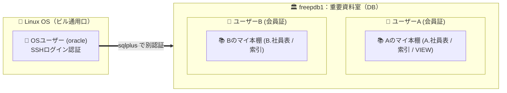
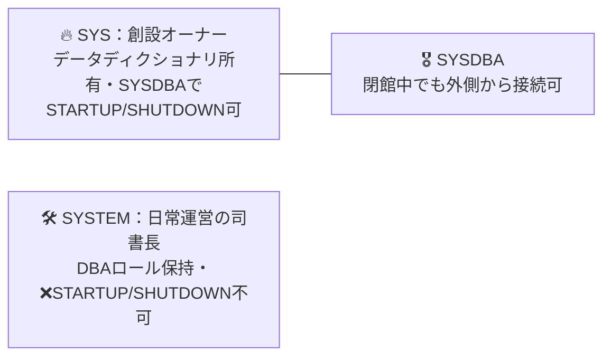
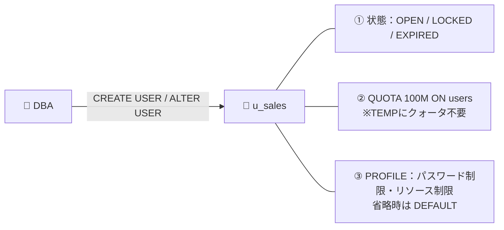
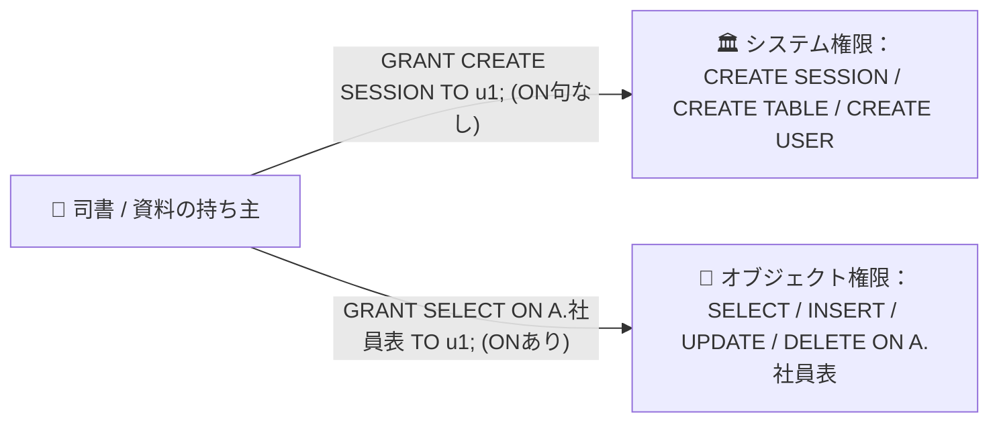
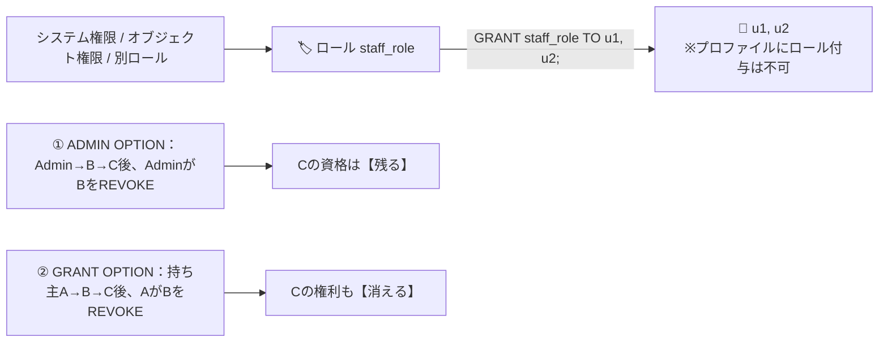

# 25上期 Oracle基礎勉強会 第4回：第7章 ユーザーおよびセキュリティの管理（章単体ソース）

> 【スライド化ルール】本ファイルは NotebookLM「詳細なスライド」単一ソース生成用（全6枚）。**1枚目は必ず下記「第7章 章扉」**。`---` 区切り（`##` 見出し）＝ スライド1枚。1 Topic＝1スライド（上段/左：WHY＋WHAT、下段/右：HOW）。「📝 補足」は下部の小さな注記にする。導入・目次・練習問題ブリッジは枠組みソース（slide_part0_frame.md）側に含まれる。

---

## 【スライド1】第7章 章扉：ユーザーおよびセキュリティの管理

> 📍 **現在地**：第1部（第7章：ユーザーとセキュリティ） ＞ **章扉**

# 第7章：ユーザーおよびセキュリティの管理
### 〜 誰に入館証を渡し、どの本棚のどの資料を見せるか 〜
- 本章（00:05 - 00:30）で扱う5トピック：① OSユーザーとDBユーザー／スキーマ ② `SYS` vs `SYSTEM` ③ アカウント状態・クォータ・プロファイル ④ 最小権限の原則（システム権限 vs オブジェクト権限）⑤ ロールと権限委譲オプション
- 統一メタファー：**重要資料室（会員制の社内図書館）／ 会員証 ／ マイ本棚（スキーマ）／ 役職バッジ（ロール）**

---

## 【スライド2】Topic 1：OSユーザーとDBユーザー／スキーマの分離

> 📍 **現在地**：第1部（第7章：ユーザーとセキュリティ） ＞ **Topic 1/10：OSユーザーとDBユーザー／スキーマの分離**

#### 💬 導入（スリー・ソー）
- **そうだよね**: LinuxへSSH接続するときは `ec2-user` や `oracle` といった「OSのユーザー」でログインしますよね。
- **そういえば**: でもハンズオンでは、Linuxに `oracle` で入ったあと `sqlplus bold/bold@freepdb1` と打って別の名前（`bold`）でログインし直していました。なぜ2回ログインするのでしょう？
- **そうなんだ！**: OSは「オフィスビルの通用口」、Oracleはビルの中の「会員制の重要資料室」。**DBユーザー（会員）を1人登録すると、資料室の中にその人専用の「マイ本棚（スキーマ）」が自動的に1つ用意される（ユーザー＝スキーマ）**のです！

#### 💡 【WHY】＋ 🏢 【WHAT】（上段／左）
- **WHY**: ビルの通用口の鍵（OSアカウント）だけで全資料に触れられたら、設備保守担当者が誤って人事・経理データを書き換えられます（職務分掌の破綻）。また、1つのDB内で複数システムを動かすとき全員が同じ机に資料を置くと `emp` 表などの名前が衝突します。**「ビル（OS）と資料室（DB）の認証の分離」**と**「資料室内でのマイ本棚（名前空間）の隔離」**が不可欠です。
- **WHAT（比喩）**: OSユーザー ＝ **ビル通用口パス**／DBユーザー ＝ **資料室の会員証**／スキーマ ＝ **自分専用のマイ本棚**（`A.社員表` と `B.社員表` は別物）。



#### 🛠️ 【HOW】Oracle正式用語・SQL（下段／右）
| 比喩 | Oracle正式用語 | 仕様 |
| :--- | :--- | :--- |
| 会員証 | **データベース・ユーザー** | `CREATE USER ユーザー名 IDENTIFIED BY パスワード;` |
| マイ本棚 | **スキーマ（Schema）** | ユーザー作成時に**同名のスキーマが自動作成**（スキーマ名＝ユーザー名） |
| 本棚の資料 | **スキーマ・オブジェクト** | 表 `TABLE`・索引 `INDEX`・ビュー `VIEW` など |
| 他人の本棚を見る | **スキーマ修飾** | 自分：`SELECT * FROM emp;` ／ 他人：`SELECT * FROM bold.emp;` |

```sql
-- ① ユーザー作成（同時に同名のマイ本棚「スキーマ」が自動生成）
CREATE USER user_a IDENTIFIED BY Pass1234;
-- ② 資料室の入館パス（これがないとORA-01045で門前払い）
GRANT CREATE SESSION TO user_a;
```

> 📝 **補足（小さく注記）**：表領域 `TABLESPACE`・`USER`・`ROLE`・`DIRECTORY` など特定の1人の所有物ではない共有設備は**「非スキーマ・オブジェクト」**と呼ぶ。


---

## 【スライド3】Topic 2：初期管理ユーザー（`SYS` vs `SYSTEM`）と `SYSDBA`

> 📍 **現在地**：第1部（第7章：ユーザーとセキュリティ） ＞ **Topic 2/10：初期管理ユーザー（`SYS` vs `SYSTEM`）と `SYSDBA`**

#### 💬 導入（スリー・ソー）
- **そうだよね**: Windowsの `Administrator`、Linuxの `root` のような「最初から用意されている最強の管理者」がありますよね。
- **そういえば**: Oracleにも `SYS` と `SYSTEM` という2つの初期管理ユーザーがいます。なぜ2人も？
- **そうなんだ！**: **`SYS` は「資料室ごと解体・閉館できる創設オーナー（館長）」**、**`SYSTEM` は「建物は壊せないが日々の会員登録や本棚案内を行う窓口の司書長」**。役割分離でオペレーションミスによる大事故を防ぎます。

#### 💡 【WHY】＋ 🏢 【WHAT】（上段／左）
- **WHY**: もし全員に「何でもできる最強の権限（`SYS`）」を渡したら、「操作としてはDB停止も全データ消去もできるが、ルール上やってはダメ」状態になり、**作業者は「触ったら会社が潰れるかも…」とビクビクし、管理者は24時間監視し続ける**ことになります。最初から権限を分けておけば**「実行できる操作＝すべて安心して使っていい安全な操作」**というガードレールが働き、お互い自由に行動できます。
- **WHAT（比喩）**: `SYS`（＋`SYSDBA`）＝ **創設オーナー兼解体業者**（閉館 `SHUTDOWN`・設計図原本の所有）／`SYSTEM` ＝ **日常運営の司書長**（閉館や設計図原本の破壊は安全ロックで不可）。



#### 🛠️ 【HOW】Oracle正式用語・比較表（下段／右）
| 初期ユーザー | 所有するもの・役割 | インスタンスの起動・停止 | 接続方法 |
| :--- | :--- | :---: | :--- |
| **`SYS`** | **データディクショナリ**（DBの設計図・管理台帳原本）の所有者。最高権限 | **〇 可能** | **`AS SYSDBA`** 指定が必要（`sqlplus sys/パスワード@... as sysdba`） |
| **`SYSTEM`** | 管理用オブジェクトを所有。**日常の管理作業用** | **× 不可能** | 通常のユーザーと同様（`AS SYSDBA` なし） |

- **なぜDB停止中は `SYSDBA` が必要？**: 閉館（`SHUTDOWN`）中は館内の名簿（データファイル）を開けないため、特別なマスターキー **`SYSDBA`** で外側から入り `STARTUP`（開館）します。

> 📝 **補足（小さく注記）**：`SYSDBA` 以外の管理権限＝起動・停止のみで中身は見られない **`SYSOPER`**、バックアップ専用 **`SYSBACKUP`**、Data Guard専用 **`SYSDG`**、暗号化鍵管理専用 **`SYSKM`**。旧Enterprise Manager用の `SYSMAN` 等は現行Oracle 26aiでは使用しない。

---

## 【スライド4】Topic 3：アカウント状態管理・クォータ（`QUOTA`）・プロファイル（`PROFILE`）

> 📍 **現在地**：第1部（第7章：ユーザーとセキュリティ） ＞ **Topic 3/10：アカウント状態管理とクォータ・プロファイル**

#### 💬 導入（スリー・ソー）
- **そうだよね**: 新入社員を会員登録するとき、司書はただ会員証を渡すだけでなく、最初に3つの安全ルールを決めますよね。
- **そういえば**: ①仮の暗証番号は初回入館時に本人のものへ変更させる（退職したら会員証を一時停止）、②共有書庫フロアを占領しないよう本棚の容量上限を決める、③暗証番号を何回間違えたらロックするか等の利用規約を適用する。
- **そうなんだ！**: Oracleの `CREATE USER` / `ALTER USER` は、**①アカウント状態、②クォータ（`QUOTA`）、③プロファイル（`PROFILE`）**をセットで管理します。

#### 💡 【WHY】＋ 🏢 【WHAT】（上段／左）
- **WHY**: ①初期パスワードのまま使い続けられたり、退職者の会員証が有効なまま放置されたりすると**なりすまし入館の温床**に。②1人が本棚へ無制限に詰め込み共有書庫フロア（表領域）が100%満杯になると、**同じフロアを使う全システムが資料を追加できず業務停止**に。
- **WHAT（比喩）**: ①`ACCOUNT LOCK`／`PASSWORD EXPIRE` ＝ **会員証の凍結／初回暗証番号変更モード**　②`QUOTA` ＝ **マイ本棚の容量上限**　③`PROFILE` ＝ **資料室の利用規約書**。



#### 🛠️ 【HOW】Oracle正式用語・SQL・試験の3大鉄則（下段／右）
```sql
CREATE USER u_sales IDENTIFIED BY Pass1234
  DEFAULT TABLESPACE users TEMPORARY TABLESPACE temp
  QUOTA 100M ON users PASSWORD EXPIRE;
ALTER USER u_sales ACCOUNT LOCK;   -- ロック／ ACCOUNT UNLOCK で解除
```
1. **`PASSWORD EXPIRE`**: ロック（`LOCKED`）にはならない。次回ログイン時にSQL*Plus等が新パスワード入力を促し、変更すれば入館できる。
2. **一時表領域（`TEMP`）**: **クォータ設定は不要（設定自体が不可）**。クォータなしでもディスクソートは実行できる。
3. **`PROFILE` 省略**: 構文エラーにならず自動で **`DEFAULT` プロファイル**が割り当てられる。

> 📝 **補足（小さく注記）**：権限 `CREATE TABLE` があっても `QUOTA` が0（未指定時デフォルト）だと、最初の `INSERT` でセグメント確保が走った瞬間に **`ORA-01950`** となる（遅延セグメント作成のため `CREATE TABLE` 時点ではない）。

---

## 【スライド5】Topic 4：最小権限の原則：システム権限 vs オブジェクト権限

> 📍 **現在地**：第1部（第7章：ユーザーとセキュリティ） ＞ **Topic 4/10：最小権限の原則（システム権限 vs オブジェクト権限）**

#### 💬 導入（スリー・ソー）
- **そうだよね**: `CREATE USER` で `u1` を作った（会員登録した）ので、パスワードで資料室に入れると思いますよね。
- **そういえば**: ところが `u1` でログインすると **`ORA-01045`**（ログオンが拒否されました）で受付ゲートで門前払い。
- **そうなんだ！**: Oracleは**「最小権限の原則（作成直後はゼロ権限。明示的に許可された操作以外はできない）」**で作られています。権限は **①建物全体で何ができるか（システム権限）** と **②誰の本棚のどの資料を触れるか（オブジェクト権限）** の2種類。

#### 💡 【WHY】＋ 🏢 【WHAT】（上段／左）
- **WHY**: 全会員に「どの本棚の資料も書き換えられる権限」を最初から渡すと、「操作としては他部署の極秘資料も消せるが、就業規則でやってはダメ」状態に。**利用者は萎縮し、管理者は全SQLを監視し続ける**ことになります。ゼロ権限から必要分だけ渡せば**「実行できる操作＝システム的に許可された安全な操作」**になり、業務に集中できます。
- **WHAT（比喩）**: システム権限 ＝ **資料室の入館ゲートを通る権利／自分の本棚に新しい資料を置く権利**（`ON` 句なし）。オブジェクト権限 ＝ **Bさんが「Aさんの本棚の特定の資料」を開く・書き込む権利**（`ON スキーマ.オブジェクト名` あり）。



#### 🛠️ 【HOW】Oracle正式用語・比較表（下段／右）
| 比較項目 | システム権限 | オブジェクト権限 |
| :--- | :--- | :--- |
| 対象 | DB全体の操作／オブジェクトの新規作成・削除 | **特定のオブジェクト**（誰かの表・ビュー・順序など）のデータ操作 |
| 代表例 | `CREATE SESSION` `CREATE TABLE` `CREATE VIEW` `CREATE USER` | `SELECT` `INSERT` `UPDATE` `DELETE` |
| 付与（GRANT） | `GRANT 権限名 TO ユーザー名;`（**`ON` 句なし**） | `GRANT 権限名 ON オブジェクト名 TO ユーザー名;`（**`ON` あり**） |
| 剥奪（REVOKE） | `REVOKE 権限名 FROM ユーザー名;` | `REVOKE 権限名 ON オブジェクト名 FROM ユーザー名;` |

- **🎯 重要ルール**: `user_a` が `ACCOUNT LOCK` や `PASSWORD EXPIRE` になっても、本棚は撤去されない。**すでに `user_a.emp` への `SELECT` 権限を持つ `user_b` は、`user_a` がロック中でも閲覧できる**。

---

## 【スライド6】Topic 5：ロール（Role）と権限委譲オプション（`WITH ADMIN OPTION` vs `WITH GRANT OPTION`）

> 📍 **現在地**：第1部（第7章：ユーザーとセキュリティ） ＞ **Topic 5/10：ロールと権限委譲オプションの連鎖挙動**

#### 💬 導入（スリー・ソー）
- **そうだよね**: 会員500人×資料100冊を1人ずつ `GRANT` したら50,000回。異動のたびに付与漏れ・回収漏れが起きますよね。
- **そういえば**: 入館システムでは「営業部バッジ」のような**役職バッジ（ロール）**に許可をまとめ、バッジを渡しますよね。では他人へ権限を委譲したあと、中間の人の権限を取り消したら、その先の人はどうなる？
- **そうなんだ！**: **その権限に「特定の個人の持ち主（オーナー）」がいるかどうか**で、連鎖して消えるか・残るかが決まります。

#### 💡 【WHY】＋ 🏢 【WHAT】（上段／左）
- **WHY（誰の持ち物か？）**: システム権限（`CREATE SESSION` 等）は資料室全体の**公的な資格**で個人の持ち主がいない。担当Aが採用した社員Bの入館証は、Aが異動（`REVOKE`）しても無効になったら困る ➔ **連鎖しない**。オブジェクト権限（`SELECT ON A.emp`）は**持ち主Aの私物の貸出**。AがBへの貸出を取り消せば、BがCへ又貸しした分も回収される ➔ **連鎖する**。
- **WHAT（比喩）**: ロール ＝ **役職バッジ（腕章）**／`WITH ADMIN OPTION` ＝ **公的資格の発令（代行任命）**／`WITH GRANT OPTION` ＝ **私物（本棚の資料）の又貸し許可**。



#### 🛠️ 【HOW】Oracle正式用語・比較表（下段／右）
- **ロールの4大仕様**: ①システム権限・オブジェクト権限の**両方**を含められる ②ロールの中に別ロールを付与（ネスト）可能 ③ユーザーまたは別ロールに付与する（**`PROFILE` に付与は不可**）④ `CREATE ROLE` は `SYSDBA` 限定ではなく `CREATE ROLE` システム権限（または `DBA` ロール）で実行可能。

| 比較項目 | `WITH ADMIN OPTION` | `WITH GRANT OPTION` |
| :--- | :--- | :--- |
| 対象 | **システム権限**・**ロール**（個人の所有物ではない） | **オブジェクト権限**（明確なオーナーがいる） |
| 例 | `GRANT CREATE TABLE TO b WITH ADMIN OPTION;` | `GRANT SELECT ON emp TO b WITH GRANT OPTION;` |
| A→B→C後、AがBをREVOKE | **Cの権限は残る（連鎖しない）** | **Cの権限も消滅（連鎖する）** |

> 📝 **補足（小さく注記）**：事前定義ロール＝ **`DBA`**（ほぼ全システム権限。`SYSDBA` ではないため起動・停止は含まない）、**`CONNECT`**（`CREATE SESSION` を含む）、**`RESOURCE`**（`CREATE TABLE` 等の基本作成権限）、**`SELECT_CATALOG_ROLE`**（データディクショナリビュー参照）。

---
