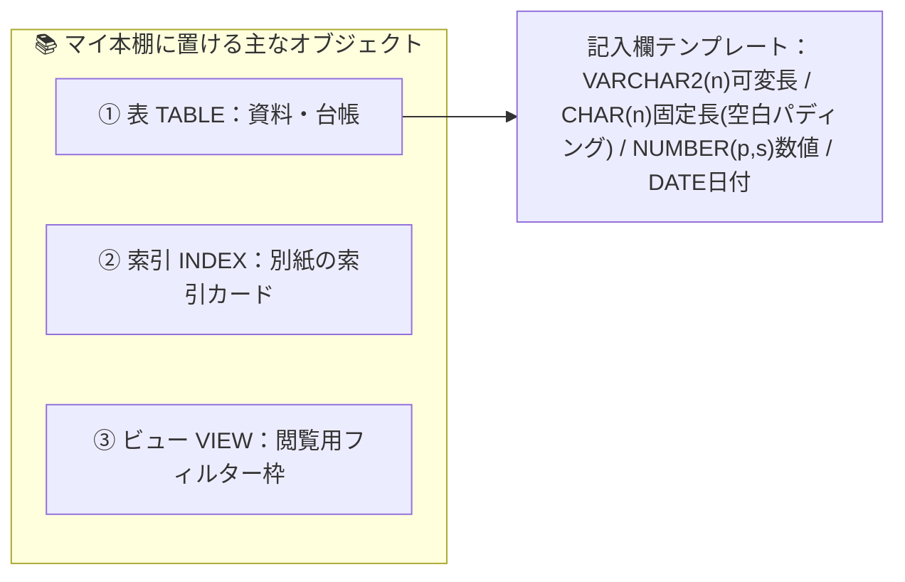
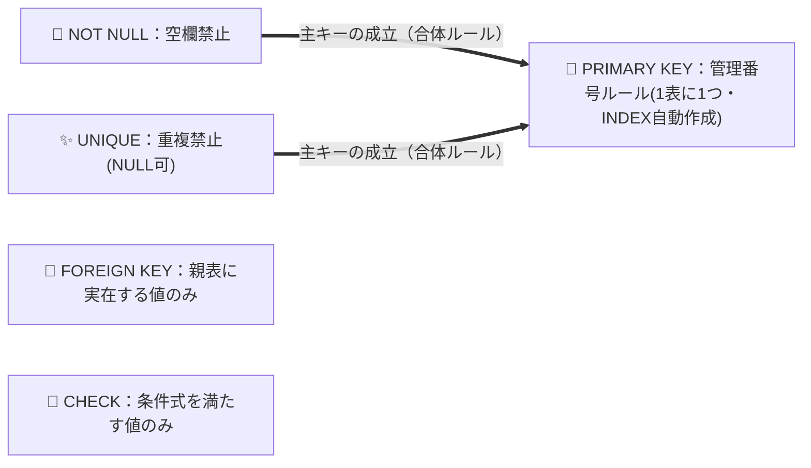
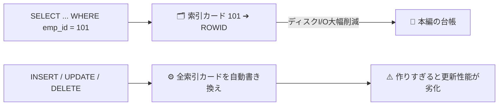
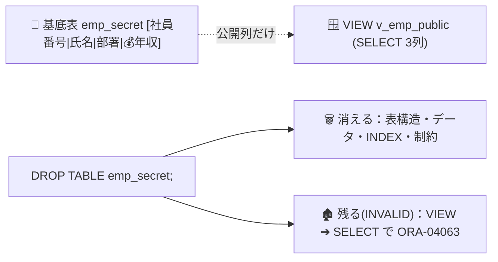
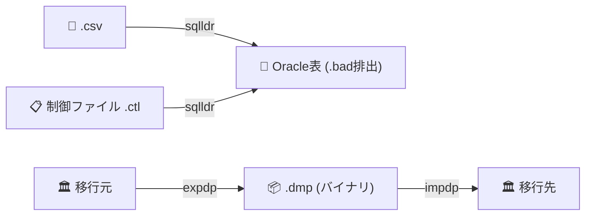

# 25上期 Oracle基礎勉強会 第4回：第8章 スキーマオブジェクトの管理（章単体ソース）

> 【スライド化ルール】本ファイルは NotebookLM「詳細なスライド」単一ソース生成用（全6枚）。**1枚目は必ず下記「第8章 章扉（タイトル表紙）」**。`---` 区切り（`##` 見出し）＝ スライド1枚。1 Topic＝1スライド（上段/左：WHY＋WHAT、下段/右：HOW）。「📝 補足」は下部の小さな注記にする。ブリッジ・休憩案内は枠組みソース（slide_part0_frame.md）側に含まれる。

---

## 【スライド1】第8章 章扉（タイトル表紙）

> 📍 **現在地**：第2部（第8章：スキーマオブジェクト管理） ＞ **章扉**

# 第8章：スキーマオブジェクトの管理
### 〜 マイ本棚に置く資料（表）・書き方ルール・索引カード・閲覧フィルターを設計する 〜
- 本章（00:38 - 01:03）で扱う5トピック：⑥ 表（Table）・基本データ型 ⑦ 5大制約（Constraints）⑧ 索引（Index）の光と影 ⑨ ビュー（View）＆ 親テーブル `DROP` 時の連鎖 ⑩ 大量データ移動（`SQL*Loader` vs `Data Pump`）
- 統一メタファー：**マイ本棚の資料（表）／ 資料テンプレート・記入欄（データ型）／ 記入ルール（制約）／ 索引カード（INDEX）／ 閲覧フィルター（VIEW）**
- 第7章でもらった入館証とマイ本棚（スキーマ）の中に、いよいよ「資料」を並べていきます。

---

## 【スライド2】Topic 6：スキーマオブジェクトの全体像と「表（Table）・基本データ型」

> 📍 **現在地**：第2部 第8章 スキーマオブジェクト管理 ＞ **Topic 6/10：表（Table）と基本データ型**

#### 💬 導入（スリー・ソー）
- **そうだよね**: マイ本棚の前に立ったら、情報をまとめた資料・台帳を並べます。基本はExcelのシートのような「表（テーブル）」ですよね。
- **そういえば**: Excelの共有台帳では、数値のセルにうっかり「未定」と入れたり、全角半角が混ざって集計マクロがエラーになった経験はありませんか？
- **そうなんだ！**: だからRDBMSの表では、資料を作る時点で**「この記入欄（列）にはこのデータ型・この文字数しか記入できない」というフォーマット（`VARCHAR2`, `CHAR`, `NUMBER`, `DATE`）**を決めます。

#### 💡 【WHY】＋ 🏢 【WHAT】（上段／左）
- **WHY**: 列ごとにデータ型・最大サイズを定義しないと、金額欄に文字列が混入して業務アプリがクラッシュしたり、不要な空白で共有書庫（ディスク容量）を浪費します。「氏名」のような可変長か、「都道府県コード」のような固定長か、計算する数値か、日付かで最適なフォーマットを選びます。
- **WHAT（比喩）**: 表 ＝ **マイ本棚の資料・台帳（バインダー）**／`VARCHAR2(n)` ＝ **文字数に合わせて幅が縮む可変記入欄（真空パック方式）**／`CHAR(n)` ＝ **マス目固定の記入欄（原稿用紙方式。余りは空白で埋まる）**／`NUMBER(p, s)` ＝ 数字専用欄／`DATE` ＝ 日時欄（年月日に加え時・分・秒まで保持）。



#### 🛠️ 【HOW】Oracle正式用語・SQL（下段／右）
```sql
CREATE TABLE emp (
  emp_id    NUMBER(6),       -- 最大6桁の数値
  emp_name  VARCHAR2(30),    -- 最大30バイトの可変長文字列
  dept_code CHAR(4),         -- 固定長4バイトの文字列
  hire_date DATE             -- 日付（年月日時分秒）
);
```
- **🎯 試験ポイント**: 可変長文字列は **`VARCHAR2(サイズ)`**。`CHAR(10)` に `'ABC'`（3バイト）を入れると後ろに空白7つが埋まり10バイト消費。`VARCHAR2(10)` なら実データの3バイトだけ消費。

> 📝 **補足（小さく注記）**：**順序（`SEQUENCE`）**＝社員番号などを重複なく自動発番する「番号札発券機」。**シノニム（`SYNONYM`）**＝他人の本棚の長い資料名（例：`bold.emp_secret`）につける短い「あだ名ラベル」。

---

## 【スライド3】Topic 7：データの整合性を守る「5大制約（Constraints）」

> 📍 **現在地**：第2部 第8章 スキーマオブジェクト管理 ＞ **Topic 7/10：5大制約（Constraints）**

#### 💬 導入（スリー・ソー）
- **そうだよね**: データ型を決めれば「社員番号欄に文字が入る」ミスは防げますよね。
- **そういえば**: でもバグで「社員番号が空欄（NULL）のまま記入」されたり、「101番が田中さんと佐藤さんに二重採番」されたらどうします？Web画面のチェックも、夜間バッチや手動SQLから直接 `INSERT` されたら突破されます。
- **そうなんだ！**: 最後の砦として、資料（表）自体に**「ルール違反の記入は受理しない5つの書き方ルール（5大制約）」**を印字します。特に **`PRIMARY KEY` と `UNIQUE` の違い**は最重要です。

#### 💡 【WHY】＋ 🏢 【WHAT】（上段／左）
- **WHY**: Web画面・バッチ・他システム連携・手動SQLなど複数ルートから書き込まれるため、アプリ側チェックだけでは「重複」「必須項目の漏れ」「存在しない部署コード」「マイナス金額」が混入します。表に制約を定義すれば、**どのルートからでもDBエンジンが不正データを拒絶**します。
- **WHAT（比喩）**: `NOT NULL` ＝ **空欄禁止ルール**／`UNIQUE` ＝ **重複禁止ルール（空欄はOK）**／`PRIMARY KEY` ＝ **行を特定する管理番号ルール（`NOT NULL`＋`UNIQUE`、1表に1つ）**／`FOREIGN KEY` ＝ **親マスタ台帳との照合ルール**／`CHECK` ＝ **記入値の条件チェックルール**。



#### 🛠️ 【HOW】Oracle正式用語・比較マトリクス・SQL（下段／右）
| 制約（書き方ルール） | キーワード | 重複 | NULL | 1表に複数 | INDEX自動作成 |
| :--- | :--- | :---: | :---: | :---: | :---: |
| 主キー | `PRIMARY KEY` | **×**（`ORA-00001`） | **×**（`ORA-01400`） | **×（1つ）** | **〇** |
| 一意 | `UNIQUE` | **×**（`ORA-00001`） | **〇（複数行でも可）** | **〇** | **〇** |
| 非NULL | `NOT NULL` | 〇 | **×**（`ORA-01400`） | 〇 | × |
| 外部キー | `FOREIGN KEY` (`REFERENCES`) | 〇 | 〇 | 〇 | × |
| チェック | `CHECK (条件)` | 〇 | 〇 | 〇 | × |

```sql
CREATE TABLE emp_secret (
  emp_id    NUMBER(4)    PRIMARY KEY,         -- 重複NG・空欄NG・INDEX自動作成
  emp_name  VARCHAR2(20) NOT NULL,            -- 空欄NG
  dept_name VARCHAR2(20),
  salary    NUMBER(10)   CHECK (salary >= 0)  -- 0以上のみ
);
```

---

## 【スライド4】Topic 8：索引（Index）の仕組みと「光と影（更新性能劣化とのトレードオフ）」

> 📍 **現在地**：第2部 第8章 スキーマオブジェクト管理 ＞ **Topic 8/10：索引（Index）の光と影**

#### 💬 導入（スリー・ソー）
- **そうだよね**: 1,000ページの台帳から探すとき、1ページ目から全部めくる（全表走査：Full Table Scan）人はいません。別紙の「索引カード」で一発で開きますよね。
- **そういえば**: 「検索を速くしたいなら15個すべての列に索引カードを作れば？」という要望が出ることがあります。でも全部に作ったら業務はどうなる？
- **そうなんだ！**: 本編に1行追記・書き換えするたび、**Oracleは裏で自動的にすべての索引カードを更新・再整列**しています。作りすぎると**検索は速くても追加・更新が劇的に遅くなる（トレードオフ）**。

#### 💡 【WHY】＋ 🏢 【WHAT】（上段／左）
- **WHY**: 数百万件を先頭から読むと大量のディスクI/Oが発生します。索引でI/Oを減らし `SELECT` を高速化できる一方、**「本編を1箇所書き換えるたびに関連する全索引カードも書き換える」維持コスト**が常に発生します。`WHERE` 句で頻繁に使う列を見極めて設計します。
- **WHAT（比喩）**: ☀️光 ＝ **目的のページへ直行できる索引カード**（キーと物理的な住所 `ROWID` のペア）／🌑影 ＝ **索引カードの自動書き換え・並べ替え作業**（`INSERT`/`UPDATE`/`DELETE` のたびに発生）。



#### 🛠️ 【HOW】Oracle正式用語・SQL・索引の5大仕様（下段／右）
```sql
CREATE INDEX idx_emp_dept ON emp_secret(dept_name);                -- 単一列
CREATE INDEX idx_emp_dept_name ON emp_secret(dept_name, emp_name); -- 複合索引
```
1. **自動メンテナンス**: 表の `INSERT`/`UPDATE`/`DELETE` で索引は自動更新される（手動再作成不要。その分DML負荷がかかる）。
2. **複合索引**: 複数列を組み合わせて1つの索引を作成できる。
3. **重複値のある列にも作成可**: 重複値やNULLを含む通常の列（`dept_name` など）にも作成できる。
4. **自動作成タイミング**: `PRIMARY KEY` / `UNIQUE` 制約を定義すると一意索引が自動作成される。
5. **親表削除時の運命**: `DROP TABLE` で表を廃棄すると、索引も道連れで自動的に消滅する（VIEWとの決定的な違い）。

---

## 【スライド5】Topic 9：ビュー（View）の正体と2大目的 ＆ 親テーブル `DROP` 時の連鎖

> 📍 **現在地**：第2部 第8章 スキーマオブジェクト管理 ＞ **Topic 9/10：ビュー（View）と親表DROP時の連鎖**

#### 💬 導入（スリー・ソー）
- **そうだよね**: 社員マスタ台帳には、公開情報（社員番号・氏名・部署）のほか「年収」「人事評価」といった極秘情報も同じ1冊に記入されていますよね。
- **そういえば**: 一般社員に名簿を見せるため台帳の `GRANT SELECT` を渡すと同僚の年収まで丸見えに。かといって年収欄を削った別テーブルにコピーすると二重管理で更新ズレが起きます。
- **そうなんだ！**: それを解決するのが**ビュー（View：閲覧用フィルター枠）**。**実データを持たず、特定の列・行だけを抜き出す `SELECT` 文に名前をつけて保存した「仮想の表」**です。

#### 💡 【WHY】＋ 🏢 【WHAT】（上段／左）
- **WHY**: ① **二重管理なしのアクセス制限**（物理コピーせず、機密列を目隠しした窓口だけに閲覧権限を与える）② **複雑なSQLの隠蔽**（`JOIN`・集計を登録し、利用者は `SELECT * FROM ビュー名` で済む）。
- **WHAT（比喩）**: ビュー ＝ **機密欄を目隠しした閲覧用フィルター枠（実データを持たない覗き窓）**。**`DROP TABLE` の運命の分かれ道**：表に綴じ込まれたデータ・索引カード・書き方ルール（制約）は**道連れで消滅**。別の棚に独立して置かれたフィルター枠（VIEW）は**残るが `INVALID`（無効）**になり、覗くと `ORA-04063`。



#### 🛠️ 【HOW】Oracle正式用語・SQL・試験の4大鉄則（下段／右）
| 項目 | 通常のビュー（VIEW） | 索引（INDEX） |
| :--- | :--- | :--- |
| 実データ | **持たない**（仮想の表・SQLの別名） | **持つ**（キーとROWIDのペア） |
| 目的 | **アクセス制限・SQLの簡素化** | **検索速度の向上** |
| 親表削除時 | **残る（`INVALID` 状態になる）** | **道連れで消滅する** |

```sql
CREATE OR REPLACE VIEW v_emp_public AS
  SELECT emp_id, emp_name, dept_name FROM emp_secret;
GRANT SELECT ON v_emp_public TO u1;   -- ビューにだけ権限付与
```
1. **2大目的**：①アクセス制限（セキュリティ）②アクセスの簡素化（複雑クエリ隠蔽）。
2. **ひっかけ**：「検索高速化」は目的ではない。「権限管理の簡素化」はロールの目的。
3. **権限ルール**：ビューへの `SELECT` 権限のみ必要。基底表の権限は不要。
4. **DROP TABLE時の連鎖**：表・データ・索引・制約は消滅。ビューは `INVALID` で残る。

---

## 【スライド6】Topic 10：大量データの移動ツール（`SQL*Loader` vs `Oracle Data Pump`）

> 📍 **現在地**：第2部 第8章 スキーマオブジェクト管理 ＞ **Topic 10/10：大量データの移動ツール**

#### 💬 導入（スリー・ソー）
- **そうだよね**: 台帳へ1件ずつ登録するときは `INSERT INTO 表 VALUES (...)` を使いますよね。
- **そういえば**: 取引先から届いた「100万件のCSV」を書き写す、あるいは本番Oracleから検証用Oracleへ「マイ本棚ごと1,000万件」を引っ越すとき、100万回 `INSERT` を手打ちしますか？
- **そうなんだ！**: そこで **`SQL*Loader`（CSV束を指示書通りに台帳へ書き写す高速自動転記マシン）** と **`Oracle Data Pump`（本棚や資料を専用コンテナに梱包して別館へ運ぶ引っ越しコンテナ便）** の出番です。

#### 💡 【WHY】＋ 🏢 【WHAT】（上段／左）
- **WHY**: 1件ずつの `INSERT` はSQL構文解析や通信のオーバーヘッドで膨大な時間がかかります。①外部テキストを台帳へ流し込む場面と、②Oracle間で本棚を丸ごと移動・退避する場面で最適な専用ツールを使い分けます。
- **WHAT（比喩）**: `SQL*Loader` ＝ **制御ファイル（指示書）に従って外部CSVを一括転記する高速自動転記マシン**（不良データは `.bad` に排出）／`Data Pump` ＝ **本棚・資料を専用バイナリ箱（`.dmp`）に梱包して運ぶ引っ越しコンテナ便**。



#### 🛠️ 【HOW】Oracle正式用語・比較表（下段／右）
| 比較項目 | `SQL*Loader` | `Oracle Data Pump` |
| :--- | :--- | :--- |
| OSコマンド | `sqlldr` | `expdp`（エクスポート）／`impdp`（インポート） |
| 主な用途 | **OS上の外部ファイル（CSV等）**からOracle表へロード | **Oracle間の高速データ移動**・**論理バックアップ** |
| 使用ファイル | データ（`.csv`等）・**制御ファイル（`.ctl`）** | **ダンプファイル（`.dmp`）**：Oracle専用バイナリ |
| データの方向 | 外部ファイル ➔ Oracle表（**ロード専用**） | Oracle ⇄ `.dmp`（**双方向**） |

> 📝 **補足（小さく注記）**：`Data Pump` は論理バックアップ。ディスク故障に備える物理バックアップ（RMAN）の完全な代替にはならない。

---
