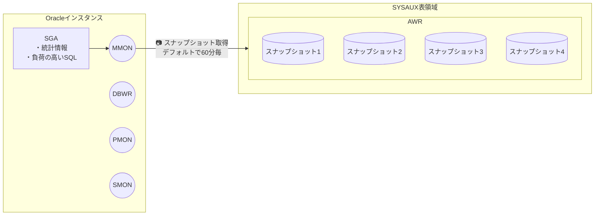
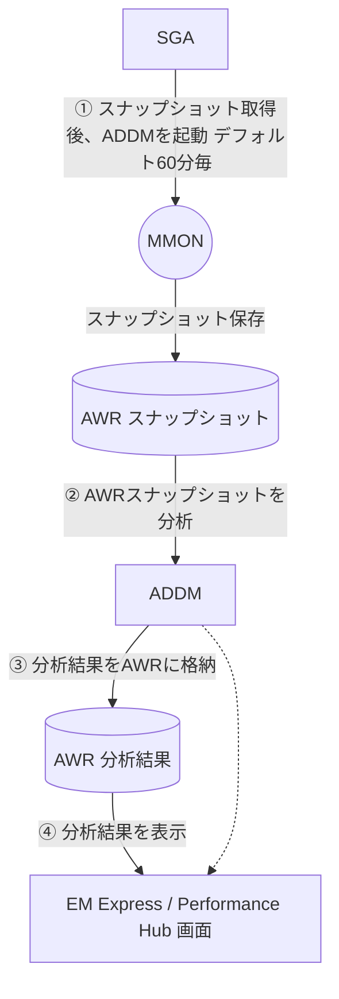
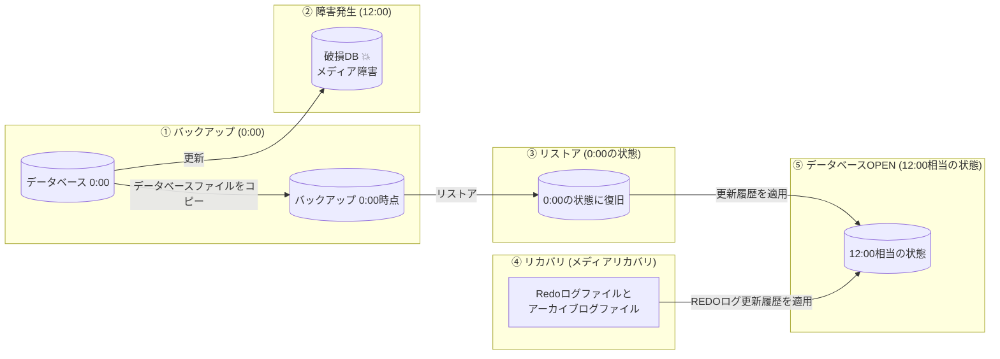
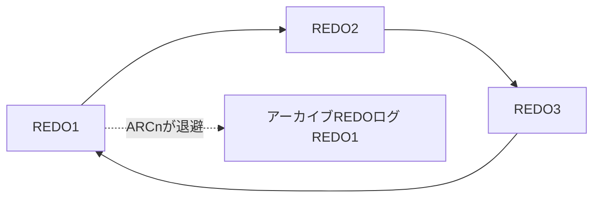
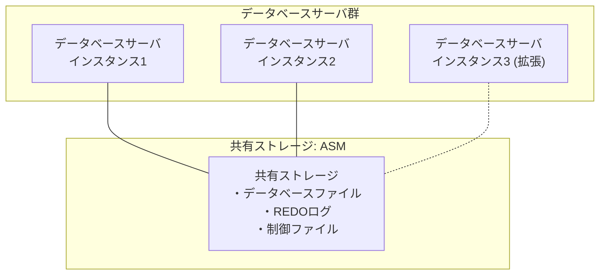
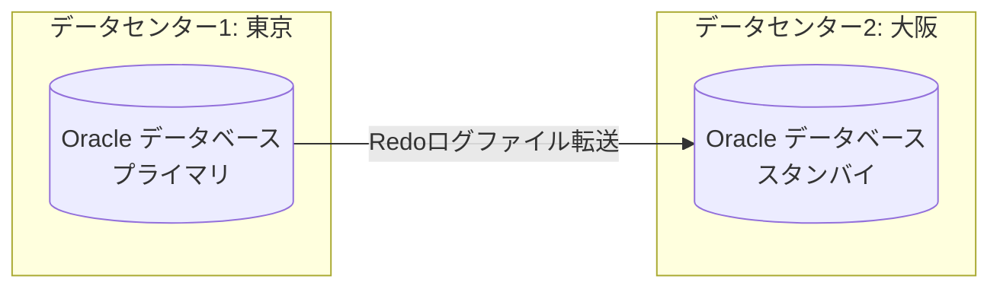
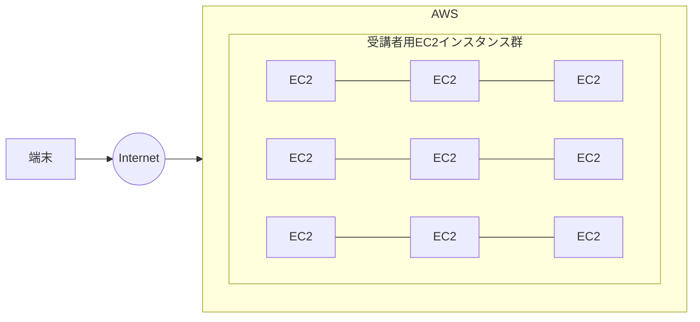

# 25上期 Oracle基礎勉強会 第5回テキスト

---

## 表紙

**25上期 Oracle基礎勉強会**  
**第5回テキスト**

---

## スケジュール

| 回数 | 日付 | 内容 |
| :--- | :--- | :--- |
| 第1回 | 2026/07/21 | 第1章：Oracleデータベース管理の概要<br>第2章：Oracleデータベースのインストールおよびデータベースの作成 |
| 第2回 | 2026/08/18 | 第3章：Oracle Enterprise Manager Database Express および SQL 管理ツールの使用<br>第4章：Oracle Network 環境の構成 |
| 第3回 | 2026/09/15 | 第5章：Oracleインスタンスの管理<br>第6章：データベース記憶域構造の管理 |
| 第4回 | 2026/10/20 | 第7章：ユーザーおよびセキュリティの管理<br>第8章：スキーマオブジェクトの管理 |
| **第5回**（※赤枠強調） | **2026/11/17** | **第9章：データベースの監視およびアドバイザの使用**<br>**第10章：バックアップ・リカバリの概要と可用性を高める構成** |
| 第6回 | 2026/12/15 | 全工程振り返り<br>最終テスト |

---

## 1. データベースの監視およびアドバイザの使用

### ■Oracle自己監視アーキテクチャ
Oracleは自分自身で監視/診断を行っており、情報を収集するAWR（自動ワークロードリポジ（※スライド右端ママ）  
ADDM（自動データベース診断モニター）がある。  

---

### ■AWR（自動ワークロードリポジトリ）
Oracleデータベースの稼働統計とワークロード情報のスナップショットを自動的に収集  

#### AWRデータ収集アーキテクチャ図


- **収集元（SGA）**: 統計情報、負荷の高いSQL  
- **収集プロセス**: `MMON`（バックグラウンドプロセス）  
- **収集頻度**: デフォルトで60分毎  
- **格納先**: `SYSAUX表領域` 内の `AWR`  
- **保持期間**: デフォルトでは8日間  

---

### ■ADDM（自動データベース診断モニター）
Oracleデータベースに搭載された自己診断エンジン  

#### ADDMの診断・分析フロー図


1. **① スナップショット取得後、ADDMを起動（デフォルト60分毎）**  
2. **② AWRスナップショットを分析**  
3. **③ 分析結果をAWRに格納**  
4. **④ 分析結果を表示**（Enterprise Manager / Performance Hub などの画面へ表示）  


---

## アドバイザ

### ■アドバイザ
ADDMの分析からOracleが最適な設定値（推奨値）を提案する機能としてアドバイザがある。  

| アドバイザ（分類） | アドバイザ名 | 機能 |
| :--- | :--- | :--- |
| ADDM | ADDM | データベース全体のアドバイス |
| メモリーアドバイザ | メモリーアドバイザ | 自動メモリー管理モードで利用。インスタンス全体のメモリーの最適化 |
| (メモリーアドバイザ) | PGAアドバイザ | 自動PGAメモリー管理モードで利用。PGA全体のメモリーを最適化 |
| (メモリーアドバイザ) | SGAアドバイザ | 自動共有メモリー管理モードで利用。SGAの構成を最適化 |
| (メモリーアドバイザ) | 共有プールアドバイザ | 共有プールの最適化 |
| (メモリーアドバイザ) | データバッファキャッシュアドバイザ | データベースバッファキャッシュの最適化 |
| SQLアドバイザ | SQLチューニングアドバイザ | パフォーマンスを向上させる推奨項目(SQLの書き換え、索引作成の推奨)を作成 |
| (SQLアドバイザ) | SQLアクセスアドバイザ | SQLを実行する際のアクセスパスに関するチューニング(索引やマテリアライズドビューの作成)を推奨する |

---

## SQLチューニングアドバイザ

### ■SQLチューニングアドバイザ
SQLチューニングアドバイザはパフォーマンスが最適でないSQL文をチューニングし、問題を解決する機能。  

#### 実行計画
SQLを実行するとき、オプティマイザと呼ばれる内部コンポーネントがSQL実行手順を作成する。  
この流れを実行計画と呼ぶ。  

#### SQLチューニングアドバイザ
高負荷なSQLを分析してより良い方法をアドバイスする。  
アドバイスする推奨事項は以下。  
・オプティマイザ統計の収集  
・新規索引の作成  
・SQLの修正  
・SQLプロファイルの作成  

チューニング対象となる高負荷SQLは以下より取得。  

| 取得元 | 説明 |
| :--- | :--- |
| トップアクティビティ | 過去1時間に実行されたSQLのうち問題のありそうなSQLが評価される。 |
| 履歴SQL | 24時間単位でSQLをチューニング。 |
| SQLチューニングセット | AWRスナップショットによって取得されたSQL等が評価される。 |

---

## 2. バックアップ・リカバリの概要と可用性を高める構成

### ■バックアップとリカバリの概要



- **① バックアップ (0:00)**: データベースファイルをコピー（0:00時点のバックアップ）
- **② 障害発生 (12:00)**: このファイル破損を**メディア障害**という
- **③ リストア (0:00の状態)**: バックアップから物理ファイルを配置
- **④ リカバリ**: REDOログファイルに記載されている更新履歴を適用。Redoログファイルとアーカイブログファイルを使用。この復旧を**メディアリカバリ**という
- **⑤ データベースOPEN (12:00相当の状態)**: 障害直前の状態までロールフォワードしてOPEN

---

### ■ARCHIVELOGモード
メディアリカバリを行うためにはARCHIVELOGモードで動作させる必要があります。  
NOARCHIVELOGモードだと↑の図でいうと0:00時点にしか戻せません。  
合わせてARCHIVELOGモードにするとデータベースOPEN中にバックアップが可能となります。（非一貫性バックアップと呼びます。）  

#### ARCHIVELOGモードのREDOログはどうなっているか。
- 💬 **この時点でREDO1が上書きされしまうので古いREDO1をバックアップします。**（※原文ママ）
- 💬 **このアーカイブログのバックアップはARCn（アーカイバプロセス）がやっています。**



REDO1が上書きされた状態でメディア障害が発生し、メディアリカバリを行うときはREDO1（旧）、REDO2、REDO3、REDO1の順に更新していきます。  

```text
[REDO1(旧)] ➔ [REDO2] ➔ [REDO3] ➔ [REDO1]
```


---

## バックアップ関連の用語とフラッシュバック機能

### ■バックアップ関連の用語
一見するとよくわからない用語が多いと思います。以下にまとめます。  

| 用語 | 説明 |
| :--- | :--- |
| リストア | データベースファイル自体を戻すこと |
| リカバリ | Redo、アーカイブログを使ってリストア後のデータから更新をかけること |
| 一貫性バックアップ | いわゆるオフラインバックアップ |
| 非一貫性バックアップ | いわゆるオンラインバックアップ<br>上記のリストア、リカバリを行う |
| 完全リカバリ | 障害発生直前まで戻すリカバリのこと |
| 不完全リカバリ | 過去の状態(指定した時間など)や完全リカバリできない状態のリカバリのこと。 |

---

### ■フラッシュバック機能
UNDO表領域を使って過去データへの問合せを行う機能。6種類がある。  
- フラッシュバッククエリ  
- フラッシュバックバージョン問合せ  
- フラッシュバックトランザクション問合せ  
- フラッシュバック表  
- フラッシュバックドロップ  
- フラッシュバックデータベース  

---

## 高可用性アーキテクチャ（RACとData Guard）

### ■Oracle RAC（Oracle Real Application Clusters）



- 💬 **サーバを増やすこと（スケールアウト）が可能。スケールアウトすることでOracleデータベースとしての性能向上が見込める**
- 💬 **RAC使用時にはASM（Automatic Strage Management）というクラスタファイルシステムを使います。ストライピングによる性能向上やミラーリングによる耐障害性を高めることができます。**（※原文ママ）

複数のインスタンスで１つのデータベースを管理する仕組みです。  
RAC利用時はOracle Grid Infrastructure を使う必要があります。  

---

### ■Oracle Data Guard
大規模災害を考慮した機能。  
データセンターレベル、地域レベルなど大きな規模で考えます。  



Redoログを送付してスタンバイデータベースの更新を行います。  
東京で災害が発生したとき、大阪のスタンバイデータベースをプライマリに切り替えてデータベースの運用を継続します。  

---

## ハンズオン：ツールの利用

AWSにみなさんのEC2を構築しております。  
事前にIPアドレスをお伝えしているのでvscodeのssh-remoteで接続してください。  
接続ユーザはec2-userです。鍵による認証となります。鍵は任意の場所に保管してください。  

※第１回と同様です。ただし、接続するIPアドレスは違います。  




---

## 高負荷をかける演習（テストテーブル作成とダミーデータ投入）

### ■高負荷をかける演習
テスト用テーブルの作成  
```bash
$ sudo su - oracle
$ sqlplus bold/bold@freepdb1
```
```sql
SQL> CREATE TABLE b_test_users (
       user_id    NUMBER,
       user_name  VARCHAR2(100),
       email      VARCHAR2(100),
       created_at DATE
     );
```

### 100万件のダミーデータをインサート
```sql
SQL> INSERT /*+ APPEND */ INTO b_test_users
     SELECT
       (t1.lv + t2.lv * 1000) AS user_id,
       'User_' || (t1.lv + t2.lv * 1000) AS user_name,
       'user' || (t1.lv + t2.lv * 1000) || '@example.com' AS email,
       SYSDATE - DBMS_RANDOM.VALUE(1, 365) AS created_at
     FROM
       (SELECT LEVEL - 1 AS lv FROM DUAL CONNECT BY LEVEL <= 1000) t1,
       (SELECT LEVEL - 1 AS lv FROM DUAL CONNECT BY LEVEL <= 1000) t2;

SQL> COMMIT;
```

### 統計情報の収集
```sql
SQL> EXEC DBMS_STATS.GATHER_TABLE_STATS(USER, 'B_TEST_USERS');
```

---

## 実行計画の事前確認（SQL Developer演習）

SQLDeveloperで接続する。  
接続したDBのアイコンを右クリックしてSQLワークシートをクリック。  
以下のSQLを貼り付け  
```sql
SELECT * FROM b_test_users WHERE email = 'user999999@example.com';
```
右上のEXPLAIN PLANのアイコンをクリック  
画面下に結果が表示される  

（※画面キャプチャ：SQL DeveloperでのEXPLAIN PLAN実行結果、`TABLE ACCESS FULL | B_TEST_USERS` が表示）

> **TABLE ACCESS FULL となっている。1件検索するのに100万件を上から下まで全て調べているという状態**


---

## 高負荷SQLの検知とインデックスチューニング演習

以下のSQLを何度か連続で実行する  
```sql
SELECT * FROM b_test_users WHERE email = 'user999999@example.com';
```

DBのアイコンを右クリックしてリアルタイムSQLモニターをクリック  

以下のSQLで犯人SQLを確認  
```sql
SELECT p.sql_id, p.operation, p.options, q.sql_text
FROM v$sql_plan p JOIN v$sql q ON p.sql_id = q.sql_id
WHERE p.operation = 'TABLE ACCESS' AND
p.options = 'FULL' AND p.object_name = 'B_TEST_USERS';
```

以下のSQLでインデックスを作成  
```sql
CREATE INDEX idx_b_test_users_email ON b_test_users(email);
```

（※画面キャプチャ：SQL DeveloperでのEXPLAIN PLAN再確認結果、`INDEX RANGE SCAN | IDX_B_TEST_USERS_EMAIL` が表示）

> **INDEX SCANになった**

---

## ARCHIVELOGモードへの変更

### ■ARCHIVELOGモードへの変更
今のEC2インスタンスで構築したOracleはNOARCHIVELOGモードです。  
Oracleデータベースは特別な理由がなければARCHIVELOGモードで運用します。  
まず、ARCHIVELOGモードに変更しましょう。  

```bash
$ sqlplus / as sysdba
```
```sql
SQL> archive log list
SQL> shutdown immediate
SQL> startup mount
SQL> alter database archivelog;
SQL> alter database open;
SQL> archive log list
```

REDOログを強制的にスイッチしてアーカイブログを作成します。  
```sql
SQL> alter system archive log current;
```

`/opt/oracle/product/26ai/dbhomeFree/dbs` を確認してみてください。  
```sql
SQL> !ls -l /opt/oracle/product/26ai/dbhomeFree/dbs
```

---

## データベースのバックアップ（RMAN）

### ■データベースのバックアップ
Oracleデータベースのバックアップは一般的にRMANを使います。  
※RMAN（Recovery Manager）  

```sql
SQL> exit
```
```bash
$ rman target /
```
```text
RMAN> backup database;
```

（※画面キャプチャ：VS Codeターミナルでの `rman target /` および `backup database;` 実行ログ）

`/opt/oracle/product/26ai/dbhomeFree/dbs` を確認してみてください。  


---

## メディアリカバリ（RMAN演習）

### ■メディアリカバリ
メディアリカバリの際もRMANを使います。ここではデータベース全体のリストア、リカバリを行います。  

```text
RMAN> shutdown;
RMAN> startup mount;
RMAN> restore database;
RMAN> recover database;
RMAN> alter database open;
```

（※画面キャプチャ：VS Codeターミナルでの `restore database`, `recover database`, `alter database open;` 実行ログ）

---

## フラッシュバック機能利用例

### ■フラッシュバック機能利用例
間違ってcommitしてしまい、戻したいとき・・・  
フラッシュバッククエリ機能で戻せます。  

まず、テスト用テーブルを作成とデータを挿入します。  
```sql
SQL> create table test_flash(id number,name varchar(10));
SQL> insert into test_flash(id,name) values(1,'aaa');
SQL> insert into test_flash(id,name) values(2,'bbb');
SQL> select * from test_flash;
SQL> commit;
```

本当はid 2だけUpdateしたかったが間違えて全部Updateしてしまった。  
```sql
SQL> update test_flash set name = 'ccc';
SQL> commit;
```

フラッシュバッククエリ機能で戻す。  
```sql
SQL> select * from test_flash as of timestamp(systimestamp - interval '3' minute );
SQL> create table test_flash_recovery as
       select * from test_flash as of timestamp(systimestamp - interval '3' minute );
SQL> select * from test_flash_recovery;
```

---

---

## 第一章練習問題

### ■練習問題 1
- 25上期スライド上はURL空欄（未設定）だったが、**24下期版の過去問が存在**（参照: `docs/quiz_archive_24h2.md`）。
- **24下期 URL**: https://docs.google.com/forms/d/e/1FAIpQLSeytiz5Gy1atUe8PCdJ2rgIxA2GIxIV5OgaV3ZKnH5neUn81Q/viewform?usp=dialog
- **出題内容（24下期ベース）**:
  - 問.1: AWRの特徴（スナップショット収集間隔60分、SYSAUX格納等）
  - 問.2: ADDMの説明（オープン状態必要、スナップショット分析、推奨事項数値化等）
  - 問.3: SQLチューニングアドバイザ（SQL変更提案、索引変更推奨、統計リフレッシュ等）

---

## 第二章練習問題

### ■練習問題 2
- 25上期スライド上はURL空欄（未設定）だったが、**24下期版の過去問が存在**（参照: `docs/quiz_archive_24h2.md`）。
- **24下期 URL**: https://docs.google.com/forms/d/e/1FAIpQLSfo5SOZq3XGQpJEah8z34c8mZ6XwotvKVYF8SFbXGPVuNcIXg/viewform?usp=dialog
- **出題内容（24下期ベース）**:
  - 問.1: ARCHIVELOGモードの特徴（OPEN中バックアップ、メディアリカバリ等）
  - 問.2: NOARCHIVELOGモードの特徴（最終バックアップ時点復旧、上書き等）
  - 問.3: SHUTDOWN ABORT後のインスタンスリカバリ（OPEN時自動実行等）
  - 問.4: Real Application Clusters (RAC) の説明（共有ストレージと複数インスタンス）
  - 問.5: Data Guard（プライマリとスタンバイ間のREDO転送・適用）

---

### [重要メモ] 練習問題に関する更新・設計方針
- 25上期では未作成だったが、24下期の過去問（上記）が発掘されたため、ゼロからの新規作成ではなく**24下期の良問をベースに最新化・リファクタリングして25上期向けFormsを作成可能**となった。
- 第6回のまとめテスト（20問・8割合格）についても、第1回〜第5回のアーカイブから厳選して網羅的に出題を設計できる。

