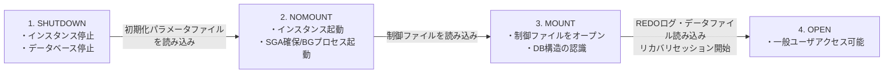
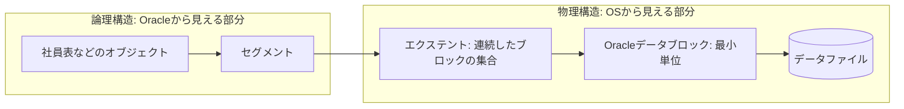
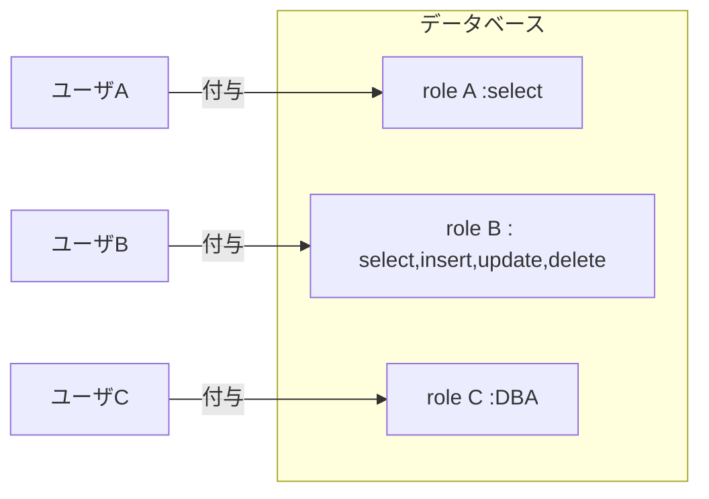
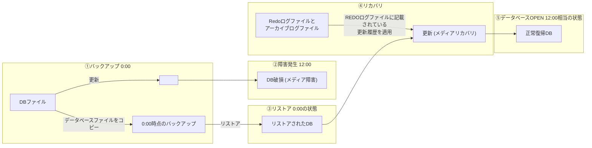

# 25上期 Oracle勉強会 第6回テキスト

---

## 表紙

**25上期 Oracle勉強会**  
**第6回テキスト**

---

## スケジュール

| 回数 | 日付 | 内容 |
| :--- | :--- | :--- |
| 第1回 | 2026/07/21 | 第1章：Oracleデータベース管理の概要<br>第2章：Oracleデータベースのインストールおよびデータベースの作成 |
| 第2回 | 2026/08/18 | 第3章：Oracle Enterprise Manager Database Express および SQL 管理ツールの使用<br>第4章：Oracle Network 環境の構成 |
| 第3回 | 2026/09/15 | 第5章：Oracleインスタンスの管理<br>第6章：データベース記憶域構造の管理 |
| 第4回 | 2026/10/20 | 第7章：ユーザーおよびセキュリティの管理<br>第8章：スキーマオブジェクトの管理 |
| 第5回 | 2026/11/17 | 第9章：データベースの監視およびアドバイザの使用<br>第10章：バックアップ・リカバリの概要と可用性を高める構成 |
| **第6回**（※赤枠強調） | **2026/12/15** | **全工程振り返り**<br>**最終テスト** |

---

## 1. Oracleデータベース管理の概要

### ■SQLの概要
・SQL（Structured Query Language：構造化問合せ言語）は、ANSI、ISO、JISなどで標準規格化されている、リレーショナルデータベースを操作するための言語である。  
・SQLを使用すると、論理レベルでデータを処理することができるため、ユーザーがデータの物理的な格納場所やアクセス経路を意識する必要はない。  
・SQLは以下の通りに分類される。  

| 分類 | 説明 | SQL文 |
| :--- | :--- | :--- |
| データ操作言語 (DML) | データベースからデータの取り出し、新しい行の挿入、既存の行の変更、行からの行を削除を実行する。 | INSERT/UPDATE/DELETE/MERGE |
| データ定義言語 (DDL) | オブジェクトを設定、変更、削除する。 | CREATE/ALTER/DROP/RENAME/TRUNCATE/COMMENT |
| データ制御言語 (DCL) | データベースとその構造体の両方に対するアクセス権の付与・取り消しを行う。 | GRANT/REVOKE |
| トランザクション制御 | DMLによる変更をトランザクション単位で管理する。 | COMMIT/ROLLBACK/SAVEPOINT |

---

## 2. Oracleデータベース・ソフトウェアのインストール

### ■OUIの概要とインストール要件
・Oracleソフトウェアは、OUI（Oracle Universal Installer）を使用してインストールする。  
・OUIが自動的に設定する主な環境変数は以下の通り。  

| 環境変数 | 説明 |
| :--- | :--- |
| ORACLE_BASE | Oracleディレクトリ構造のトップのディレクトリを指定する |
| ORACLE_HOME | Oracleソフトウェアを格納するディレクトリを指定する |
| ORACLE_SID | システム識別子を指定する。ORACLE_SIDによって同じコンピュータ上の他のインスタンスと区別できる |


---

## 3. Oracle Databaseを操作する管理ツール

### ■管理ツール
Oracle Databaseを操作するにあたり、一般的に使われるツールは以下となります。

| 管理ツール名 | 用途 |
| :--- | :--- |
| EM Express | データベース単体のパフォーマンスや状態をGUIで見ることができる<br>Oracle Database側でインストールが必要 |
| SQL Plus | データベースを操作することができるCLIのツール<br>Oracle Databaseをインストールすると標準で導入される<br>別の端末で接続する場合はOracle Clientをインストールする必要がある |
| SQL Developer | 一般的ではなく、Oracleが提供しているツール<br>SQL PlusでできることをGUIとして操作できるもの |
| lsnrctl | リスナーを管理するツール<br>クライアントから接続はリスナーが起動していないと接続できない |

---

## 4. Oracle Network 環境の構成

### ■クライアントの構成
Oracle Databaseに接続するにはクライアントの「設定」が必要です。  
その設定にあたるものがネーミングメソッドとなります。  
接続情報にあたるものが接続記述子と呼ばれる。  

### 以下、ネーミングメソッドの種類

| 種類 | 説明 |
| :--- | :--- |
| ローカルネーミング | tnsnames.oraというファイルを使う<br>tnsnames.oraに接続情報を記載する |
| 簡易接続ネーミング | 接続する際、接続情報をすべて記載して接続する |
| ディレクトリネーミング | LDAP等に接続情報を格納してこの情報を使って接続 |
| 外部ネーミング | サードパーティのネーミングサービスを使って接続<br>※NIS、DCE、CDSなどの名前解決 |

---

### ■ローカルネーミング

`tnsnames.ora` の構造例：

```text
ORCL =
  (DESCRIPTION =
    (ADDRESS = (PROTOCOL = TCP)(HOST = 172.31.12.166)(PORT = 1521))
    (CONNECT_DATA =
      (SERVER = DEDICATED)
      (SERVICE_NAME = orcl.bold.ne.jp)
    )
  )
```

- **`ORCL`**: ネットサービス名  
- **`(DESCRIPTION = ...)`**: 接続記述子（※赤枠）  

#### 接続コマンド
```sql
> sqlplus /nolog
SQL> connect [ユーザ名]/[パスワード]@orcl
```

---

## 5. Oracleインスタンスの管理

### ■インスタンスの起動と停止の概要



#### 各状態と読み込み対象ファイル
1. **SHUTDOWN**: インスタンス停止、※データベース停止
2. **NOMOUNT**: **初期化パラメータファイルを読み込み**、インスタンス起動（SGA・バックグラウンドプロセス生成）
3. **MOUNT**: **制御ファイルを読み込み**（制御ファイルをオープンし、データファイルやREDOログの位置を認識）
4. **OPEN**: **REDOログ読み込み**、**データファイル読み込み**、**リカバリセッション開始**（全ファイルが整合性確認の上オープンされ、一般利用可能状態へ）


---

## 6. データベース記憶域構造の管理

### ■表領域とデータファイル
オブジェクト（Oracleで見える表領域（Oracleで見える部分） データファイル（OSから見える部分）



### ■特殊な表領域

| 表領域 | 説明 |
| :--- | :--- |
| SYSTEM表領域 | Oracleに必須な表領域。内部管理情報であるデータディクショナリを格納。 |
| SYSAUX表領域 | Oracleに必須な表領域。SYSTEM表領域の補助的な役割。AWR（Automatic Workload Repository）で利用。 |
| UNDO表領域 | UNDOデータ保存用。（更新前の過去データ） |
| 一時表領域 | ソート処理などで利用される領域 |

---

## 7. ユーザーおよびセキュリティの管理

### ■Oracleデータベースのユーザアカウント
Oracleデータベースを利用するにはデータベース管理者がユーザアカウントを作成する必要があります。  
Oracleデータベースインストールで追加される初期ユーザ  

| ユーザ名 | 説明 |
| :--- | :--- |
| SYS | すべての操作を実行できるユーザ |
| SYSTEM | SYSユーザとほぼ同じ。DBの起動・停止ができない。 |
| SYSMAN | EM操作用のユーザ |
| DBSMNP | EMCCのAgent用ユーザ |

### ■権限とロール
OSと同じようにOracleデータベースユーザも権限付与が可能。（selectだけできる、updateはできないなど）  
ロールはこの各権限のまとめて定義したもの。  



| ユーザ | ロール | 権限 |
| :--- | :--- | :--- |
| A | A | select |
| B | B | select,insert,update,delete |
| C | C | DBA |

---

## 8. データベースの監視およびアドバイザの使用

### ■Oracle自己監視アーキテクチャ
Oracleは自分自身で監視/診断を行っており、情報を収集するAWR（自動ワークロードリポジトリ）とADDM（自動データベース診断モニター）がある。  

### ■AWR（自動ワークロードリポジトリ）
Oracleデータベースの稼働統計とワークロード情報のスナップショットを自動的に収集  
・デフォルトで60分毎  
・デフォルトで60分毎SYSAUX表領域に格納  

### ■ADDM（自動データベース診断モニター）
Oracleデータベースに搭載された自己診断エンジン  
  ADDMの分析からOracleが最適な設定値（推奨値）を提案する機能としてアドバイザがある。  
  代表的なものとしてSQLチューニングアドバイザ（パフォーマンスが最適でないSQL文をチューニングし、問題を解決（※スライド右端ママ）  

---

## 9. バックアップ・リカバリの概要と可用性を高める構成

### ■バックアップとリカバリの概要



- **メディア障害**: ファイル破損のこと（「↑ このファイル破損を メディア障害という」）
- **メディアリカバリ**: 復旧のこと（「↑ この復旧を メディアリカバリという」）

---

### ■ARCHIVELOGモード
メディアリカバリを行うためにはARCHIVELOGモードで動作させる必要があります。  
NOARCHIVELOGモードだと↑の図でいうと0:00時点にしか戻せません。  
合わせてARCHIVELOGモードにするとデータベースOPEN中にバックアップが可能となります。（非一貫性バックアップと呼びます。）  

ARCHIVELOGモードのREDOログはどうなっているか。  

- **循環するREDOログ**: REDO1 → REDO2 → REDO3 → REDO1
  - 注釈: `この時点でREDO1が上書きされしまうので古いREDO1をバックアップします。`（※原文ママ）
  - 注釈: `このアーカイブログのバックアップはARCn（アーカイバプロセス）がやっています。`
- **メディアリカバリの適用順**:  
  REDO1が上書きされた状態でメディア障害が発生し、メディアリカバリを行うときはREDO1（旧）、REDO2、REDO3、REDO1の順に更新していきます。  
  （`REDO1(旧)` → `REDO2` → `REDO3` → `REDO1`）

---

### ■バックアップ関連の用語
一見するとよくわからない用語が多いと思います。以下にまとめます。  

| 用語 | 説明 |
| :--- | :--- |
| リストア | データベースファイル自体を戻すこと |
| リカバリ | Redo、アーカイブログを使ってリストア後のデータから更新をかけること |
| 一貫性バックアップ | いわゆるオフラインバックアップ |
| 非一貫性バックアップ | いわゆるオンラインバックアップ<br>上記のリストア、リカバリを行う |
| 完全リカバリ | 障害発生直前まで戻すリカバリのこと |
| 不完全リカバリ | 過去の状態（指定した時間など）や完全リカバリできない状態のリカバリのこと。 |

---

## 講義後半：まとめテスト（重要要件・新規作成必須）

> **【受講者向けまとめテストの実施仕様（ユーザー共有メモ）】**  
> - **位置づけ**: 第6回講義の後半は、まとめテストを「ローカル試験」として受講者に受験してもらう。  
> - **問題数**: 全20問  
> - **合格ボーダー**: 8割（16問以上正解で合格）  
> - **現状**: 事前に用意されていたスライド資料は上記の「バックアップ関連の用語」までで終了しており、テスト問題は未作成。  
> - **必須アクション**: 本勉強会リニューアル資料作成フェーズにおいて、第1回〜第6回（座学・ハンズオン全般）を網羅した20問のまとめテスト（問題文・選択肢・解答・詳細解説）を新規に設計・作成する必要がある。
  
